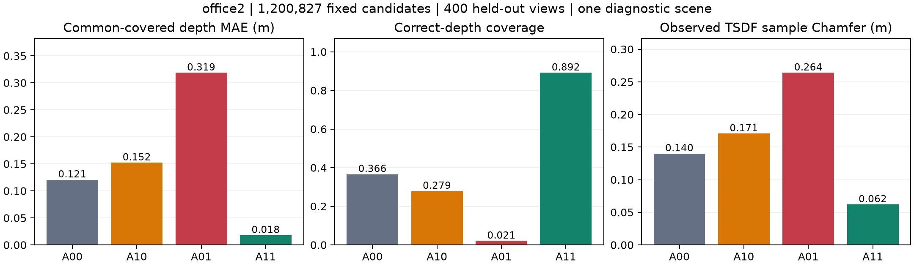
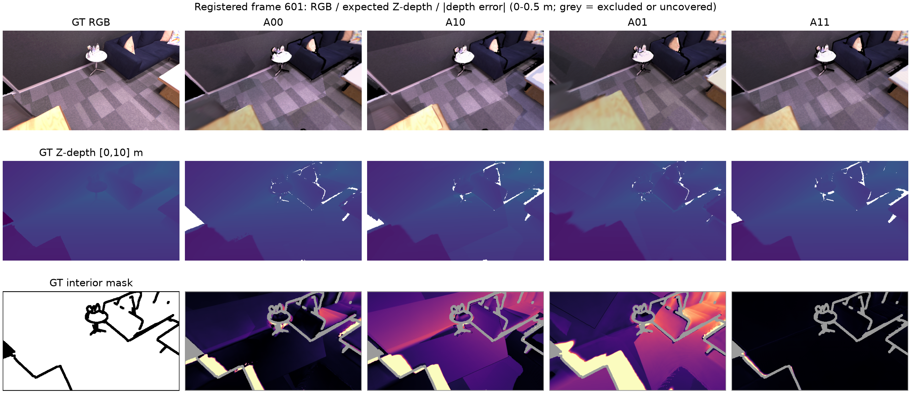

# A0 office2: Pointmap × Pose 2×2 Oracle 오류 분해 결과

- **수행일:** 2026-10-26 (Asia/Seoul)
- **실행 상태:** **완료 — 기준선·4군·등록 대조군·무결성 검사 통과**
- **연구 판정:** **REVISE — 단독 Oracle 이득이 아닌 강한 interaction 관측**
- **장면:** N2의 `office2` 진단·개발 장면. `office3`·`office4` 모델 예측은 실행하지 않았다.
- **사전 등록:** [a0_office2_factorial.json](../../configs/a0_office2_factorial.json)
- **계약:** [N1](N1_coordinate_contract.md), [N2](N2_dataset_preparation.md)
- **출력:** `results/A0_pointmap_pose_factorial/office2/`
- **요약 명세:** [a0_results_summary.json](../../configs/a0_results_summary.json)

## 1. 현재 얻은 결론

**현재 gauge와 동일 후보 조건에서 local geometry만 GT로 바꾸거나 placement만 GT로 바꾸면 깊이 오차가 악화됐다. 두 요인을 함께 바꾼 A11은 크게 개선됐다.** 따라서 이 장면의 결과로 ‘Depth 또는 Pose 중 하나가 독립적인 주원인’이라고 선택할 수 없다.

이 결과는 개입 효과의 강한 상호작용을 보여 준다. 기존 local geometry와 placement 사이의 정합·오차 상쇄 또는 native local-unit/KF-scale 배분이 관여할 가능성이 있지만, 그 원인을 이번 A0만으로 확정하지 않는다. 특히 GT placement는 scale 1인 metric SE(3)이므로, A01은 회전·이동만의 Oracle이 아니다.

MAE와 renderer의 비선형성도 factorial contrast에 영향을 줄 수 있다. Interaction의 크기만으로 물리적 오차 상쇄나 새로운 joint optimizer의 필요성이 입증됐다고 해석하지 않는다.

실행 성공과 보정법의 GO를 구분한다. **현재 추정 Pose를 고정한 Depth 보정 D 경로로 바로 진행할 근거는 확보하지 못했다.** 다음은 A1의 local-unit/KF-scale/SE(3) 분리와 검증 장면 재현이다.

## 2. 기준선·후보·평가 조건

| 항목 | 실제 실행값 |
|---|---:|
| 원본 / RGB 입력 | 1,000 / 짝수 500프레임 |
| Tracking pose | 500/500 (100%) |
| Calibration pose | 원본 `[0,200)`의 짝수 100개 |
| 최종 KF / prefix 이후 KF | 11 / 10 |
| Raw KF 후보 | 1,622,016 |
| Native active Gaussian | 1,545,979 |
| 전체 KF의 GT-valid interior 공통 후보 | 1,314,328 |
| Primary strict 후보 | **1,200,827** |
| Held-out 평가 뷰 | 원본 홀수 `201,203,...,999`, **400개** |
| 표면 TSDF fusion 뷰 | 등록한 20개 (`201,241,...,961`) |

기준선은 seed 0, 기존 weights·native filter, refinement 0으로 실행했다. Mapper에는 GT depth/trajectory를 넣지 않았다. 기존 메모리 관리 설정과 keyframe buffer 32를 사용했다.

Primary는 **prefix 이후 raw self-branch의 baseline native-active ∩ GT-valid interior**다. Native mask는 GT 치환 전에 한 번 계산했다. 모든 arm에서 candidate ID·픽셀·후보 수·opacity·RGB/SH·raw scale/rotation과 환산된 local covariance를 유지했다. 중심 교체 후 filter나 covariance 초기화를 재실행하지 않았다.

이 GT 공통 부분집합을 만든 것은 Oracle 비교 자격을 맞추기 위해서다. 이를 배포 가능한 pruning이나 메모리 절감 기법의 성과로 주장하지 않는다.

## 3. Primary 4군 결과

| Arm | Local geometry / placement | 공통 픽셀 depth MAE ↓ (m) | Depth coverage ↑ | Correct-depth coverage ↑ | 관측영역 TSDF Chamfer ↓ (m) | PSNR ↑ (dB) |
|---|---|---:|---:|---:|---:|---:|
| A00 | 추정 / 추정 | **0.120683** | 92.541% | 36.619% | 0.140149 | 13.869 |
| A10 | GT local / 추정 | 0.152251 | 92.322% | 27.878% | 0.170695 | 13.785 |
| A01 | 추정 / GT pose | 0.318686 | 94.093% | 2.079% | 0.263979 | 14.869 |
| A11 | GT local / GT pose | **0.017892** | 92.732% | 89.163% | **0.061912** | 17.248 |



주 MAE는 **네 arm에서 모두 렌더링된 동일 GT-valid interior 픽셀**에서 계산한 프레임별 MAE의 단순 평균이다. 400개 뷰 모두 공통 픽셀이 있었고, 뷰당 최소 70,222개·평균 115,927.88개였다. 평균적으로 전체 GT interior의 **91.840%**가 이 공통 영역에 포함됐다.

Coverage와 correct-depth coverage는 공통 렌더링 영역으로 분모를 줄이지 않고 **각 뷰의 전체 유효 GT 픽셀**을 분모로 사용했다. Correct 조건은 오차가 `max(0.05 m, 2% GT depth)` 이하인 경우다. 각 arm의 자체 covered-only MAE·AbsRel·interior/boundary 지표도 원자료에 별도로 기록했다.

A11의 주 MAE는 A00 대비 **85.17% 감소**했다. 반면 A10은 약 26.16%, A01은 약 164.07% 악화됐다. 이 비율은 해당 지표의 상대 변화이며, 물리적 오차 원인의 기여율이 아니다.

A01의 PSNR은 A00보다 높지만 깊이는 크게 나빠졌다. 이 사례도 RGB 품질을 기하 정확도의 대용 지표로 사용할 수 없음을 보여 준다. Appearance optimization은 실행하지 않았으며 LPIPS는 이번 선택적 부차 지표에서 계산하지 않았다.

## 4. Factorial effect와 interaction

낮을수록 좋은 동일 공통-pixel MAE를 $E_{00},E_{10},E_{01},E_{11}$로 두었다.

$$
\Delta_L=E_{00}-E_{10}=-0.031567\ \mathrm{m},\qquad
\Delta_P=E_{00}-E_{01}=-0.198003\ \mathrm{m}.
$$

$$
\mathcal I=E_{11}-E_{10}-E_{01}+E_{00}=-0.332362\ \mathrm{m}.
$$

| Contrast | 값 (m) | 의미 |
|---|---:|---|
| Local GT, estimated placement 고정 | -0.031567 | 단독 local 치환 악화 |
| Placement GT, predicted local 고정 | -0.198003 | 단독 placement 치환 악화 |
| Local GT, GT placement 고정 | +0.300794 | GT placement 조건에서는 local 치환 개선 |
| Placement GT, GT local 고정 | +0.134359 | GT local 조건에서는 placement 치환 개선 |
| 두 Oracle의 joint improvement | +0.102791 | A00 → A11 개선 |
| Interaction | **-0.332362** | 단독 효과를 더해 joint 효과를 설명할 수 없음 |

사전 기준 `|interaction| ≥ 0.25 × (|ΔL|+|ΔP|)`를 넘었다. 어느 효과도 보편적·독립적인 오차 기여율로 분배하지 않는다. H1의 ‘한 가지 Oracle만으로도 개선’은 이 장면·gauge에서 지지되지 않았고, H2의 상호작용 가능성은 관측됐다. RGB-only 보정 가능성 H3/H4는 평가하지 않았다.

## 5. Ray-preserving GT Z-depth 대조

N1에서 raw Pointmap ray가 GT pinhole ray와 정확히 같지 않음을 확인했으므로, raw ray를 유지하고 Z-depth만 GT로 바꾼 Z10/Z11도 같은 400뷰에서 평가했다. 이 비교는 여섯 arm이 모두 덮는 **별도의 공통 영역**으로 다시 맞췄다.

| Arm | 6군 공통 픽셀 MAE (m) |
|---|---:|
| A00 | 0.120594 |
| A10: GT local, estimated placement | 0.151978 |
| Z10: GT Z / predicted ray, estimated placement | 0.152215 |
| A01 | 0.318660 |
| A11: GT local, GT placement | 0.017885 |
| Z11: GT Z / predicted ray, GT placement | 0.024719 |

Ray를 유지한 Z10도 현재 placement에서는 개선되지 않았다. 따라서 단독 치환 악화가 GT ray 교체만으로 설명되는 결과는 아니다. GT placement 아래 Z11은 크게 좋아지지만 A11보다 약 **0.006835 m**의 잔차가 더 남았다. Z10/Z11 역시 평가용 GT Z를 쓰는 진단이며 RGB-only 방법의 성능이 아니다.

## 6. Local 단위 C 민감도

Prefix 100개 pose에서 정한 global scale 및 local 환산 계수는 **C = 1.033018070**이었다. 첫 KF scale은 1이며, KF별 metric placement scale은 약 **0.892529~1.084086**의 변화를 유지했다. GT pose arm의 scale은 1이다.

등록한 `C×0.8`, `C`, `C×1.25`를 같은 20개 뷰에서 비교했다. 민감도 표는 12개 설정이 모두 렌더링한 동일 GT interior 픽셀을 사용하므로, 위 400뷰 주 표와 분모가 다르다.

| C multiplier | A00 MAE | A10 MAE | A01 MAE | A11 MAE | Interaction |
|---|---:|---:|---:|---:|---:|
| 0.8 | 0.122935 | 0.498344 | 0.904899 | 0.013788 | -1.266520 |
| 1.0 | 0.122935 | 0.154115 | 0.328112 | 0.018105 | -0.341187 |
| 1.25 | 0.122935 | 0.533305 | 0.350583 | 0.024438 | -0.736516 |

모든 값의 단위는 m이다. **A00은 단위 재표현에 대해 유지됐고, 단독 Oracle 악화·joint 개선 패턴도 세 C에서 유지됐다.** 다만 효과의 크기는 크게 달라져 정량적 귀속이 gauge에 조건부임을 확인했다.

C를 바꿀 때 local covariance도 $C^2$로 환산한다. A11 중심은 같은 GT 위치지만 GT pose 아래 covariance extent는 C와 함께 달라지므로 A11 렌더링 잔차까지 동일할 필요는 없다. Position·KF scale·covariance 효과의 추가 분리는 A1/R 민감도에서 다뤄야 한다.

## 7. Full-map sensitivity: strict 결과가 전체 맵에 자동 전이되지는 않음

이 비교는 prefix KF와 모든 native-active 후보 **1,545,979개**를 유지한다. GT-valid interior인 1,314,328개는 local GT 교체 대상이고, 나머지 **231,651개 (약 14.98%)**의 local geometry는 원본을 유지했다. Placement 변경은 모든 후보에 적용했다.

| Arm | 공통-pixel MAE (m) | Correct-depth coverage | TSDF Chamfer (m) |
|---|---:|---:|---:|
| A00 | 0.146024 | 36.948% | 0.143856 |
| A10 | 0.169302 | 30.224% | 0.139584 |
| A01 | 0.346787 | 5.017% | 0.257511 |
| A11 | 0.147773 | 59.056% | 0.072257 |

Full-map A11은 correct coverage와 TSDF Chamfer가 좋아졌지만 MAE는 개선되지 않았다. 이 arm의 local GT는 일부 후보에만 적용된 것이므로 완전한 GT local map이라고 부르면 안 된다. Strict 대비 prefix·비공통 후보가 추가된다는 점도 함께 고려해야 하며, 잔차를 특정 후보 유형 하나의 원인으로 확정하지 않는다.

따라서 strict의 85.17% 개선을 전체 지도나 실제 RGB-only 보정의 예상 성능으로 옮겨 주장하지 않는다. 이전 pruning 연구를 재개하거나 비공통 후보를 제거하는 정책을 이번에 시험한 것도 아니다.

## 8. Rendered surface와 center proxy의 구분

표면 지표는 같은 20개 GT view의 depth TSDF를 reference로 사용했다. Voxel 4cm, truncation 12cm, depth 상한 10m, 표면당 area-weighted 100,000 samples, seed 0, 5cm precision/completion 기준이다. NN 거리는 truncation 없이 m 단위로 계산했다. 이는 **관측영역 sample Chamfer**이며 장면 전체 GT mesh completeness가 아니다.

별도의 고정 후보 7,247개에서 Gaussian center와 제공 GT mesh 정점 사이 거리를 계산했다.

| Arm | Center→mesh vertex median (m) | p95 (m) |
|---|---:|---:|
| A00 | 0.033689 | 0.138138 |
| A10 | 0.071223 | 0.320559 |
| A01 | 0.081745 | 0.258149 |
| A11 | 0.005208 | 0.007841 |

A11 중심의 작은 잔차는 GT local/world 좌표 경로의 일관성과 부합한다. 그러나 A11도 finite Gaussian extent·alpha compositing·source 공통 mask·coverage·TSDF sampling 때문에 완벽한 렌더링 표면을 보장하지 않는다. 예를 들어 strict A11의 5cm surface completion은 **82.856%**로 100%가 아니다.

## 9. Pose·자원·검증

동일 prefix gauge를 유지한 post-prefix 400 pose의 ATE RMSE는 **0.088730 m**, orientation median은 **1.6906°**, p95는 **1.9543°**였다. Consecutive mapping input의 RPE translation RMSE는 **0.012564 m**였다. 이 수치를 단독 placement Oracle 이득이나 camera translation만의 오차 기여와 동일시하지 않는다.

- Baseline subprocess wall time: **109.77초**, 모델 로드·export·audit·저장 포함.
- Baseline GPU: RTX 5060, 8,151 MiB. 200ms 간격 device-wide memory 관측 최대 **6,586 MiB**. 정확한 per-process peak가 아니다.
- Compact map payload: strict arm당 **62,443,004 bytes**, full-map arm당 **80,390,908 bytes**. 같은 scope 내 ID·속성·count·bytes 동일.
- 18개 등록 map 설정의 렌더링/지표 루프 wall time 합계 약 **120.50초**. 준비·공통-mask 후처리·모든 IO를 포함한 전체 연구 수행 시간이 아니며 원본 대비 속도 개선을 주장하지 않는다.
- 원본 TF32 native bake와 PLY의 mean·covariance·RGB·opacity를 대조했다. Oracle 평가는 모두 float64 좌표 구성·float32 compact CUDA·TF32 off로 통일했다.
- Audit 2,042 events, raw 500개, snapshots 23개, 최종 pose revision **520**. Lineage·pose revision·causal replay PASS, unknown ancestry 0.
- 새 metric 시험 6개와 재사용 좌표 계약 시험 12개, 합계 **18개 PASS**. CUDA compositing parity와 합성 TSDF 평면 검사도 PASS.
- 저장된 compact map 자체에서도 RGB·opacity 불변과 local-only 개입의 world covariance 불변을 확인했다. 모든 strict 후보의 GT world → local → pixel 왕복 최대 오차는 `6.43e-05 pixel`이었고, C 민감도의 A00 packed 배열 차이는 0이었다.
- Source input과 18개 map을 평가 후 재해시했고 변경이 없었다. Baseline export/audit/map의 553개 파일도 별도 manifest로 고정했다.

Mapper 종료 시 기존 CUDA IPC lifetime 경고가 있었으나 exit code 0, snapshot·PLY·후보 대조는 통과했다. 장기 운용이나 allocator 밖 메모리까지 이번 측정으로 검증한 것은 아니다.

## 10. 그림·viewer·원자료



601은 결과를 보기 전에 저장 대상으로 지정한 frame이다. Depth 색상 범위는 0~10m, 오차 그림은 0~0.5m이며 시각화 상한은 실제 지표의 truncation이 아니다. 회색은 제외/미관측 영역이다.

- [프레임별 지표 그림](../figures/A0/office2_frame_metrics.png)
- [오프라인 3D center proxy viewer](../../results/A0_pointmap_pose_factorial/office2/A0_center_proxy_viewer.html): legend에서 4군을 전환한다. GT target frame 601과 그 직전 source KF 582의 GT/estimated 카메라 축도 표시했다. 실제 rendered surface viewer와 구별한다.
- [4군 CSV](../../results/A0_pointmap_pose_factorial/office2/analysis/A0_four_arms.csv), [effect CSV](../../results/A0_pointmap_pose_factorial/office2/analysis/A0_effects.csv)
- [전체 분석 결과](../../results/A0_pointmap_pose_factorial/office2/analysis/results.json), [판정](../../results/A0_pointmap_pose_factorial/office2/analysis/decision.json)
- [공통 픽셀 분모](../../results/A0_pointmap_pose_factorial/office2/analysis/strict_common4.json), [C 민감도](../../results/A0_pointmap_pose_factorial/office2/analysis/C_sensitivity_effects.json), [ray 대조](../../results/A0_pointmap_pose_factorial/office2/analysis/ray_preserving_controls.json)
- [후보 manifest](../../results/A0_pointmap_pose_factorial/office2/oracles/candidate_manifest.json), [4군·대조 map manifest](../../results/A0_pointmap_pose_factorial/office2/oracles/manifest.json)
- [기준선 실행 명세](../../results/A0_pointmap_pose_factorial/office2/baseline/run_manifest.json), [실행 자격](../../results/A0_pointmap_pose_factorial/office2/baseline/qualification.json), [audit](../../results/A0_pointmap_pose_factorial/office2/oracles/journal_checks.json)
- [Metric 시험](../../results/A0_pointmap_pose_factorial/office2/analysis/tests_metrics.log), [좌표 시험](../../results/A0_pointmap_pose_factorial/office2/analysis/tests_coordinates.log), [원본 보존](../../results/A0_pointmap_pose_factorial/office2/analysis/preservation.json)
- [저장 map의 독립성·왕복 검사](../../results/A0_pointmap_pose_factorial/office2/analysis/packed_map_independence_checks.json)

실행 순서:

```bash
.venv/bin/python scripts/run_a0_baseline.py
.venv/bin/python scripts/build_a0_oracles.py
.venv/bin/python scripts/evaluate_a0_oracles.py
.venv/bin/python scripts/finalize_a0.py
.venv/bin/python scripts/check_a0_packed.py
.venv/bin/python scripts/plot_a0_results.py
```

Baseline·map 구성·평가는 GPU가 보이는 호스트 실행 환경을 사용했다. 완료 출력은 보존한다. 평가 스크립트는 같은 고정 source/map인 완료 arm을 재사용할 수 있으나 다른 source로 결과를 덮어쓰지 않는다. 새 실행에는 별도 등록·경로가 필요하다.

## 11. 다음 판단

**REVISE를 유지한다.** 현재 결과만으로 Depth-only나 Pose-only 보정법을 선택하지 않는다.

1. **A1:** native local-unit/KF scale과 metric SE(3), 회전·이동, covariance world 변환을 분리해 단독 Oracle 악화의 구조를 검사한다. 오차 상쇄/단위 배분은 이 단계의 가설이다.
2. **검증 재현:** 명시적으로 고정한 프로토콜을 `office3`에서 반복해 강한 interaction 패턴이 유지되는지 확인한다. 한 장면의 400뷰를 독립 scene 반복이나 CI로 간주하지 않는다.
3. 원인·관측 가능성이 뒷받침된 경로 하나를 선택한 뒤 D/P/R 후속을 설계한다. `office4`의 예측·Oracle 평가는 최종 방법·평가 규칙 고정 전까지 보류한다.
