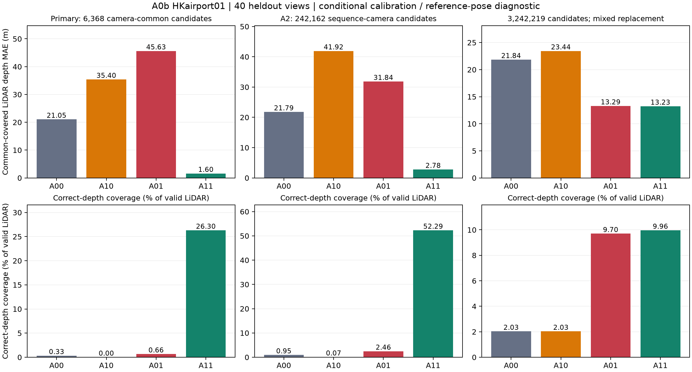
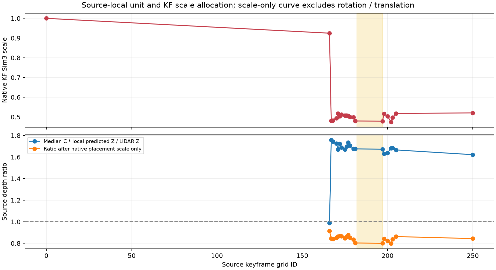
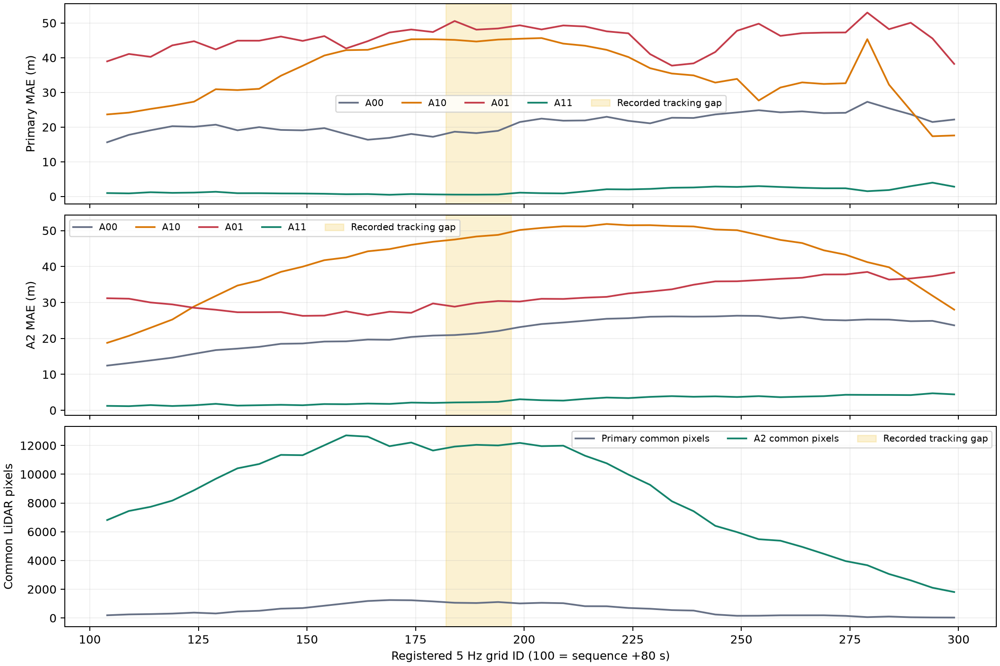
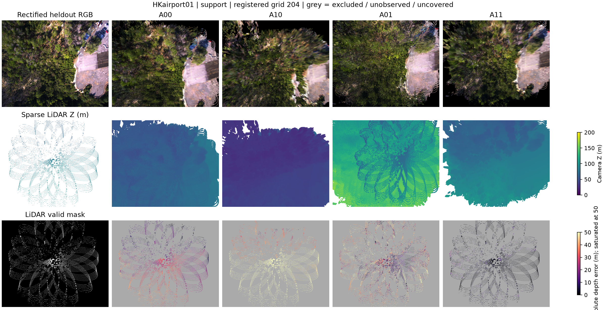

# A0b HKairport01: 희소 LiDAR × 참조 pose 2×2 진단 결과

**실행일: 2026-10-26. 실행 완료: COMPLETE_CONDITIONAL. 연구 판정: REVISE_CALIBRATION_AND_A1.**

실제 드론 영상에서 큰 기하 오차를 확인했다. 보정 방식 공통 후보와 더 넓은 공식 HKairport 후보 비교 모두에서 local geometry 또는 placement 단독 치환은 악화되고, 두 치환을 함께 적용하면 개선됐다. 이 결과를 Depth-only 원인 또는 보정의 근거로 해석하지 않는다. KF scale/local-unit 배분과 pose 정렬을 분리하는 A1이 필요하다. 공식 보정·영상 전처리의 불확실성이 남아 **엄격한 GT 인과 기여율 및 효능 GO는 발행하지 않는다.**

## 1. 식별과 재현 범위

- 기존 office2 실험은 **A0**, 이번 UAV 실험은 **A0b**로 구분한다. 기존 결과와 원본 데이터는 보존했다.
- [원 등록](../../configs/a0b_hkairport01_factorial.json), [A1: 정렬·보정 공통 후보 대조](../../configs/a0b_amendment_A1.json), [A2: 추가 support 대조](../../configs/a0b_amendment_A2.json).
- HKairport01 시퀀스 시작 기준 `[60,120)`초, 기존 5 Hz 분할을 재사용했다. 매핑 RGB 240장, 이전 RGB-only 모델 추론 및 최종 native KF 21개를 재사용했다. 새 추론·학습·pruning은 수행하지 않았다.
- 앞 20초(grid `<100`)의 매핑 pose **80개**로 전역 Sim(3)를 한 번 맞췄다. 이후 heldout **40개**(grid `104,109,…,299`)를 전부 평가했다. calibration 구간의 heldout 20개는 주 평가에 포함하지 않았다.
- seed 0, refinement 0, 기존 native filter 고정. 후보 ID·RGB/opacity·local covariance를 각 네 조건에서 고정했다. placement 변경에 따른 world covariance 변화는 A0와 동일하게 포함된다.
- 출력: `results/A0b_pointmap_pose_factorial/HKairport01/`. office3/office4와 다른 UAV 장면에는 접근하지 않았다.

## 2. 참조 자료와 보정 QA

LiDAR는 metric camera-Z 참조다. Terra pose는 GNSS로 초기화한 SfM 재구성 참조이며 독립적인 완전 GT가 아니다. [공식 논문 §3.1](https://arxiv.org/html/2507.22412v1#S3.SS1), [공식 데이터 설명](https://github.com/sijieaaa/UAVScenes).

보정 파일은 카메라–LiDAR와 카메라–3D map 보정을 구별한다. HKairport01의 sequence-named `HKairport_calibration`을 조건부 주 분석에 사용했다. 이전 E4e는 `HK_GNSS_calibration`을 loader metadata에 썼지만 `use_calib=false`여서 해당 값으로 mapper 영상을 remap하거나 calibrated tracking을 실행하지 않았다. 따라서 이번 차이는 저장된 모델을 재추론할 사유가 아니라 평가 보정 규칙의 차이다. [공식 보정 소스](https://github.com/sijieaaa/UAVScenes/blob/main/calibration_results.py).

- Sequence K는 `fx=1451.28, fy=1451.29, cx=1177.5, cy=1043.5`; Terra P3x3는 `fx=fy=1471.0653, cx=1172.3577, cy=1046.3674`로 서로 다르다. Terra P3x3를 LiDAR 투영에 혼용하지 않았다.
- 공개 HKairport extrinsic R의 `max|RRᵀ−I|=0.050434`, 사전 한도 `0.001` 초과. **원본을 임의로 올바른 회전이라고 취급하지 않았다.** 공식값 그대로의 조건부 분석과 SVD nearest-rotation, 이전 HK_GNSS, 무왜곡 가정 대조를 구분했다. SVD 값은 저자가 확인한 수정값이 아니다.
- Prefix 영상 특징점 5쌍의 image-only RANSAC inlier에서 c2w 해석의 Sampson 오차 중앙값은 **0.047–0.091 px**였다. 역행렬 해석은 **1.20–19.33 px**였다. Prefix RTK 궤적 정합 잔차 중앙값도 c2w **0.232m**, inverse **2.581m**로 c2w를 지지했다. 이는 절대 pose 정확도 보증이 아니다.
- Prefix 5쌍의 모델과 무관한 LiDAR cross-view Z 차이 중앙값은 **0.052–0.909m**였다. sparse 최근접 pixel과 가림, 보정, 참조 pose 등의 영향을 함께 포함하므로 센서 정밀도 자체로 해석하지 않는다.
- 공개 JPG의 distortion 전처리와 physical camera–Terra pose 관계는 저자 확인이 없다. [공식 저장소의 미해결 보정 질문](https://github.com/sijieaaa/UAVScenes/issues/6)도 존재한다. 이미지를 distorted raw라고 가정한 조건부 규칙을 고정하고, zero-distortion 대조를 별도로 기록했다.
- 매핑 RGB는 원본 그대로 보존했다. source LiDAR를 distortion 포함 raw 픽셀로 투영한 뒤 원래 resize/crop에 맞췄다. source local 참조는 해당 픽셀의 undistorted ray × LiDAR Z로 만들었다. heldout 렌더러·LiDAR·RGB 비교만 같은 물리 K의 rectified pinhole 좌표에서 수행했다.

LiDAR depth 범위는 `[2,200]m`, nearest-pixel Z buffer이며 hole interpolation을 하지 않았다. 동일 픽셀의 깊이 spread 및 관측 이웃의 단차를 `max(0.5m, 2% depth)`로 제외하고 1픽셀 확장했다. 평가 뷰당 유효 참조는 최소 **10,554픽셀**이다. semantic 라벨은 이번 로컬 자료에 없어 static-only 또는 동적 객체 완전 제거를 주장하지 않는다. LiDAR가 없는 하늘·영역의 정확도와 전체 표면 completeness는 평가하지 않았다.

## 3. 네 조건과 공통 분모

| Arm | Source-local 중심 | World placement |
|---|---|---|
| A00 | 모델 추정 | 추정 Sim(3) placement |
| A10 | LiDAR 참조 | 추정 Sim(3) placement |
| A01 | 모델 추정 | Terra metric SE(3) 참조 |
| A11 | LiDAR 참조 | Terra metric SE(3) 참조 |

A01은 회전·이동만 교체하는 실험이 아니다. 원래 KF scale을 가진 placement를 scale 1인 metric SE(3)로 교체하므로 local-unit/KF-scale 개입이 포함된다. GT pose arm에 프레임별 best-fit scale을 허용하지 않았다.

### 3.1 주 분석: 보정 방식 공통 후보 6,368개

네 보정 방식 모두에서 LiDAR 참조가 있는 native-active post-prefix source 후보의 교집합을 고정했다. 원본 active **3,242,219개 중 0.1964%**다. 각 네 조건의 후보·속성은 같지만 전체 지도 대표성은 제한된다.

| Arm | 공통 depth MAE (m) | LiDAR coverage | Correct-depth coverage |
|---|---:|---:|---:|
| A00 | 21.046052 | 16.897% | 0.326% |
| A10 | 35.399786 | 16.552% | 0.000% |
| A01 | 45.627794 | 31.457% | 0.661% |
| A11 | 1.601097 | 32.991% | 26.304% |

주 MAE는 네 조건이 모두 렌더링된 같은 LiDAR-valid target 픽셀에서 계산한 **뷰별 MAE의 단순 평균**이다. 40/40 뷰에 공통 픽셀이 있었으며, 뷰당 **28–1,247개**, 평균 **563.525개**, 유효 LiDAR의 평균 **4.104%**다. 평균 프레임 MAE와 pooled-pixel MAE는 구분해 원자료에 저장했다.

Coverage와 correct-depth coverage의 분모는 각 뷰의 **전체 LiDAR-valid 픽셀**이다. Correct 기준은 `max(0.5m, 2% LiDAR depth)`다. 이 기준은 실내 5cm 임계값을 그대로 적용한 것이 아니며 A0b 등록 시 고정했다.

`ΔL=E00−E10=-14.353734m`, `ΔP=E00−E01=-24.581742m`, interaction `E11−E10−E01+E00=-58.380431m`. A00→A11 개선은 **92.39%**지만 이 수치는 해당 sparse 공통 영역의 오차 변화이며 물리적 원인의 기여율이 아니다.

### 3.2 A2 보조: 공식 HKairport 보정에서 대응되는 242,162개

보정 교집합의 support 손실을 확인하기 위해 추가했다. **첫 A00 결과와 후보 수를 본 뒤 등록한 secondary sensitivity**이며, 사전 등록된 주 분석을 대체하거나 독립적인 검증 성공으로 취급하지 않는다. Source 선택은 오차 크기가 아니라 공식 보정의 유효 LiDAR 대응 여부로 고정했다. Prefix 후보를 제외한 242,162개는 원본 native-active의 **7.469%**다.

| Arm | 공통 depth MAE (m) | LiDAR coverage | Correct-depth coverage |
|---|---:|---:|---:|
| A00 | 21.790515 | 78.560% | 0.948% |
| A10 | 41.919585 | 64.682% | 0.071% |
| A01 | 31.838613 | 97.447% | 2.465% |
| A11 | 2.782529 | 88.110% | 52.289% |

40/40 뷰의 공통 픽셀은 평균 **8,610.375개**, 전체 LiDAR-valid의 평균 **62.472%**였다. 더 넓은 support에서도 단독 개입 악화·joint 개선 패턴이 같았다. A00→A11 MAE 감소는 **87.23%**다. A11에도 **2.783m**의 렌더링 잔차가 남으며, sensor/pose 참조 불일치, Gaussian 표현, 가림·렌더링, sparse support 등을 이번 결과만으로 분리할 수 없다.

### 3.3 전체 native map 보조: 미관측 local 중심 보존

아래는 원본 active 3,242,219개를 모두 보존하고, prefix 포함 보정 공통 후보 **7,609개(0.2347%)**의 local 중심만 교체한 mixed-reference 실험이다. Placement 개입은 모든 후보에 적용했다. **A11을 완전 LiDAR/GT 지도라고 부르면 안 된다.**

| Arm | 공통 depth MAE (m) | LiDAR coverage | Correct-depth coverage |
|---|---:|---:|---:|
| A00 | 21.842800 | 90.613% | 2.030% |
| A10 | 23.441040 | 90.613% | 2.030% |
| A01 | 13.286802 | 99.921% | 9.701% |
| A11 | 13.234331 | 99.921% | 9.963% |

이 경우 참조 placement만으로 MAE가 **21.843→13.287m**로 개선된다. Sparse subset에서 A01이 악화된 것과 다르므로, **어떤 후보 집합을 보느냐에 따라 결론이 달라진다.** 전체 지도에서 local 참조를 거의 교체하지 못했으므로 이 표로 Depth의 중요도가 낮다고 결론 내리지 않는다.

## 4. 정렬·단위·ray 대조

주 정렬은 prefix position-only Sim(3)이며 global scale 및 local 변환 `C=40.486856808m/raw-unit`다. KF raw scale 범위는 **0.4744–1.0000**이었다. Prefix 이후 pose 위치 잔차 중앙값 **6.001m**, p95 **10.427m**, 방향 잔차 중앙값 **10.432°**다. 이는 해당 prefix gauge와 Terra 참조에 대한 잔차로, 독립적인 절대 측정 오차가 아니다.

Prefix 위치 singular-value 비율 `[1,0.082965,0.017367]`로 거의 직선이다. Prefix의 참조·추정 방향 평균으로 회전을 정한 별도 전역 gauge는 주 gauge와 **9.929°** 차이가 났다. 모든 정렬 fit은 동일 prefix 매핑 pose만 사용했다. 이 불확실성이 단일 frame-wise pose 오류와 섞이지 않도록 했다.

- 고정 5개 diagnostic view의 **두 gauge·8조건 공통 픽셀**에서 A00 MAE는 position gauge **20.975m**, orientation gauge **14.372m**였다. A11은 **1.620/1.618m**로 유사했다. 단독 개입 악화·joint 개선은 유지됐으나 기준선 절대 오차 자체가 정렬에 민감했다.
- `C×0.8/1/1.25`의 **12조건 공통 영역**에서 A00은 **22.197m**로 동일했다. A10은 **26.957/34.236/50.061m**, A01은 **24.686/42.280/70.350m**로 크게 달랐다. **공통 영역은 4/5뷰만 유효(14/427/598/45/0픽셀)**였으므로 강건성 검증으로 과장하지 않는다. 실제 serialized A00 배열은 세 C에서 bitwise 동일했다.
- 보정 4종·16조건 target 교집합은 **3/5뷰만 유효(3/62/21/0/0픽셀)**였다. 관측된 패턴은 같았으나 표본이 너무 좁아 **보정 민감도는 충분히 검증됐다고 판단하지 않는다.** 각 보정의 자체 four-arm 공통 분모도 별도 파일에 남겼다.
- 예측 ray를 보존하고 LiDAR Z만 넣는 6조건 공통 비교에서 A00 **21.305m**, A10 **34.210m**, Z10 **34.591m**, A11 **1.601m**, Z11 **2.415m**였다. Ray 교체만으로 단독 local 치환 악화를 설명할 수 없었다.

이 그림의 `C×local Z / LiDAR Z`는 고정 local-unit 계약에 조건부다. Native KF scale을 곱한 보조 곡선은 scale 배분을 보여 주는 진단일 뿐, 회전·이동을 포함한 올바른 world depth라고 해석하지 않는다. Local depth와 placement scale의 상쇄 가능성을 **A1에서 검증할 가설**로 남긴다.

## 5. 추적 실패와 관측 범위

기존 pose 산출률 **228/240(95%)**, 매핑 입력 146–157의 **2.4초 연속 누락**은 그대로다. E4e의 2초 tracking gate는 여전히 FAIL이며 이번 진단이 이를 통과로 바꾸지 않는다. 최종 snapshot은 22슬롯이지만 실제 native Gaussian export는 21KF였다. 누락된 `kf_idx=14/frame_id=156`은 최종 지도에 없으므로 복원·추가하지 않았다. Slot 재사용 때문에 generic audit를 강제로 통과시키지 않고, 최종 export의 각 KF를 **KF ID + frame ID + raw event + 최종 pose 값**으로 추적했다.

추적 공백의 heldout 3개 뷰도 평가에서 빼지 않았다. 공백 이전 16뷰, 공백 3뷰, 이후 21뷰를 별도 기록했다. 최종 전체 지도에서 렌더링하는 **offline 평가**이므로, 공백에서 지도가 보인다는 것이 당시 온라인 추적 성공을 뜻하지 않는다.

## 6. 결과 보기

사전 고정 grid **104/154/204/254/299** 전부에 대해 strict/A2/전체-map RGB·깊이·오차 이미지를 저장했다. 회색은 제외·미관측·미렌더링 영역이며 깊이 0의 정확한 표면이 아니다. Depth 색상은 0–200m, error 색상은 0–50m이며 50m 이상은 포화한다.

- [전체 native map, grid 204](../figures/A0b/HKairport01_full_map_grid204.png)
- [보정 공통 strict 후보, grid 204](../figures/A0b/HKairport01_strict_grid204.png)
- [Offline 3D center proxy viewer](../../results/A0b_pointmap_pose_factorial/HKairport01/A0b_center_proxy_viewer.html): 브라우저로 열고 legend에서 A00/A10/A01/A11을 전환한다. A2의 고정 source 중심 표본과 sparse heldout LiDAR, grid 204 target 및 직전 source KF의 카메라 축을 표시한다. **Gaussian 표면 mesh 또는 dense GT viewer가 아니다.**
- [4군 CSV](../../results/A0b_pointmap_pose_factorial/HKairport01/analysis/A0b_four_arms.csv), [effect CSV](../../results/A0b_pointmap_pose_factorial/HKairport01/analysis/A0b_effects.csv), [상세 결과](../../results/A0b_pointmap_pose_factorial/HKairport01/analysis/results.json), [A2 결과](../../results/A0b_pointmap_pose_factorial/HKairport01/support_control/results.json).

Gaussian center→sparse heldout LiDAR NN는 별도 proxy다. 주 strict 표본 1,733개에서 A00 median **14.494m**, A11 **0.381m**였다. 참조 cloud의 샘플링 간격 영향을 포함하며 rendered-surface Chamfer 또는 full-scene completeness로 보고하지 않는다. RGB PSNR/SSIM은 sparse-map support에 크게 의존하는 참고 지표로, 기하 정확도를 대신하지 않는다.

## 7. 검증과 실행 기록

- sparse projection/단차 제외/ray 왕복/epipolar convention 4개 + 기존 좌표 계약 12개 + A0 metric 6개, **총 22개 검사 통과**.
- 각 최종 KF의 raw self-branch `means==pts3d`, mean/scale/rotation/SH/opacity/confidence 동일성, final pose revision **281** 일치 검증 통과.
- 원래 GPU/TF32 모드로 재생성한 native PLY mean/covariance/RGB/opacity 비교 통과. CPU float64로 지도 중심을 재계산한 값과 원 PLY의 TF32 반올림 차이는 별도 기록했다. Metric 비교군은 모두 동일한 float64 계약 후 float32 packing으로 생성했으며 native PLY 자체와 bitwise 동일하다고 주장하지 않는다.
- Compact map을 다시 읽어 중심·covariance·색·opacity를 모든 block에서 검증했다. Placement-only/geometry-only 독립성과 동일 후보·속성 계약 검사를 실행했다.
- UAV 거리 70/90m Gaussian의 expected-depth renderer smoke 통과. TF32는 arm 평가에서 끄고 동일 renderer를 사용했다.
- 원본 mapper 입력 hash, 선택한 raw exports·최종 pose/snapshot·LiDAR·참조 캐시·arm map·평가 depth/coverage hash를 기록·검증했다. CUDA는 RTX 5060을 사용했다.
- 주/민감도 34개 지도(520 depth views), A2 4개 지도(160 depth views), 합계 **38개 지도·680 depth-view 평가**를 수행했다. 속도 개선 또는 새 추론 실행으로 보고하지 않는다.
- 최초 native PLY 검증 시 CPU double과 이전 TF32 export의 수치 모드를 혼동해 검사에 실패했다. 해당 미완료 산출물은 `oracles_attempt1_native_precision_check/`에 보존했고 평가하지 않았다. 원래 GPU 모드 parity 검사를 추가한 뒤 `oracles/`를 다시 생성했다. 결과에 맞춰 수치 허용 범위를 완화하지 않았다.
- [준비 코드](../../scripts/prepare_a0b.py), [개입 지도 생성](../../scripts/build_a0b_oracles.py), [CUDA 평가](../../scripts/evaluate_a0b_oracles.py), [A2 보조 비교](../../scripts/run_a0b_support_control.py), [분석](../../scripts/finalize_a0b.py), [그림·보고서](../../scripts/report_a0b.py). Snapshot code와 각 단계 입력 hash는 출력 폴더에 보관했다.

## 8. 현재 판단과 다음 실험

**실제 UAV에서 큰 기하 잔차는 확인했지만 Depth-only 오류로 귀속할 근거는 부족하다.** Sparse local/placement 치환에서는 강한 상호작용이 있고 전체 지도에서는 placement 치환의 효과가 달라진다. 보정·gauge·source support가 결론에 영향을 준다.

1. HKairport sequence extrinsic R와 JPG distortion 처리, Terra pose와 물리 카메라 관계를 명확히 한다. 현재는 조건부 수치로 유지한다.
2. **A1에서 local-unit, KF scale, rigid SE(3) 효과를 분리한다.** 특히 추정 KF scale을 보존한 rigid-pose 치환과 전역 gauge 민감도를 비교한다. A01을 순수 pose 오류로 부르지 않는다.
3. Local depth의 frame별 scale 편향과 표면의 국소 왜곡을 구별한 뒤 depth 보정의 타당성을 판정한다. A0b만으로 새 depth 보정·joint optimizer 구현에 GO하지 않는다.
4. office3의 미사용 검증 재현은 기존 계획의 별도 단계로 남긴다. 이번 HKairport01은 이전에 본 개발 장면이므로 새 장면 검증을 대신하지 않는다. office4의 보류 상태도 유지한다.
