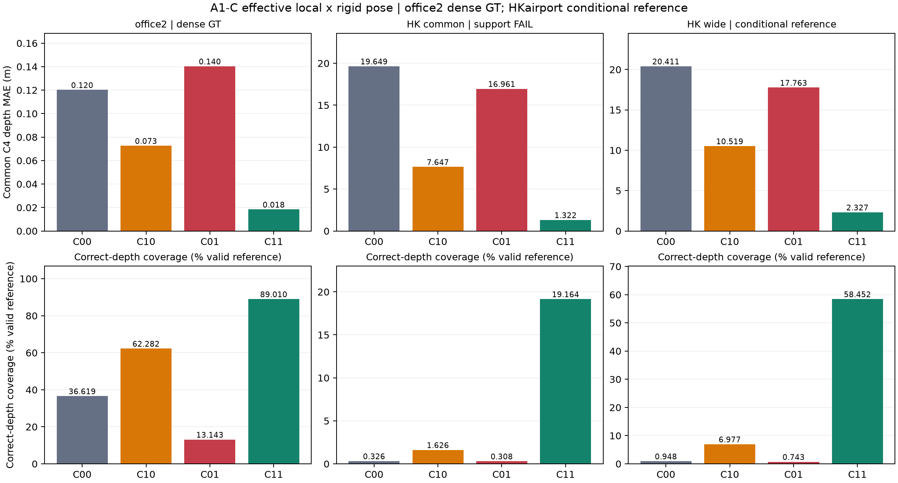
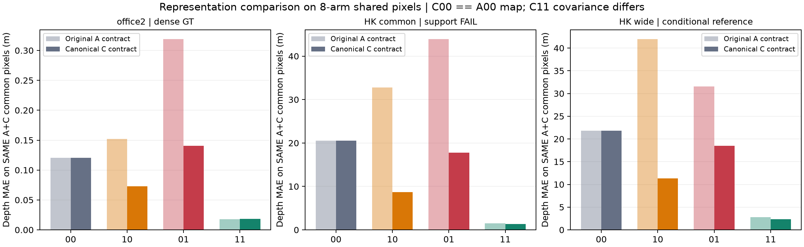
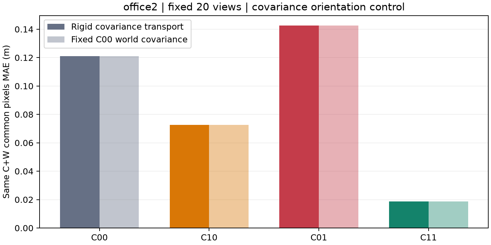
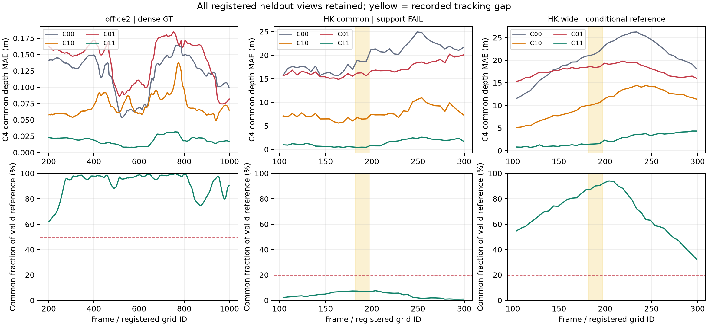
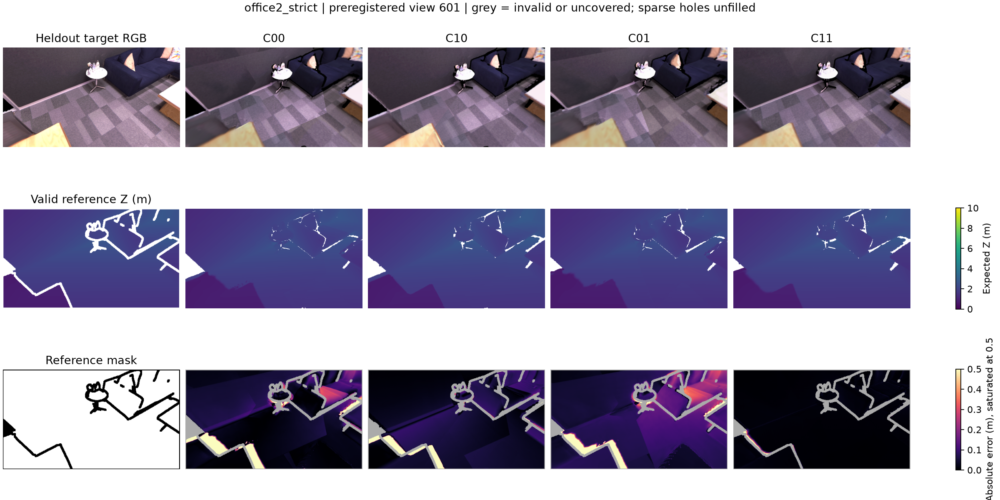
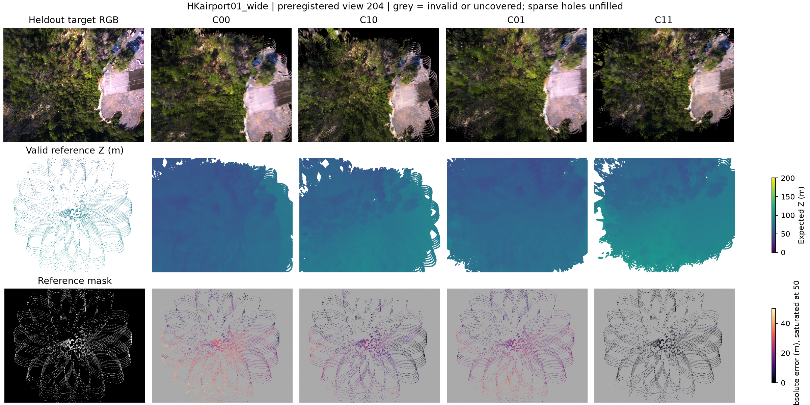

# A1-C: 유효 Local Geometry × Rigid Pose 2×2 결과

**실행일: 2026-10-26. 실행 COMPLETE. 연구 판정: A1-G/M 및 V1 필요, 보정 알고리즘 GO 보류.**

KF scale을 local에 흡수한 표현에서는 **local geometry 단독 참조 치환이 개선됐다.** Office2는 공통 MAE **0.120241→0.072655m(39.58% 감소)**, HKairport01 wide는 **20.410804→10.518980m(48.46% 감소)**였다. 기존 A0/A0b의 local-only 악화는 raw local/placement scale 배분과 개입 정의에 조건부였음을 지지한다.

다만 office2에서 rigid pose만 교체하면 **0.140378m로 악화**됐고, 같은 local에서 pose 효과는 다른 local 조건에 따라 달랐다. Interaction은 남는다. HKairport common은 support gate를 통과하지 못했고, wide는 support를 확보했지만 reference 보정이 미해결이다. **Depth-only 해결책이나 새로운 joint optimizer가 입증된 결과가 아니다.**

## 1. 등록과 범위

- [사전 설정](../../configs/a1_c_canonical_factorial.json), [등록 manifest](../../results/A1_C_canonical_factorial/2026-10-26/registration.json): **1,068개** 입력·코드 hash를 C map 생성·synthetic 검사·factorial 결과 확인 전에 고정했다. 기존 A0/A0b/A1-U 결과를 알고 설계한 개발 진단이다.
- Office2 strict: 기존 native-active/GT-valid post-prefix **1,200,827개**, 기존 홀수 heldout **400뷰(201–999)**.
- HKairport01 common: 기존 보정 공통 **6,368개**, wide: 기존 sequence-camera 참조 **242,162개**. 두 scope 모두 고정 heldout **40뷰(grid 104–299)**. Scope를 합치거나 더 좋은 scope로 대체하지 않았다.
- A1-U의 $y=a_kx$, $\Sigma^y=a_k^2\Sigma^x$, rigid Q와 기존 final-revision prefix gauge를 재사용했다. **새 모델 추론·학습·filter 재실행·전역/프레임별 GT fit은 없다.**
- Q0-HK, A1-G/M의 별도 gauge/sparsification 실험, F/RT, office3 V1, office4, 실제 보정 알고리즘은 실행하지 않았다. HKairport 추적 공백의 heldout 3뷰도 제외하지 않았다.

## 2. 실제 비교 조건

| Arm | Local 중심 | Placement |
|---|---|---|
| C00 | Native scale을 포함한 유효 local y | 추정 rigid Q |
| C10 | GT/LiDAR metric local | 추정 rigid Q |
| C01 | 유효 local y 그대로 | 참조 회전·이동만 적용한 SE(3) |
| C11 | GT/LiDAR metric local | 참조 SE(3) |

모든 C-arm에서 후보 ID·순서·RGB/opacity·canonical local covariance **동일**. World covariance는 각 rigid rotation으로 옮겼다. C01에서는 KF scale을 제거하는 추가 개입을 하지 않았다. CZ10/CZ11은 predicted ray를 유지하고 참조 Z만 대입하는 보조 조건이다.

**C00 map은 각 scope의 기존 A00과 SHA-256까지 동일**하며 모든 480뷰의 depth/coverage cache도 기존 A00과 array-identical했다. **C11의 중심은 기존 A11과 bitwise 동일하지만 covariance는 다르다.** 그러므로 A11→C11 렌더링 변화는 중심 정확도 개선이 아니라 covariance 계약 변경의 결과다.

## 3. 주 결과: 비교군별 동일 target 공통 픽셀

각 scope의 네 C-arm이 모두 렌더링한 같은 유효 reference 픽셀에서 **프레임별 MAE의 단순 평균**을 계산했다. 기존 A와 새 C는 가림·coverage가 달라 공통 mask도 달라진다. 따라서 이 절의 C00 값이 과거 보고서 A00 값과 조금 다른 것은 지도가 좋아져서가 아니다. 동일 픽셀의 A/C 비교는 §4에 따로 제시한다.

Coverage/correct coverage의 분모는 각 뷰 전체 유효 reference다. Office2는 기존 전체 GT-valid 분모를 유지하고 주 MAE는 GT interior에서 계산한다. Correct 기준은 실내 `max(0.05m,2% Z)`, UAV `max(0.5m,2% Z)`다.

### 3.1 Office2 dense GT, strict 1,200,827후보

| Arm | 공통 깊이 MAE (m) | Coverage | Correct-depth coverage |
|---|---:|---:|---:|
| C00 | 0.120241 | 92.541% | 36.619% |
| C10 | 0.072655 | 92.004% | 62.282% |
| C01 | 0.140378 | 93.463% | 13.143% |
| C11 | 0.018412 | 92.820% | 89.010% |

400/400뷰가 support gate 통과. 공통 reference의 평균 **92.195%**, 뷰당 평균 **116,382.933픽셀**, 최소 **71,376픽셀**이었다. C10의 correct coverage는 **36.619→62.282%**로 상승했다. C01은 PSNR이 **13.869→16.170dB**로 좋아졌지만 깊이 MAE와 correct coverage는 악화돼, RGB를 기하 정확도의 대용으로 쓰면 안 됨을 다시 확인했다.

동일한 기존 20뷰 GT-depth TSDF reference에 대한 sample Chamfer는 C00/C10/C01/C11 각각 **0.140149/0.089321/0.153691/0.062509m**였다. Depth와 같은 방향이다. voxel 4cm, truncation 12cm, 100k area samples, seed 0, 최대 깊이 10m로 기존 A0와 동일한 **관측영역 표면 진단**이다. Gaussian center proxy와 구분한다.

### 3.2 HKairport01 common, 6,368후보 — support 부족

| Arm | 공통 깊이 MAE (m) | Coverage | Correct-depth coverage |
|---|---:|---:|---:|
| C00 | 19.648902 | 16.897% | 0.326% |
| C10 | 7.647197 | 16.539% | 1.626% |
| C01 | 16.960990 | 25.178% | 0.308% |
| C11 | 1.321622 | 23.327% | 19.164% |

40/40뷰에 공통 픽셀이 있지만 평균 **587.175픽셀**, LiDAR-valid의 **4.209%**뿐이다. 등록한 `≥1,000픽셀 및 ≥20%` 조건을 만족한 뷰는 **0/40**으로 gate 실패다. 숫자는 재현 가능한 좁은 집합의 조건부 진단이며 우세 원인·효능 GO에 사용하지 않는다.

### 3.3 HKairport01 wide, 242,162후보 — support 확보, reference는 조건부

| Arm | 공통 깊이 MAE (m) | Coverage | Correct-depth coverage |
|---|---:|---:|---:|
| C00 | 20.410804 | 78.560% | 0.948% |
| C10 | 10.518980 | 73.029% | 6.977% |
| C01 | 17.763107 | 90.344% | 0.743% |
| C11 | 2.326588 | 86.087% | 58.452% |

40/40뷰 support gate 통과. 공통 영역은 평균 **9,568.25픽셀**, LiDAR-valid의 **69.256%**, 최소 **4,010픽셀**이었다. C10 correct coverage는 **0.948→6.977%**, C11은 **58.452%**였다. Local-only MAE가 크게 줄어도 허용 오차 이내로 맞는 전체 관측 영역은 아직 작다.

이 범위도 원본 native-active의 약 **7.47%** source 후보만 다룬다. 기존 full native map 전체가 48% 좋아졌다고 말할 수 없다. 이 단계는 full-map mixed 대조를 새로 실행한 A1-M이 아니다. LiDAR 없는 하늘·전체 표면 completeness 또는 static-only 성능도 주장하지 않는다.

## 4. 같은 픽셀에서 원 A0/A0b와 C 비교

A 네 조건과 C 네 조건, 총 8-arm의 target 공통 mask에서 비교했다. C00과 A00은 같은 지도이며 아래에서도 같은 오차다. 이 비교는 representation/factor 정의에 조건부인 효과를 평가하며 물리적 원인 기여율을 산출하지 않는다.

| Scope | 동일 8-arm mask의 A00 / A10 / A01 / A11 (m) | 동일 mask의 C00 / C10 / C01 / C11 (m) |
|---|---|---|
| office2_strict | 0.120343 / 0.151961 / 0.318694 / 0.017852 | 0.120343 / 0.072759 / 0.140462 / 0.018426 |
| HKairport01_common | 20.506986 / 32.749765 / 43.880330 / 1.470158 | 20.506986 / 8.678466 / 17.756799 / 1.337496 |
| HKairport01_wide | 21.788037 / 41.926703 / 31.562393 / 2.790898 | 21.788037 / 11.291258 / 18.515309 / 2.352560 |

Office2에서는 local-only 오차가 **A10 0.151961→C10 0.072759m**, pose-only가 **A01 0.318694→C01 0.140462m**로 바뀌었다. HKairport wide에서도 local-only는 **41.926703→11.291258m**, pose-only는 **31.562393→18.515309m**였다. 따라서 기존 단독 개입 악화에 **KF scale의 local/placement 배분과 factor 정의가 관여**한다는 해석이 지지된다. C의 local에는 추정 KF scale이 이미 포함돼 있으므로 ‘raw network depth 오류만 제거한 효과’는 아니다.

한편 C11과 A11의 중심·pose·RGB·opacity가 같다는 점에 주의해야 한다. HK wide의 **A11 2.790898→C11 2.352560m** 변화는 이 동일 mask에서 covariance만 달라 생긴 렌더링 차이다. 더 정확한 중심으로 바뀌었다는 뜻이 아니다. Office2도 A11/C11 covariance 계약을 혼합하지 않았다.

원 A0 수치·분모는 저장된 전체 depth/coverage cache와 동일 GT/mask에서 **전 뷰 재계산**해 per-view MAE·common pixel count를 재현했다. 원래 HK common mask 파일도 array-equal이었다. 추가로 각 scope의 원 A 네 map을 고정 5뷰에서 **CUDA 재렌더링(60 map-view)**해 depth/coverage 일치를 검증했다. 원 모델의 새 추론이나 원 A map의 전체 400뷰 GPU 재실행으로 보고하지 않는다.

## 5. 잔여 Interaction과 ray 보존 대조

오차가 작을수록 좋은 지표에서 `Δlocal=E00−E10`, `Δrigid=E00−E01`, `I=E11−E10−E01+E00`를 사용했다. 이 절의 effect는 각 scope의 C4 공통 mask다.

| Scope | Δ local (m) | Δ rigid pose (m) | Interaction (m) | Joint gain (m) |
|---|---:|---:|---:|---:|
| office2_strict | 0.047586 | -0.020136 | -0.074379 | 0.101829 |
| HKairport01_common | 12.001705 | 2.687913 | -3.637663 | 18.327281 |
| HKairport01_wide | 9.891824 | 2.647697 | -5.544695 | 18.084216 |

Office2의 pose 효과는 추정 local에서 **−0.020136m**(악화)지만 reference local에서는 **+0.054243m**(개선)다. Scale 흡수만으로 모든 coupling이 사라지지는 않았다. HK wide에서도 joint 개선과 단독 개선의 합에 차이가 남는다. 비선형 MAE·renderer·잔여 pose/local 정합·gauge의 영향이 섞일 수 있어 물리적 오류 상쇄로 확정하지 않는다.

다음은 C/CZ 총 6조건의 **별도 공통 mask**에서 계산한 ray 보존 대조다. 위 4조건 표와 분모가 다르다.

| Scope | C00 | C10 | CZ10 | C11 | CZ11 |
|---|---:|---:|---:|---:|---:|
| office2_strict | 0.120115 | 0.072506 | 0.073458 | 0.018401 | 0.025329 |
| HKairport01_common | 19.600502 | 7.846188 | 7.835441 | 1.253922 | 1.916632 |
| HKairport01_wide | 20.459818 | 10.550614 | 10.500615 | 2.327044 | 3.730832 |

Office2의 CZ10은 baseline 대비 약 **38.8%**, HK wide CZ10은 약 **48.7%** MAE가 감소했다. GT ray로 방향을 바꿔야만 local 개입 이득이 나는 것은 아니다. 다만 이는 **참조 Z를 직접 대입한 Oracle**이며 RGB-only가 그 Z를 알아낼 수 있다는 증거가 아니다. C11/CZ11 차이는 ray 방향의 잔여 영향도 있음을 보여 준다.

## 6. Covariance 최소 통제

Office2 고정 20뷰에서 canonical C 4조건과 world covariance를 C00 값으로 고정한 W-C 4조건을 같은 8-arm 픽셀에서 비교했다.

| 정책 | C00 | C10 | C01 | C11 |
|---|---:|---:|---:|---:|
| Rigid transport | 0.121111 | 0.072615 | 0.142549 | 0.018782 |
| Fixed C00 world covariance | 0.121111 | 0.072615 | 0.142496 | 0.018742 |

이 대조에서는 local 개선·pose 단독 악화·joint 개선의 방향과 C10/C01 순위가 바뀌지 않았다. 따라서 이 office2 subset에서 covariance의 **회전 transport만**이 단독 pose 악화를 설명하지는 않는다. 이 검사는 A→C 간 covariance scale magnitude 변화나 HKairport의 representation 문제까지 해결한 검증이 아니다. Reference-only splat/z-buffer 등을 포함한 R-Q 확대는 미실행이다.

## 7. Source local 잔차와 추적 공백

각 source KF의 유효 local Z·3D 오류, ray angle, C-scaled raw Z 잔차, reference world→local 왕복을 기록했다. C-scaled raw 통계와 scale을 흡수한 effective local 통계는 서로 다른 단위 배분의 진단이며, A1-U 자체가 오류를 고쳤다는 뜻으로 비교하지 않는다. [Source residual CSV](../../results/A1_C_canonical_factorial/2026-10-26/analysis/A1_source_residuals.csv).

HKairport은 기존 공백 이전 **16뷰**, 공백 **3뷰**, 이후 **21뷰**를 그대로 남겼고 MAE를 층화했다. 최종 offline map에서 공백 view를 렌더링할 수 있다는 것이 당시 tracking 성공을 뜻하지 않는다. 기존 228/240 pose 및 2.4초 tracking 중단·E4e gate FAIL은 그대로다.

## 8. 결과 보기

각 scope의 사전 고정 5뷰 전체에 RGB/reference depth/rendered depth/error 이미지를 저장했다. 미관측·미렌더링 픽셀은 회색이다. Error 색상은 실내 0–0.5m, UAV 0–50m이며 상한 이상은 포화한다.

- [4군 CSV](../../results/A1_C_canonical_factorial/2026-10-26/analysis/A1_C_four_arms.csv), [effect CSV](../../results/A1_C_canonical_factorial/2026-10-26/analysis/A1_effects.csv), [전체 결과](../../results/A1_C_canonical_factorial/2026-10-26/analysis/results.json), [연구 판정](../../results/A1_C_canonical_factorial/2026-10-26/analysis/decision.json).
- [Office2 3D center proxy viewer](../../results/A1_C_canonical_factorial/2026-10-26/office2_strict_center_proxy_viewer.html), [HKairport common viewer](../../results/A1_C_canonical_factorial/2026-10-26/HKairport01_common_center_proxy_viewer.html), [HKairport wide viewer](../../results/A1_C_canonical_factorial/2026-10-26/HKairport01_wide_center_proxy_viewer.html). 브라우저에서 legend로 C00/C10/C01/C11을 전환한다. Source 중심 표본 및 카메라 축이며 **Gaussian 표면 viewer가 아니다.**

## 9. 검증과 재현 기록

- Canonical 개입·ray·support denominator 검사 **6개**와 기존 32개, 총 **38검사 통과**.
- 모든 source block에서 same IDs/order/attributes·local covariance, C01의 local 불변·rigid-only 개입, packed inverse 왕복, C00/A00 map equality 및 C11/A11 center equality 검증 통과.
- C00 depth/coverage는 전 480뷰에서 원 A00과 array-identical. 원 A의 common mask·per-view 지표는 전체 480뷰에서 4군씩 재현했다.
- CUDA에서 **새 map 22개**: office2 6 C/CZ+4 covariance, HK 두 scope 각 6개. 새 map **2,960 depth/RGB map-view**, 원 A GPU replay **60 depth map-view**, 합계 **3,020 depth map-view**를 평가했다. 모델 추론 횟수 또는 속도 개선으로 보고하지 않는다.
- RTX 5060, TF32 off, degree 0, refiner 0. Office2 6개 지도에 관측영역 TSDF를 생성했고 sparse UAV에 dense surface/completeness 지표를 채우지 않았다.
- [생성/등록](../../scripts/build_a1_canonical_oracles.py), [CUDA 평가](../../scripts/evaluate_a1.py), [분석](../../scripts/finalize_a1_c.py), [시각화/보고서](../../scripts/report_a1_c.py), [개입 계약](../../src/canonical_oracles.py), [요약](../../configs/a1_c_results_summary.json). 입력·code·map·depth/coverage cache·결과 hash와 소스 snapshot을 출력 폴더에 보관했다.

## 10. 현재 판단과 다음 단계

**A1-C는 실행 완료했지만 후속 방법 GO는 아니다.** Scale 배분을 정리하면 유효 local geometry 개입의 이득이 나타나며, ray 보존 Z 대조도 이를 지지한다. 그러나 실내 rigid pose 단독 악화와 잔여 interaction, UAV 보정·gauge 불확실성은 남는다.

1. **다음은 A1-G/M:** 기존 prefix에서 position/orientation gauge를 비교하고, source/target support를 따로 바꾸는 dense→sparse 및 full-map mixed 대조로 결론의 범위를 확인한다. 현재 C의 여러 scope 평가를 G/M 완료로 대체하지 않는다.
2. **Q0-HK reference는 미해결:** extrinsic 직교성·JPG distortion·Terra/물리 카메라 대응을 검증하기 전 UAV 수치를 조건부로 유지한다. U/C의 수학적 개입 통과로 sensor QA를 통과시킬 수 없다.
3. 개발 규칙을 고정한 뒤 **V1 office3**에서 재현한다. 새 장면 재현 없이 local/pose 지배 원인을 일반화하지 않는다. Office4는 계속 보류다.
4. 이후에도 local 잔차 이득이 남으면 **A2-S/O**에서 scalar bias와 공간적 deformation, RGB 관측 가능성을 구분한다. C10/CZ10 개선만으로 D4나 joint optimizer 구현에 GO하지 않는다.
