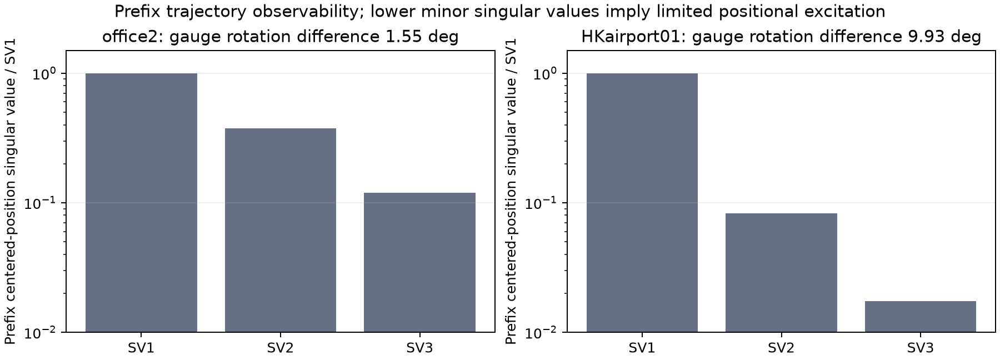
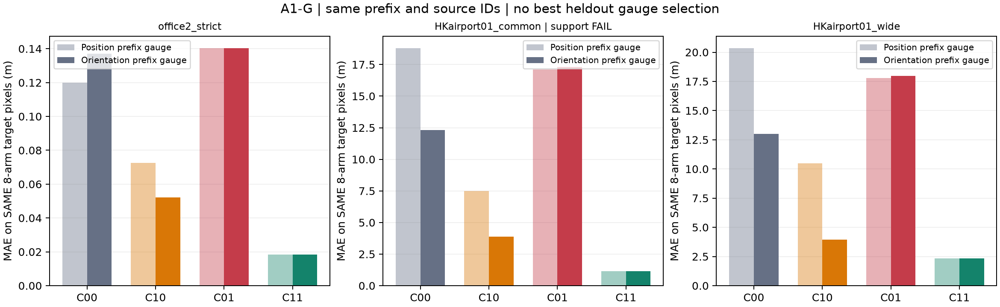
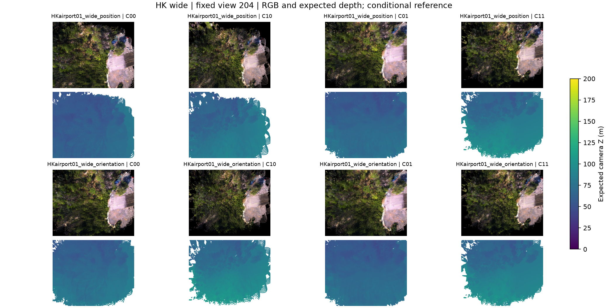

# A1-G: Prefix gauge 민감도 결과

**실행일: 2026-10-26. 실행 COMPLETE. 판정: Gauge-dependent rigid-pose effect, 보정 GO 보류.**

같은 prefix·후보·target 픽셀에서도 **HKairport wide의 rigid pose 참조 교체 효과가 정렬에 따라 반전**됐다. Local 참조 개입은 두 정렬 모두에서 개선됐지만, 효과 크기와 pose 해석은 gauge에 조건부다. 절대 오차가 작은 정렬을 사후 정답으로 선택하지 않았다.

## 1. 고정 조건

- [설정](../../configs/a1_g_gauge_sensitivity.json), [등록](../../results/A1_G_gauge_sensitivity/2026-10-26/registration.json). A1-C 결과를 알고 설계한 개발 진단이며, 새 G/M 결과를 보기 전 입력 **1,134개**와 생성·평가 코드, 비교군·분모·support gate를 고정했다.
- Position gauge는 기존 final-revision prefix position Sim(3)이다. 같은 입력으로 fit을 재계산해 저장값과 일치를 확인했다.
- Orientation gauge는 같은 prefix의 `Rref @ Rest.T` SO(3) 평균으로 회전을 정한 뒤, 그 회전에서 **전역 scale 하나와 translation 하나**를 prefix 위치로 fit했다. Office2 원본 `<200`의 100개 pose, HK grid `<100`의 80개 pose만 사용했다. Post-prefix/heldout GT는 fit하지 않았다.
- Office2 strict 1,200,827후보·400뷰, HK common 6,368후보·40뷰, HK wide 242,162후보·40뷰를 유지했다. 최종 pose revision·source ID·color/opacity·camera 모델은 동일하다. 새 모델 추론/학습은 없다.
- 상대 gauge D의 scale을 effective local y와 covariance에 함께 반영하고, rigid rotation·camera origin을 D로 옮겼다. `new C00 world == D(old C00 world)` mean/covariance 검사를 통과했다. 참조 local과 참조 SE(3)는 바꾸지 않았다. 이는 C 단위 재배분 불변성(A1-U)과 다른 **전역 정렬 불확실성** 검사다.

## 2. Prefix 관측 조건

| Scene | Prefix pose | 추정 위치 SV 비율 | 두 gauge 회전 차이 | Global scale 비 |
|---|---:|---|---:|---:|
| office2 | 100 | 1 / 0.376868 / 0.119359 | 1.550503° | 0.999922 |
| HKairport01 | 80 | 1 / 0.082965 / 0.017367 | 9.929346° | 0.997034 |

HK prefix는 거의 직선이어서 위치만으로 회전을 정할 때의 제한된 관측 조건을 보여 준다. 이것만으로 orientation gauge가 더 정확한 물리 GT라는 뜻은 아니다. Terra pose의 물리 카메라 대응도 여전히 미해결이다.

## 3. 같은 target 8-arm 공통 픽셀의 결과

단위 m, 낮을수록 좋은 depth MAE다. 각 행쌍은 position/orientation 각 네 조건의 **동일 8-arm mask**를 사용한다. 각 gauge 자체 C4 결과와 별도로 기록해 mask 변경을 개선으로 혼동하지 않는다.

| Scope / gauge | C00 | C10 | C01 | C11 | 8-arm support |
|---|---:|---:|---:|---:|---|
| office2_strict_position | 0.120025 | 0.072564 | 0.140199 | 0.018413 | PASS |
| office2_strict_orientation | 0.136927 | 0.052112 | 0.140407 | 0.018412 | PASS |
| HKairport01_common_position | 18.805369 | 7.490368 | 17.095179 | 1.162735 | FAIL |
| HKairport01_common_orientation | 12.316582 | 3.880517 | 17.296097 | 1.162527 | FAIL |
| HKairport01_wide_position | 20.359776 | 10.489161 | 17.774036 | 2.328522 | PASS |
| HKairport01_wide_orientation | 12.994454 | 3.929995 | 17.961217 | 2.327428 | PASS |

HK wide의 pose 효과는 position에서 **20.359776−17.774036=+2.585740m**인 반면 orientation에서는 **12.994454−17.961217=−4.966763m**였다. 40/40뷰의 paired support가 충분한 상태에서 부호와 10% 이상 효과가 바뀌었다. 따라서 **‘이 장면은 pose만 교체하면 개선된다’는 무조건적 결론은 유지할 수 없다.**

반면 local 참조 교체는 HK wide에서 position **20.359776→10.489161m**, orientation **12.994454→3.929995m**로 모두 개선됐다. Office2도 local 개선이 유지됐고 rigid pose 효과는 두 gauge에서 모두 음수였지만, orientation gauge에서는 악화 폭이 작아졌다. HK common의 방향 반전은 좁은 support 때문에 참고 진단으로만 둔다.

## 4. 자체 C4 분모 결과와 한계

다음은 각 gauge의 own four-arm 공통 mask다. **행 사이의 target 분모가 달라 위 paired 표와 숫자를 혼합하지 않는다.**

| Scope | 후보 수 | C00 | C10 | C01 | C11 | Support gate |
|---|---:|---:|---:|---:|---:|---|
| office2_strict_position | 1,200,827 | 0.120241 | 0.072655 | 0.140378 | 0.018412 | PASS (400/400) |
| office2_strict_orientation | 1,200,827 | 0.136758 | 0.052124 | 0.140286 | 0.018415 | PASS (400/400) |
| HKairport01_common_position | 6,368 | 19.648902 | 7.647197 | 16.960990 | 1.321622 | FAIL (0/40) |
| HKairport01_common_orientation | 6,368 | 11.097785 | 4.644931 | 15.799380 | 1.554646 | FAIL (0/40) |
| HKairport01_wide_position | 242,162 | 20.410804 | 10.518980 | 17.763107 | 2.326588 | PASS (40/40) |
| HKairport01_wide_orientation | 242,162 | 12.148444 | 3.901407 | 17.045753 | 2.169427 | PASS (40/40) |

C11의 GT/reference 중심은 gauge 간 같고 covariance의 global scale만 일관되게 달라진다. 같은 픽셀에서 HK wide C11은 **2.328522/2.327428m**로 유사했다. 자체 C4의 C11 변화에는 서로 다른 C00/C10 가림 영역에 따른 mask 변화가 포함된다.

## 5. 실행·검증·다음 단계

- Orientation 새 map **12개·1,920 depth-view**를 CUDA로 평가했고, position의 같은 수 cache를 hash로 검증해 재사용했다. RGB는 기존 고정 5뷰씩 총 60뷰만 렌더링했다. 전체 새 모델 추론으로 보고하지 않는다.
- Prefix-only fit·가역 world similarity·GT를 인자로 받지 않는 mask 검사 6개와 기존 38개, **총 44검사 통과**. 원본 prefix gauge 재현, 동일 후보 hash 및 HK 과거 orientation gauge와의 수치 일치도 통과했다.
- Mean per-view MAE, depth coverage와 correct coverage, 픽셀/뷰 수를 기록했다. 모든 등록 뷰와 HK 추적 공백 3뷰를 포함했다. Pixels/frames를 독립 실험 반복으로 세지 않는다.
- Q0-HK는 미해결, V1/office4는 미실행이다. Gauge가 더 좋은 heldout 결과를 보인다는 이유로 primary를 교체하지 않았다. **V1에서는 기존 position을 primary, 같은 prefix orientation을 고정 sensitivity로 둘 다 보고한다.**
- [4군 CSV](../../results/A1_G_gauge_sensitivity/2026-10-26/analysis/A1_G_four_arms.csv), [gauge/support matrix](../../results/A1_G_gauge_sensitivity/2026-10-26/analysis/A1_gauge_support_matrix.csv), [상세 결과](../../results/A1_G_gauge_sensitivity/2026-10-26/analysis/results.json), [요약](../../configs/a1_g_results_summary.json).

현재는 **유효 local 참조 개입의 개선 방향은 유지되지만 rigid pose 효과는 gauge-dependent**라는 개발 관측까지다. 다음은 고정된 V1 절차의 다른 장면 재현이며 Depth-only/pose-only 알고리즘 GO는 아니다.
