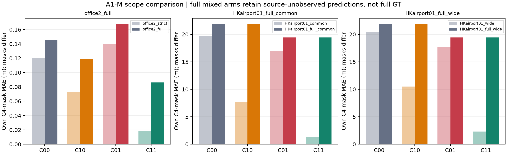
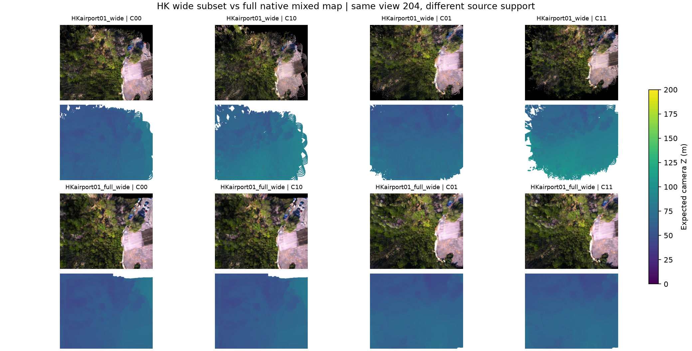
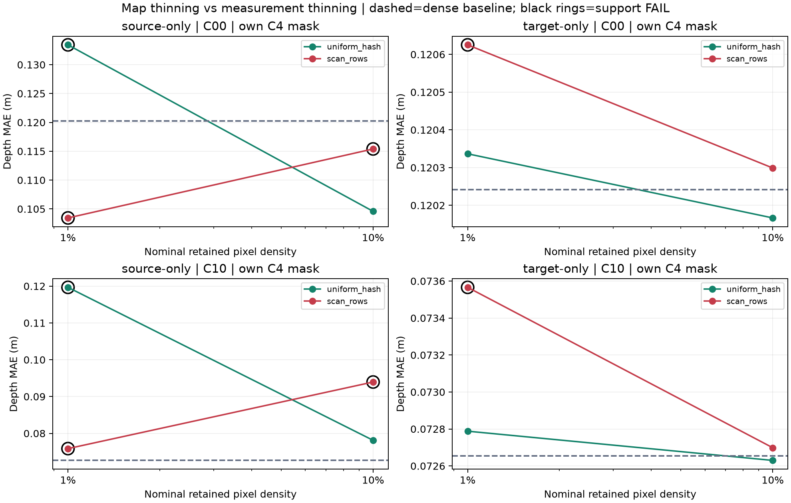
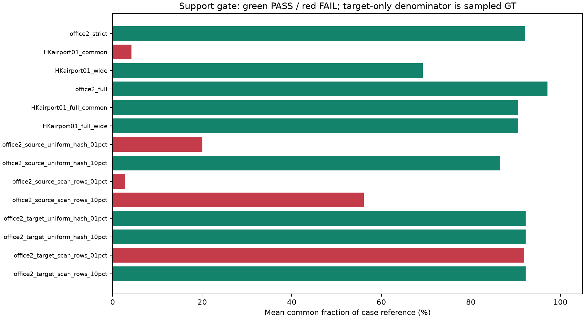

# A1-M: Source support·Target 측정 밀도·전체 지도 범위 대조

**실행일: 2026-10-26. 실행 COMPLETE. 판정: Scope/density에 조건부인 효과; 보정 GO 보류.**

Source 후보를 줄이는 경우와 target 평가 픽셀만 줄이는 경우는 달랐다. **지도·렌더링을 그대로 둔 target-only 대조**에서는 이번 office2의 효과 방향이 유지됐지만, **source-only 대조**에서는 rigid pose 효과의 방향이 바뀌는 경우가 있었다. 전체 native 지도에서는 HK local 참조 교체가 적은 후보에만 적용돼, 좁은 참조 후보에서의 큰 개선이 전체 지도 개선으로 이어지지 않았다.

## 1. 사전 고정과 비교 정의

- [설정](../../configs/a1_m_support_sensitivity.json), [등록](../../results/A1_M_support_sensitivity/2026-10-26/registration.json). G와 별도로 등록·출력·판정했다. 입력 1,134개와 mask seed·밀도·pattern·분모를 새 결과 전에 고정했다.
- Gauge는 기존 position prefix 정렬만 사용했다. **G×모든 density×pattern의 전 조합 실험이 아니다.** G와 M이 동시에 바뀔 때의 효과까지 검증했다고 주장하지 않는다.
- 기존 C의 strict/common/wide를 그대로 재사용하고, full native mixed 3범위 및 office2 source-only 4범위를 새로 렌더링했다. Target-only 4범위는 같은 dense C map/cache를 재사용했다.
- 400 office2 / 40 HK heldout view, 후보 ID·Gaussian 크기/covariance·RGB/opacity를 규약대로 유지했다. Source thinning에서는 선택된 기존 C의 **packed row 자체**를 복사해 생존 후보의 모든 값이 변하지 않게 했다. GT outlier 선택, opacity/footprint inflation, hole interpolation, 재학습은 없다.

## 2. 전체 native map의 mixed reference

| Scope | Native-active 후보 | Local 참조 교체 가능 후보 | 교체 비율 |
|---|---:|---:|---:|
| office2_full | 1,545,979 | 1,314,328 | 85.016% |
| HKairport01_full_common | 3,242,219 | 7,609 | 0.235% |
| HKairport01_full_wide | 3,242,219 | 261,958 | 8.080% |

Prefix KF를 포함한 원본 후보 전체를 보존했다. C10/C11에서는 source 참조가 있는 local 중심만 교체하고, 나머지 local은 effective 예측을 유지한다. Rigid placement 개입은 모든 후보에 적용한다. **완전 GT/Oracle 지도라고 부르면 안 된다.** 두 HK full scope의 C00/C01 map은 SHA-256까지 동일하며, C10/C11만 local 교체 범위가 다르다.

각 scope **자체 C4 target 공통 mask**의 depth MAE(m)다. Scope 간 비교는 source 정보량·후보 수가 달라지므로, 이를 physical error 기여율로 분할하지 않는다.

| Scope | 후보 수 | C00 | C10 | C01 | C11 | Support gate |
|---|---:|---:|---:|---:|---:|---|
| office2_strict | 1,200,827 | 0.120241 | 0.072655 | 0.140378 | 0.018412 | PASS (400/400) |
| office2_full | 1,545,979 | 0.146010 | 0.119108 | 0.167390 | 0.086284 | PASS (400/400) |
| HKairport01_common | 6,368 | 19.648902 | 7.647197 | 16.960990 | 1.321622 | FAIL (0/40) |
| HKairport01_wide | 242,162 | 20.410804 | 10.518980 | 17.763107 | 2.326588 | PASS (40/40) |
| HKairport01_full_common | 3,242,219 | 21.836890 | 21.834005 | 19.433967 | 19.433531 | PASS (40/40) |
| HKairport01_full_wide | 3,242,219 | 21.836925 | 21.807298 | 19.433986 | 19.415332 | PASS (40/40) |

HK full wide는 local-only **21.836925→21.807298m**로 변화가 작았다. 이것은 local 깊이가 중요하지 않다는 뜻이 아니다. 약 92%의 native source 후보는 참조 local로 교체하지 못했고, 여러 KF의 가림·opacity 합성에 의해 target 표면이 결정된다. **Wide subset의 약 48% 개선을 전체 native 지도 개선율로 확대할 수 없다는 한계**다.

Office2 full mixed에서도 strict보다 잔차가 커졌다. 같은 target common8에서 strict C00/C10/C01/C11은 **0.120241/0.072655/0.140378/0.018412m**, full은 **0.140793/0.112479/0.163155/0.079434m**였다. Source 참조가 없는 후보 및 prefix를 추가하는 실험이며, 특정 후보 유형 하나가 원인이라고 확정하지 않는다.

## 3. Source-only thinning — 지도 후보 수만 변경

Office2 strict 1,200,827개에서 seed 0의 **uniform pixel hash / row-scan**, nominal **1%/10%**를 사용했다. Hash는 frame ID와 pixel index만 사용한다. Row scan은 주기 100/10에서 frame별 고정 phase의 행을 선택한다. 실제 후보 수는 GT/native validity를 적용한 뒤 기록했고 부족한 칸을 다시 채우지 않았다. Dense target reference는 그대로다.

| Scope | 후보 수 | C00 | C10 | C01 | C11 | Support gate |
|---|---:|---:|---:|---:|---:|---|
| office2_source_uniform_hash_01pct | 11,989 | 0.133434 | 0.119666 | 0.100117 | 0.045519 | FAIL (0/400) |
| office2_source_uniform_hash_10pct | 120,330 | 0.104586 | 0.078117 | 0.099543 | 0.012655 | PASS (400/400) |
| office2_source_scan_rows_01pct | 12,017 | 0.103440 | 0.075860 | 0.091886 | 0.029402 | FAIL (0/400) |
| office2_source_scan_rows_10pct | 120,738 | 0.115395 | 0.093950 | 0.101822 | 0.020957 | FAIL (297/400) |

Uniform 10%의 matched dense+source common8에서는 dense pose-only **0.119371→0.139491m**(악화), source-thinned에서는 **0.104586→0.099543m**(소폭 개선)였다. Paired support는 충분했다. 다만 thinned의 개선은 약 4.8%로 사전 최소 효과 10%에 미달하므로 **강한 pose 우세/보정 GO로 세지 않았다.** 방향 자체가 density에 의존할 수 있다는 관측이다.

1% source 두 pattern은 support gate를 통과하지 못했고, 10% row scan도 충족 뷰 297/400(74.25%)로 등록 한도 80%에 미달했다. 이 숫자를 유리한 뷰만 골라 다시 계산하지 않았다. 삭제로 생긴 coverage·가림·compositing 변화는 새 geometry 보정 알고리즘의 성능이 아니다. 이전 pruning 연구를 재개하는 결과로 해석하지 않는다.

## 4. Target-only thinning — 지도·렌더링은 그대로, 측정만 희소화

동일 pattern/density를 target image grid에 적용하되, 모든 source 후보와 stored render는 그대로 두었다. 각 조건의 map hash와 depth/coverage cache hash가 dense C와 같음을 검증했다. **서로 다른 target 측정을 평가하는 민감도**이며, 더 작은 MAE가 나와도 지도가 개선된 것이 아니다.

| Scope | 후보 수 | C00 | C10 | C01 | C11 | Support gate |
|---|---:|---:|---:|---:|---:|---|
| office2_target_uniform_hash_01pct | 1,200,827 | 0.120337 | 0.072788 | 0.140280 | 0.018429 | PASS (359/400) |
| office2_target_uniform_hash_10pct | 1,200,827 | 0.120167 | 0.072630 | 0.140320 | 0.018423 | PASS (400/400) |
| office2_target_scan_rows_01pct | 1,200,827 | 0.120625 | 0.073566 | 0.140756 | 0.018450 | FAIL (300/400) |
| office2_target_scan_rows_10pct | 1,200,827 | 0.120299 | 0.072699 | 0.140404 | 0.018430 | PASS (400/400) |

이번 대조에서 local 개선·pose 단독 악화가 대체로 유지됐다. Uniform 1%/10%, row 1%/10% C00 MAE는 **0.120337/0.120167/0.120625/0.120299m**, 원 dense는 **0.120241m**였다. Row 1%는 `≥1,000 common pixel` 조건 등의 gate를 300/400뷰만 만족해 실패했다. Uniform 1%는 359/400으로 통과했다. 이 한 실내 장면의 측정 안정성이 실제 UAV LiDAR의 noise·extrinsic·가림·스캔 pattern을 검증하지는 않는다.

Target-only의 coverage/correct coverage 분모는 **선택된 GT**이고, 전체 dense reference 중 몇 %를 측정했는지도 별도 저장했다. Source-only는 **원 dense reference**를 분모로 유지했다. 두 정의를 같은 full-scene coverage로 비교하지 않는다.

## 5. 통계·실행 기록

- 각 범위 common4와 dense-vs-각 source/full scope **common8**을 구분했다. 16조건 전역 교집합을 만들지 않았고, 빈/부족 support는 오류 0이나 강건성 통과로 채우지 않았다.
- G/M의 coverage와 correct coverage는 **해당 primary reference-valid 픽셀**(office2 GT interior, HK LiDAR-valid) 기준이다. A1-C 보고서의 office2 전체 GT-valid coverage와 분모가 다르므로 수치를 직접 동일시하지 않는다. Depth MAE와 기존 C4 mask 재현은 동일하다.
- 신규 map **28개·8,320 depth-view**, cache 재사용 **8,320 case-arm-view 참조**. Target-only의 render 재실행은 없다. G까지 합쳐 신규 map 40개·10,240 depth-view, saved RGB 200뷰를 실행했다. 같은 cache의 반복 참조를 독립 표본이나 새 모델 추론으로 세지 않는다.
- 새 6 + 기존 38 = **44검사 통과**. Seeded mask의 determinism/nesting, prefix fit의 heldout 배제, canonical world similarity 및 기존 계약을 검사했다. Source/target용 mask에 GT 오차 인자는 없다.
- HK common의 support 부족, Q0-HK 미해결 및 기존 tracking gate FAIL을 유지했다. Office3/office4 prediction은 미실행이다.
- [4군 CSV](../../results/A1_M_support_sensitivity/2026-10-26/analysis/A1_M_four_arms.csv), [gauge/support matrix](../../results/A1_M_support_sensitivity/2026-10-26/analysis/A1_gauge_support_matrix.csv), [상세 결과](../../results/A1_M_support_sensitivity/2026-10-26/analysis/results.json), [요약](../../configs/a1_m_results_summary.json).

## 5.1 Source KF·거리·confidence별 참조 범위 보충

[분포 CSV](../../results/A1_M_support_sensitivity/2026-10-26/analysis/source_strata.csv)와 [정의·상세 JSON](../../results/A1_M_support_sensitivity/2026-10-26/analysis/source_strata.json)에 14범위의 source KF, 예측 local 거리, native confidence별 후보·참조 가능·참조 불가 수를 306행으로 기록했다. 각 합계가 map manifest와 일치한다. 이는 **결과 이후 추가한 기술 통계**이며 primary metric·mask·gate·판정을 바꾸지 않았다.

거리는 참조가 없는 후보도 포함할 수 있도록 effective 예측 local의 Euclidean range를 사용했다. Confidence는 장면 전체 native-active 후보의 1/3·2/3 분위값으로 나눴고 동률을 분할하지 않았다. 경계는 office2 **9.019469/19.399624**, HK **1.786351/2.211769**다. 서로 다른 장면의 confidence 값을 같은 확률로 해석하지 않는다.

HK full wide에서 예측 거리 30–60m는 62,418개 중 3,675개(5.888%), 60–120m는 3,172,549개 중 258,279개(8.141%), 120m 이상은 7,252개 중 4개(0.055%)만 local 참조로 교체 가능했다. 30m 미만 native 후보는 없었다. **참조 부재는 오류 0이 아니다.** 이 분포는 source 관측 범위이며, 여러 source가 합성된 target 렌더링 오차를 KF/거리/confidence별 인과 기여율로 나눈 결과가 아니다.

## 6. 현재 판정

**Sparse source map과 sparse target measurement를 같은 실험으로 취급할 수 없다.** 이번 target-only 대조는 안정적이었지만 source-only는 지도 footprint·가림·support를 바꿔 pose 효과 방향까지 달라질 수 있었다. Local 참조 개입의 개선 방향은 검사한 범위에서 유지됐으나, 크기는 scope에 크게 의존했다.

따라서 단일 subset/정렬에서 local/pose 지배 원인을 결정하지 않는다. 다음은 사전 고정한 **office3 V1 진단 재현**이다. 실제 RGB-only correction이나 새로운 joint optimizer의 GO는 아직 아니다.
