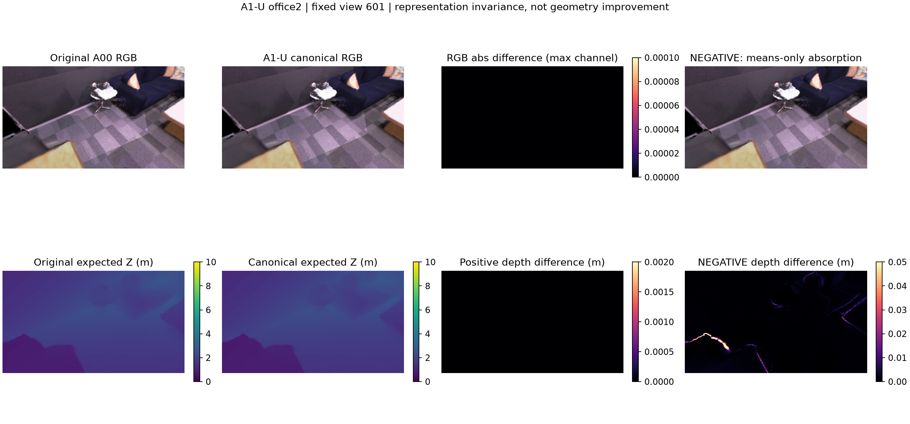
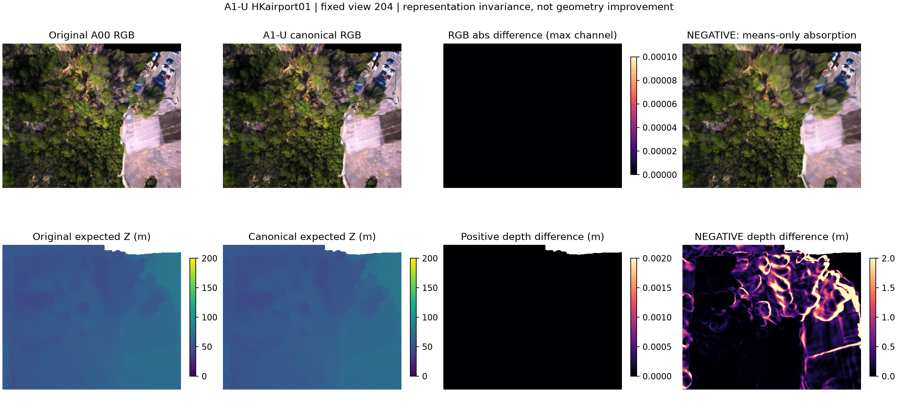
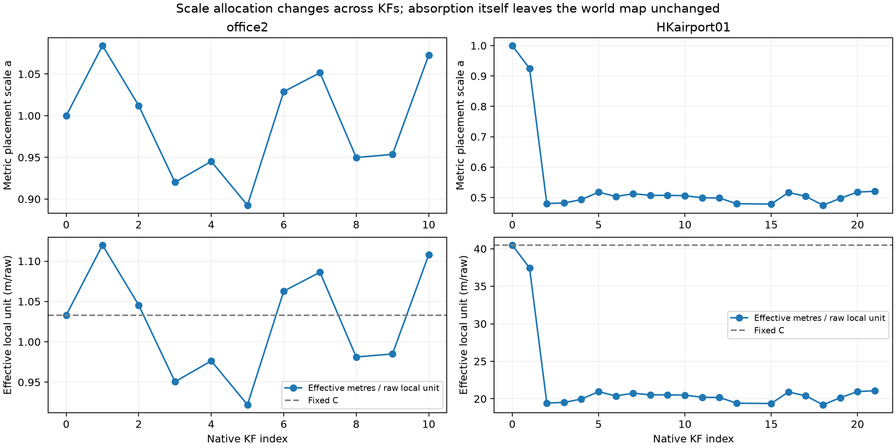

# A1-U: Native map을 보존하는 KF scale 흡수 검증

**실행일: 2026-10-26. 판정: PASS.** Office2와 HKairport01의 저장된 native-active Gaussian **4,788,198개·32KF**에서 scale 재표현을 검증했다. 여섯 가지 positive 재표현의 float32 compact map은 각각 기존 A00과 **바이트 단위로 동일**했고, 동일 viewpoint RGB·expected depth·compositing weight·coverage도 변하지 않았다.

이번 PASS는 **표현 변환의 정확성**이다. 깊이 정확도 개선, scale 오류의 교정, A0/A0b interaction의 원인 규명 또는 RGB-only 알고리즘 효능을 뜻하지 않는다. **A1-C 실행 준비 조건을 충족**했다. A1-C와 Q0-HK는 이번 작업에서 수행하지 않았다.

## 1. 등록과 입력 범위

- [실행 전 고정한 설정](../../configs/a1_unit_reparameterization.json), [등록 manifest](../../results/A1_U_scale_reparameterization/2026-10-26/registration.json). 허용 오차와 code/input hash는 synthetic 검사·실제 지도 구성·CUDA smoke 이전에 고정했다.
- Office2: 기존 A0 RGB-only 추론의 11KF, native-active **1,545,979개**. 기존 strict **1,200,827개**의 후보 연결과 packed 값도 재확인했다.
- HKairport01: 기존 E4e/A0b RGB-only 추론의 21KF, native-active **3,242,219개**. 기존 strict **6,368개**의 연결과 packed 값도 재확인했다.
- Native mask와 후보 순서를 보존하고 필터를 군별로 다시 적용하지 않았다. 원본 native mask 재계산은 기존 registry와의 동일성 감사에만 사용했다.
- Gauge와 C는 기존 A0/A0b alignment 파일의 값을 읽었다. **새 trajectory fit·LiDAR/GT-depth fit·모델 추론·학습·가지치기를 하지 않았다.** Evaluation camera pose는 동일 view를 렌더링하는 데만 사용했다.
- Office3/office4 예측과 Oracle 평가는 하지 않았다. 기존 A0/A0b 출력은 수정하지 않았다.

## 2. 재표현 계약

Metric local $x=C X^{\mathrm{raw}}$, local covariance $\Sigma^x$, metric placement $(a,R,t)$에서 다음을 적용했다.

$$
y=ax,\qquad \Sigma^y=a^2\Sigma^x,\qquad Q=(1,R,t).
$$

따라서 world 값은 다음과 같이 보존된다.

$$
R y+t=aR x+t,\qquad R\Sigma^yR^T=(aR)\Sigma^x(aR)^T.
$$

Gaussian 표준편차에는 $a$, covariance에는 $a^2$를 곱했다. Camera origin $t$, local rotation, color/SH·opacity, candidate ID와 active mask는 보존했다. Canonical local 점과 covariance는 의도적으로 달라지므로 local tensor hash가 같아야 한다고 검사하지 않는다. 대신 **world map과 변경하지 않는 속성**의 불변성을 검사했다.

`construction/<scene>/local/kf*.npz`에는 $y$, covariance, effective standard deviation, rigid Q, active pixel indices와 source event를 저장했다. Candidate ID는 기존 `event:self:pixel_index`로 재구성된다. Rotation 배열은 upstream local preparation의 정규화된 카메라 local 회전이며 원 raw 회전의 불변성은 별도 속성 hash로 검증했다. 기존 covariance는 원래 float32 local preparation 결과를 float64로 승격해 사용했고, std→covariance 배율 법칙은 별도의 float64 경로로도 검증했다.

## 3. 대조 조건

C multiplier **0.8/1/1.25**와 KF 단위 재배분 유무를 교차해 **6개 positive map/scene**을 생성했다. 재배분 배율은 scene마다 seed 0에서 `q=exp(uniform(log(0.5),log(2)))`로 KF당 한 개씩 뽑았으며 GT에 fit하지 않았다.

$$
x'=q x,\qquad \Sigma^{x'}=q^2\Sigma^x,\qquad a'=a/q.
$$

각 경우 scale을 흡수한 $y$, covariance, rigid Q가 같고 world 값도 보존되는지 모든 native-active 후보에서 확인했다. Inverse transform으로 metric local point/covariance와 원 placement를 복원하는 검사도 수행했다.

| Scene | KF / active | Float64 world center 최대 차이 | Float64 world covariance 최대 차이 | Positive packed map |
|---|---:|---:|---:|---|
| office2 | 11 / 1,545,979 | 1.776e-15 m | 4.337e-18 m² | 6/6 기존 A00과 byte-identical |
| HKairport01 | 21 / 3,242,219 | 5.684e-14 m | 1.110e-15 m² | 6/6 기존 A00과 byte-identical |

Float64 허용치는 `rtol=1e-9`, point `atol=1e-10m`, covariance `atol=1e-12m²`, pose `atol=1e-10`였다. Packed 값의 등록 한도는 point `2e-5m`, covariance `1e-5m²`, `rtol=1e-6`였고 실제 차이는 전 positive map에서 **0**이었다.

Raw branch provenance·최종 pose revision도 재검증했다. Office2 revision **520**, HKairport01 revision **281**이다. HKairport의 KF slot 누락/재사용은 KF ID와 frame ID를 함께 맞춰 처리했고 새 후보를 보충하지 않았다.

## 4. 동일 viewpoint의 CUDA 렌더링 검증

- Office2 고정 view: **201, 401, 601, 801, 999**, 해상도 512×288.
- HKairport01 고정 grid: **104, 154, 204, 254, 299**, 해상도 512×416. A0b의 같은 conditional rectified camera 규약을 사용했다.
- 기존 E4 compact CUDA renderer, float32, **TF32 off**. RGB 수치는 clipping 전 출력으로 비교했다. Depth는 alpha-weighted expected camera-Z, covered 조건은 weight `>0.001`이다.
- Positive **60 map-view 비교**, 기존 baseline **10뷰**, baseline 반복 **2뷰**, negative **8뷰**로 총 **80 map-view render**를 실행했다. 각 case에서 RGB와 depth/weight를 렌더링했다.

| Scene | Positive 비교 | RGB 최대 절대 차이 | Z-depth 최대 차이 | Weight 최대 차이 | Coverage 불일치 |
|---|---:|---:|---:|---:|---:|
| office2 | 30 | 0.000e+00 | 0.000e+00 m | 0.000e+00 | 0 |
| HKairport01 | 30 | 0.000e+00 | 0.000e+00 m | 0.000e+00 | 0 |

두 장면 모두 baseline 반복 검사를 통과했다. Positive 비교는 모든 등록 뷰의 **전체 이미지**에서 수행했고, GT-valid mask로 차이를 숨기지 않았다. Expected depth는 두 이미지가 모두 covered인 곳에서 비교하고 coverage mask가 하나라도 달라지면 별도로 실패하도록 했다.

등록된 RGB/weight 한도는 max `1e-4`, mean `1e-6`; depth는 max `0.002m`, mean `2e-5m`; coverage 불일치는 **0픽셀**이었다. 실제 positive 차이는 모두 **0**이다. 70/90m 두 Gaussian의 depth compositing smoke도 통과했다.





## 5. 의도적으로 잘못된 구현을 검출했는가?

| Negative control | 오류 | Office2 | HKairport01 |
|---|---|---:|---:|
| Mean-only absorption | Mean에만 a를 흡수하고 covariance를 그대로 둠 | 최대 covariance 성분 차이 0.000638087 m² | 4.68731 m² |
| Naive scale removal | Local mean을 그대로 두고 placement scale만 1로 만듦 | 최대 좌표 성분 차이 0.374963 m | 101.829865 m |

Nonunit-scale KF **office2 10개 / HKairport01 20개**, 총 **30개 모두**에서 두 오류를 검출했다. 각 장면 첫 KF의 a=1에서는 원래 변화가 없어 negative control을 검출해야 할 대상으로 세지 않았다. 두 negative map의 등록된 총 **8개 render case 모두 불변성 검사를 실패**해, 잘못된 구현이 실제 영상에서도 구별됨을 확인했다. Negative 이미지의 차이는 오류를 주입한 결과이며 보정 성공이 아니다.

## 6. Scale 배분 관측과 해석

- Office2 metric placement a: **0.892529–1.084086**, 고정 C **1.033018070m/raw-unit**.
- HKairport01 metric placement a: **0.474385–1.000000**, 고정 C **40.486856808m/raw-unit**.
- 유효 local의 meter/raw-unit 값은 **a×C**이며 KF마다 다르다. 이 값의 변화가 전부 실제 scale 오차라는 뜻은 아니다.



이번 검증은 “현재 native 지도와 동일한 원본을 SE(3) placement + 유효 local geometry로 표현할 수 있다”는 사실을 실제 저장 지도와 renderer에서 확인했다. **단독 GT 치환 악화가 사라지는지, 오차 상쇄가 실제 존재하는지, rigid pose와 local geometry 중 어느 쪽이 더 중요한지는 아직 모른다.** 이를 확인하는 네 조건 비교가 A1-C다.

HKairport01의 calibration·distortion 전처리·Terra physical-camera 관계는 **REFERENCE_UNRESOLVED**로 유지한다. 틀린 camera를 사용해도 두 동일 지도의 렌더링은 같을 수 있으므로, U의 PASS는 Q0-HK의 보정 정확도 통과를 뜻하지 않는다. 기존 E4e tracking gate FAIL도 변경하지 않는다.

## 7. 테스트·무결성·다음 단계

- 새 재표현 검사 **10개** + 기존 좌표 12개 + A0 metric 6개 + sparse geometry 4개 = **32개 통과**.
- Raw self-branch equality, native mask/ID/order, local 속성 hash, source event·final pose 값, 기존 strict 후보 연결을 확인했다.
- 원래 GPU/TF32 모드의 native PLY mean/covariance/RGB/opacity 재생 parity는 별도로 통과했다. Canonical map과 비교한 기준은 float64 계약으로 만든 기존 A00이므로, 원 PLY의 TF32 반올림과 수학적 재표현 오차를 혼동하지 않았다.
- 등록한 input **90개**, 코드, 새 local/map/render 산출물 hash를 보존했다. 원본 입력은 실행 전후 hash로 확인한다.
- [Contract JSON](../../results/A1_U_scale_reparameterization/2026-10-26/A1_U_contract.json), [KF 단위 표](../../results/A1_U_scale_reparameterization/2026-10-26/analysis/A1_U_per_KF_units.csv), [렌더링 차이 CSV](../../results/A1_U_scale_reparameterization/2026-10-26/analysis/A1_U_render_invariance.csv), [요약](../../configs/a1_u_results_summary.json).
- [구현](../../src/scale_reparameterization.py), [검사](../../tests/test_scale_reparameterization.py), [실행 스크립트](../../scripts/run_a1_unit_invariance.py), [보고서 생성](../../scripts/report_a1_unit_invariance.py).

**다음은 A1-C 설정 등록과 effective local × rigid pose 네 조건 비교다.** C01에서는 y와 local covariance를 고정한 채 회전·이동만 참조로 바꾸고, C10에서는 현재 KF scale을 이미 포함한 y를 참조 local로 바꾼다. C00이 기존 A00과 같다는 전제는 이번 U에서 통과했다. A1-C/Q0-HK/V1 및 알고리즘 개발을 이번 결과로 완료 처리하지 않는다.

재현 순서는 아래와 같다. 완료 output을 덮어쓰지 않도록 runner가 막으므로 재실행하려면 별도 output·등록을 사용한다.

```bash
.venv/bin/python scripts/run_a1_unit_invariance.py register
.venv/bin/python -m unittest discover -s tests -p 'test_scale_reparameterization.py' -v
.venv/bin/python scripts/run_a1_unit_invariance.py build
.venv/bin/python scripts/run_a1_unit_invariance.py evaluate
.venv/bin/python scripts/report_a1_unit_invariance.py
```

Build/evaluate는 CUDA가 보이는 host 환경에서 실행했다. 이번 비교에서 GPU는 RTX 5060이었다. 실행 결과에 맞춰 한도를 바꾸거나 negative map을 positive에 섞지 않았다.
