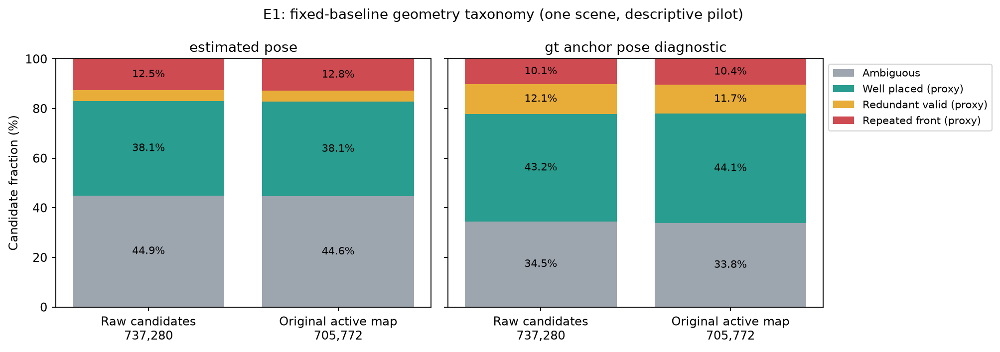
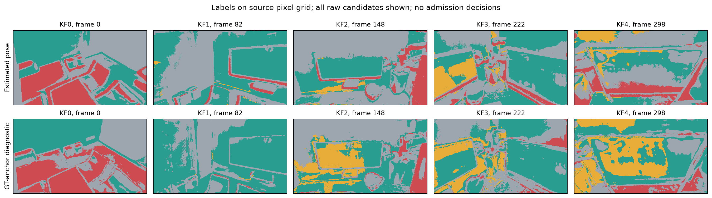
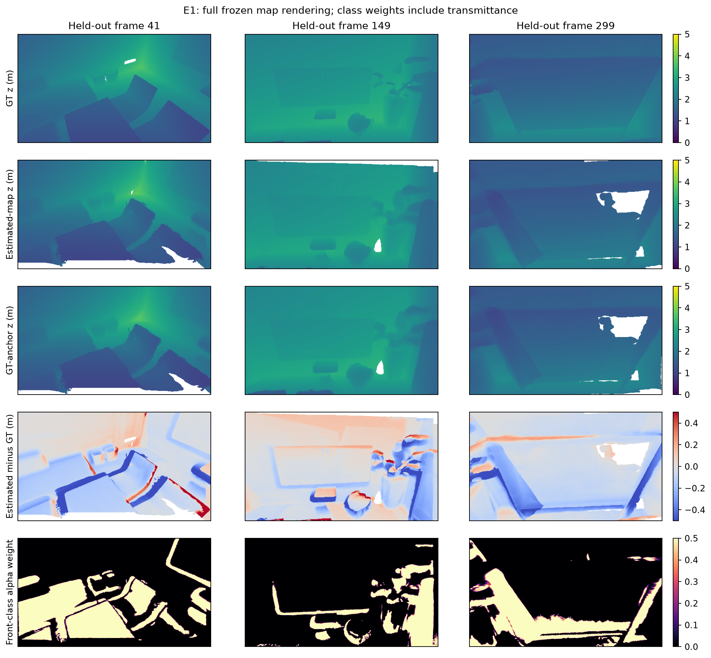

# 실험 보고서: E1 — Frozen-baseline error taxonomy

## 결론

**E1 단일 장면 파일럿을 완료했다.** 원본 active Gaussian 705,772개 중 반복 front 오류 proxy는 **90,376개(12.81%)**였고, GT anchor pose 진단에서도 **73,077개(10.35%)**가 남았다. 두 pose 조건 모두에서 같은 라벨인 후보는 **39,907개(5.65%)**다. GT 회전·이동으로 바꿔도 오류 proxy가 남지만, 예측 depth·Gaussian shape·보존한 anchor scale bias를 분리한 결과는 아니다. 엄밀한 실제 floater 개수로 간주해서는 안 된다.

180개 held-out 시점에서 원본 맵의 rendered-depth MAE는 **0.09966m**, 단순 coverage는 **89.97%**, 허용 깊이 오차까지 만족한 coverage는 **40.04%**였다. 표면 앞 오류 proxy 집합은 전체 합성 가중치의 **19.37%**를 기여했다(프레임별 비율의 평균). 중심 위치의 작은 진단 오차만 있는 것으로 보기 어렵고, 표현 공백과 깊이 부정확성도 함께 관측된다.

**다음 판단은 “E2 판별력 비교를 준비할 근거 확보, pose 민감도와 반복 관측 가용성은 별도 해결 필요”**다. 새 필터의 제거 정확도나 개선 효과를 입증한 결과가 아니며, E0b에서 동시 2개 source-disjoint 관측이 없었던 문제도 해소하지 않는다.

## 목적과 범위

- 날짜: **2026-10-20 (Asia/Seoul)**
- 계획서: [v3 §8, §9.3, §10.2](../surface_guided_gaussian_mapping_research_plan_v3.md), 선행 실험: [E0b](E0b_ancestry_causality_audit.md).
- E0b 확장 실행의 고정 Gaussian 후보를 GT depth와 비교하여 **표면 앞 오류 proxy / 표면에 맞는 후보 / 유효하지만 중복된 후보 / 관측 부족 또는 모호한 후보**로 분해한다.
- Gaussian 중심만으로 floater를 확정하지 않도록 중심·3σ z-envelope·화면 footprint·실제 full-map 합성 기여도·렌더링 깊이를 구분한다.
- Baseline의 tracking, KF 선택, 후보, 원본 admission, pose graph, refiner 및 맵을 변경하지 않는다. GT는 평가 프로세스에서만 사용한다.
- 한 장면의 기술적 파일럿이다. 새로운 admission 정책, 원본 논문 성능 재현, 통계적 유의성 또는 연구 전체 GO를 검증하는 실험이 아니다.

## 고정한 조건과 데이터 분리

설정은 [e1_taxonomy.json](../../configs/e1_taxonomy.json)에 **E1 수치 측정 전에 고정**했다. 정식 성능 사전등록이나 개발/검증으로 최적화한 임계값은 아니다. 사후 선택을 피하기 위해 절대 오차 2/5/10cm의 민감도도 함께 계산한다.

| 항목 | 조건 |
|---|---|
| 기준선 | E0b `extended`: office0, 짝수 원본 프레임 `[0,360)`, 180입력 |
| 원본 코드 | Splatt3R-SLAM `74ffc37454dfa7560c9531b1534825c54c36a89e` + 기존 E0/E0b 패치 |
| KF / 원본 frame IDs | 5개 / 0, 82, 148, 222, 298 |
| 고정 후보 / 원본 active | 737,280 / 705,772 |
| 원본 필터 | local z >0.05, depth percentile 0.98, max scale <1, confidence ≥1.5, opacity >0.3, stride 1 |
| 평가 pose | 최종 revision 188; mapping 입력 180개 camera center만으로 GT에 단일 Sim(3) 정렬 |
| 해상도 | 1200×680 → 512×290 resize → 512×288 crop |
| GT depth | 공식 NICE-SLAM rendered Replica, uint16 / 6553.5, 유효 범위 0.1–10m |
| 후보 라벨용 GT | 짝수 원본 0,20,…,340과 KF 원본 ID의 합집합: 22개 시점 |
| 렌더링 평가 GT | 홀수 180개 전체: 기존 validation 1–39, 기존 held-out test 41–119, 확장 held-out diagnostic 121–359 |
| GT 표면 cloud | 라벨용 GT depth의 유효 내부 픽셀을 stride 4로 역투영 |
| seed | 0; 재검토용 예시 후보 추출에만 사용 |
| 환경 | 기존 E0 `.venv`; 새 패키지 설치 없음. 환경·모델 명세는 [E0](E0_baseline_reproduction.md), 실행별 버전은 `run_manifest.json` |

GT depth는 `data/E1/Replica`에 별도로 준비했다. 기존 RGB·초기 GT를 재사용하고, 필요한 202개 GT 시점(22개 라벨용 + 180개 렌더링용)이 모두 있는지 확인한다. 추가로 로컬에 있던 깊이 파일은 보관하지만 라벨용 시점을 늘리는 데 사용하지 않는다. [다운로드 명세](../../configs/e1_replica_download_manifest.json)의 CRC/SHA-256을 대조하고 RGB가 E0b 데이터와 동일한지 검사한다. 원본 12.44GB ZIP 전체는 받지 않는다.

**홀수 RGB·GT는 후보 라벨, 정렬, 임계값 선택, map update에 사용하지 않는다.** 홀수 GT는 최종 렌더링 평가에만 사용한다. 입력 바로 다음 홀수 프레임이므로 독립적인 off-axis novel-view 시험이라고 주장하지 않는다.

## 후보 라벨 정의

각 후보를 22개 GT 시점에 투영한다. 유효한 GT와 대응하고 깊이 경계에서 벗어난 경우만 판정에 사용한다. 깊이 차이가 `max(0.05m, 0.02 × GT depth)`를 넘는 인접 픽셀을 경계로 잡고 2픽셀 팽창한다. 영상 테두리 2픽셀과 GT 미기록 인접 영역도 보호한다.

관측별 허용 오차는 `τ=max(0.05m, 0.02 × GT depth)`이다. 후보의 camera z를 `z`, 해당 방향의 표준편차를 `σz`, GT depth를 `D`라 하면:

- **Center front:** `z < D−τ`.
- **Ellipsoid front:** `z+3σz < D−τ`. 중심뿐 아니라 3σ z 범위까지 표면 앞에 놓인다.
- **Support:** center 또는 z-envelope가 허용 표면 구간과 겹친다.
- **Behind:** 표면 뒤에 있다. 가림 가능성이 있으므로 이것만으로 오류라고 하지 않는다.

이 관측들을 합쳐 다음 라벨을 만든다.

| 라벨 | 조건과 해석 |
|---|---|
| `repeated_front_error_proxy` | center와 ellipsoid 모두 ≥2개 관측에서 front, support 0개. 처음 front였던 시점과 다른 front 시점의 관측각 차이 ≥1°도 요구 |
| `well_placed_proxy` | center support ≥1개, center front 0개. 아래 중복 조건에 해당하지 않음 |
| `redundant_but_valid_proxy` | 위의 표면 정합 후보 중, 이전 KF의 유효 후보와 중심 거리 ≤2cm이고 가까운 GT surfel 법선 차이 ≤20°. 같은 KF 내부는 중복 검사에서 제외 |
| `unobserved_or_ambiguous` | GT 대응 없음, 경계/얇은 구조, 가림만 확인, 상충 관측 또는 center만 앞이고 ellipsoid까지 확정되지 않는 경우 등 |

**라벨의 한계:** 3σ z-envelope는 중심 ray에서의 보수적 진단이다. Gaussian footprint 전체의 가림을 증명하거나 Gaussian 하나를 제거해도 렌더링이 보존됨을 증명하지 않는다. 표면 정합 역시 모든 시점에서 정상이라는 보증이 아니다. 중복 라벨은 공간적 redundancy proxy이며, 정상 후보를 버릴 근거로 자동 전환하지 않는다. 관측 부족은 오류에 합치지 않는다.

Nearest-GT distance는 경계를 제외한 **관측된 GT 표면 샘플 cloud까지의 거리**다. 완전한 GT mesh distance나 엄밀한 floater label이 아니다. 이 거리가 크다는 이유만으로 front 오류를 부여하지 않는다.

## 중심·크기·합성 깊이의 분리

1. **Center proxy:** nearest sampled GT distance와 중심만의 반복 front 개수.
2. **Extent / footprint proxy:** 3σ z-envelope를 고려한 front 라벨과 `opacity × 2π√det(JΣJᵀ+0.3I)`의 시점별 최대값. 이 footprint는 선형 근사이며 영상 경계 clipping과 다른 Gaussian의 transmittance를 포함하지 않는다.
3. **Rendered geometry:** 원본 전체 맵의 alpha-weighted expected z와 GT depth 비교. coverage는 compositing weight >1e-3, depth-correct coverage는 전체 유효 GT 중 깊이까지 허용 오차 안에 들어온 비율이다. 단순 coverage와 정확한 표면 표현을 구분한다.
4. **실제 합성 기여:** 전체 Gaussian을 그대로 두고 front-class indicator를 색으로 렌더링한다. 따라서 이 집합의 alpha 기여는 다른 Gaussian에 의한 transmittance를 포함한다. class별 기여 합이 전체 compositing weight와 일치하는지 검사한다. 집합 수준 기여이며, 각 픽셀의 오류 원인을 특정 후보 하나로 확정한 값은 아니다.

깊이 MAE/AbsRel은 렌더링된 유효 GT 픽셀에서만 계산한다. Coverage·depth-correct coverage·미표현 비율은 전체 유효 GT가 분모다. 깊이 경계 보호 영역과 내부 영역도 따로 집계한다. 모든 프레임 결과와 프레임별 단순 평균을 저장하며 KF/픽셀을 독립 반복 시행으로 취급하지 않는다.

## Pose와 원본 맵 무결성

- Primary: 최종 추정 pose와 단일 Sim(3) 정렬을 사용한다.
- GT-anchor diagnostic: 각 anchor의 회전·이동을 GT pose로 대체하되, 예측 anchor scale × 단일 정렬 scale을 유지한다. GT depth를 보고 KF별 scale을 다시 맞추지 않는다. 후보 집합과 원본 active mask는 동일하다.
- 원본 TF32 GPU bake를 재실행해 후보 순서·중심·covariance·opacity를 저장 PLY와 대조한다. CPU 고정밀 Sim(3) 배치와 TF32 저장 좌표의 차이는 별도로 기록한다.
- Active 후보의 primary 라벨은 **실제 PLY 파라미터**로 평가한다. 원본 필터가 제외한 raw 후보의 배치는 CPU Sim(3) 진단이다. Raw/active 분모와 중복 이력은 각각 계산한다.
- E1 평가용 카메라는 정확한 resize/crop 후 fx/fy/cx/cy를 사용한다. 동일 upstream CUDA rasterizer를 호출하되, projection matrix에 principal point를 반영했다. 이전 E0 helper의 중심 주점 가정과 차이가 있어 E0 표의 수치와 직접 성능 비교하지 않는다. 5픽셀 주점 이동의 GPU 합성 검사를 포함한다.

## 결과

### 1. 전체 후보와 active 후보의 taxonomy

| 유형 | 추정 pose, active 705,772개 | GT-anchor 진단, 같은 active 집합 |
|---|---:|---:|
| 반복 front 오류 proxy | **90,376 (12.81%)** | **73,077 (10.35%)** |
| 표면 정합, 비중복 proxy | 268,883 (38.10%) | 311,415 (44.12%) |
| 표면 정합, 중복 proxy | 31,441 (4.45%) | 82,380 (11.67%) |
| 미관측 또는 모호 | 315,072 (44.64%) | 238,900 (33.85%) |

737,280개 **raw 전체**에서 front 오류 proxy는 추정 pose 92,498개(12.55%), GT-anchor 진단 74,572개(10.11%)였다. 원본 필터를 통과한 집합에서도 이 비율이 사라지지 않았다. Raw와 active의 중복 판정은 각 집합의 이전 유효 후보 이력을 별도로 사용했다.

추정 pose에서 center만으로 반복 front를 세면 136,567개(19.35%)다. 그중 **46,191개는 extent까지 고려한 front로 확정되지 않는다.** 이를 오류 개수에 합치지 않고 모호한 후보로 남겼다. 최소 한 개의 유효 GT-view 판정을 확보하지 못한 active 후보는 37,351개(5.29%)였다. 따라서 44.64%의 모호 라벨 전체가 단순히 GT 범위 밖이라는 뜻은 아니다.

Nearest sampled GT surface distance의 active 중앙값/p95는 추정 pose **5.61/15.71cm**, GT-anchor 진단 **4.61/13.89cm**였다. 표면 cloud는 경계를 제외한 180,735개 샘플이며, stride 4의 이산 샘플링 오차를 포함한다. 완전한 mesh distance나 outlier 비율로 읽지 않는다.



### 2. Pose·임계값 민감도

단일 Sim(3) scale은 **1.07833216**, 180개 mapping camera center의 정렬 ATE RMSE는 **3.05cm**, p95는 **6.13cm**였다. 두 pose arm에서 4개 유형 중 라벨이 달라진 active 후보는 **45.40%**다. 이 수치에는 표면 정합↔중복 전환도 포함된다. Front 여부만의 전환은 **83,639개(11.85%)**다.

추정 pose front 90,376개 중 GT-anchor에서도 front인 것은 39,907개이고, **19,129개는 GT-anchor에서 표면 정합/중복으로 바뀐다.** 추정 pose의 GT 비교 라벨을 pose와 무관한 Gaussian 자체의 정답 label로 쓰면 오해가 생긴다. E2는 두 arm을 분리해 보고하고, 양쪽에서 일치하는 후보 집합도 별도 진단해야 한다.

| 절대 허용 오차¹ | 추정 pose front proxy | GT-anchor front proxy |
|---|---:|---:|
| 2cm | 106,968 (15.16%) | 92,116 (13.05%) |
| **5cm, 주 설정** | **90,376 (12.81%)** | **73,077 (10.35%)** |
| 10cm | 46,798 (6.63%) | 22,912 (3.25%) |

¹ 실제 허용 오차는 항상 `max(표의 절대값, GT depth의 2%)`다. 임계값에 따라 비율은 크게 변하지만, 느슨한 조건과 GT-anchor 진단에서도 front proxy가 남는다. 최적 임계값이나 실제 outlier 유병률을 추정한 결과는 아니다.



색은 회색=모호, 청록=표면 정합, 노랑=중복 proxy, 빨강=front 오류 proxy다. 원본 후보 source pixel grid에 표시한 것으로 GT 영상에 재투영한 segmentation이 아니다. KF0의 넓은 책상 영역과 물체 경계에서 front 라벨이 남고, GT-anchor 진단에서는 뒤쪽 KF의 표면 정합·중복 영역이 크게 늘어난다. 이는 독립 장면 반복 실험이나 사람이 정답으로 확정한 semantic label이 아니다.

### 3. Held-out rendered geometry와 표현 공백

| Arm / 평가 구간 | 프레임 | Depth MAE (m) ↓ | 단순 coverage | Depth-correct coverage |
|---|---:|---:|---:|---:|
| 추정 pose / 기존 validation | 20 | 0.10888 | 99.02% | 44.11% |
| 추정 pose / 기존 held-out test | 40 | 0.09964 | 91.17% | 46.44% |
| 추정 pose / 확장 held-out diagnostic | 120 | 0.09814 | 88.06% | 37.23% |
| **추정 pose / 전체** | **180** | **0.09966** | **89.97%** | **40.04%** |
| GT-anchor / 기존 validation | 20 | 0.09955 | 98.15% | 44.32% |
| GT-anchor / 기존 held-out test | 40 | 0.08878 | 92.07% | 54.47% |
| GT-anchor / 확장 held-out diagnostic | 120 | 0.06982 | 89.22% | 52.41% |
| **GT-anchor / 전체** | **180** | **0.07734** | **90.85%** | **51.97%** |

전체 AbsRel은 각각 **0.04743 / 0.03657**이다. 원본 추정 pose 맵에서 유효 GT의 **10.03%**는 렌더링 coverage가 없었고, coverage가 있더라도 상당 부분은 깊이 허용 오차를 넘었다. “missing”을 후보 개수로 세지 않고, GT 픽셀 수준 표현 공백으로 구분한 이유다.

경계 보호 영역의 depth-correct coverage는 **22.16% / 27.00%**, 내부 영역은 **42.20% / 55.00%**였다. 이 경계 지표는 얇은 구조의 semantic recall을 대체하지 않는다. 깊이와 coverage를 동시에 봐야 하며, 오류 후보를 삭제하면 이 coverage가 유지된다고 결론내릴 수 없다.

Front proxy 집합이 담당하는 **실제 full-map 합성 가중치 비중**은 추정 pose **19.37%**, GT-anchor **15.49%**였다. 평균 alpha weight 자체는 **0.17020 / 0.13783**이다. 이 집합이 화면에 기여하는 것은 확인했지만, 그 기여 전부가 해당 픽셀에서 잘못된 density이거나 안전하게 제거 가능하다는 뜻은 아니다. Class partition 합성 검사 최대 오차는 **7.16e-7 미만**이었다.



위에서부터 GT depth, 원본 추정-pose 맵 depth, GT-anchor 진단 depth, 원본 맵의 signed depth error, front 집합의 실제 alpha 기여다. 깊이·오차 그림의 흰색은 GT 미기록 또는 렌더링 미표현으로 해당 비교에서 제외된 픽셀이다. Alpha 그림은 0.5에서 색 범위를 잘랐다. 오차 그림은 ±0.5m 범위다.

### 4. 검증과 비용

- **전체 테스트 16개 PASS:** source/fusion/causality 기존 검사 7개, 앞/표면/뒤·큰 Gaussian·시차 부재·GT 부재·충돌 관측·얇은 구조·중복 보호·Sim(3)·카메라/footprint 검사, ZIP 목록 파싱·손상 CRC 거부를 포함한다.
- **GPU synthetic PASS:** 앞/뒤 Gaussian 합성 순서와 depth, class 기여, 정확한 5픽셀 주점 이동을 검사했다.
- **실제 baseline GPU 재구성 PASS:** 705,772개 중심 최대 차이 **0**, covariance 최대 차이 **4.66e-10**. Source raw mean과 KF 후보, 최종 revision 188 pose도 각각 정확히 일치했다.
- CPU 정밀 배치와 원본 TF32 PLY의 최대 중심 차이는 평가 좌표에서 **2.56mm**였고, covariance 원소 최대 차이는 **1.57e-6m²**였다. Active 라벨은 실제 PLY로 계산하여 이 차이를 숨기거나 느슨한 identity 검사로 넘기지 않았다.
- CPU taxonomy **18.60초**, GPU 2개 arm × 180시점 렌더링 **15.89초**. 데이터 다운로드·원본 mapper 실행은 제외한다. 원본 맵을 다시 생성하거나 학습하지 않았다. 이는 최종 평가 재실행의 비용이며 독립적인 모델 반복 실험이 아니다.
- 평가 renderer의 PyTorch allocator peak는 allocated 약 **207MiB**, reserved **246MiB**였다. Native rasterizer의 모든 CUDA allocation을 포함한 device-wide peak VRAM이나 온라인 mapping 비용이 아니다.

## 판단과 다음 단계

1. **E1의 목적을 충족하는 오류 분해 및 재검토 가능한 GT proxy를 확보했다.** 중심만의 오차, extent까지 표면 앞인 후보, 정상 표면의 공간적 중복, 모호 영역, 픽셀 수준 missing을 구분했다.
2. **판별할 문제는 남아 있다.** GT-anchor 진단과 10cm 허용 오차에서도 front proxy가 남고, full-map 깊이·coverage 오류도 관측된다. 다만 관측 비율을 엄밀한 floater 정답 비율로 확대하지 않는다.
3. **E2에서는 pose 민감도를 주 결과와 함께 보고한다.** 두 arm, 공통 front 집합, 표면 정합 보호 집합을 구분하고 confidence/self/B6/B7/B8/P1의 식별력을 같은 후보에 비교한다. GT 라벨은 평가에만 사용한다.
4. **E0b의 실행 가능성 제한은 그대로다.** 이번 GT 22시점은 평가용이며 실제 gate의 raw 관측 풀이 아니다. 반복 REJECT를 시험하려면 더 긴/재방문 구간이나 관측 풀 확장으로 동시에 ≥2개의 유효 source-disjoint 관측을 먼저 확보해야 한다.
5. **미측정:** 완전한 GT mesh distance, per-candidate strict floater oracle, TSDF accuracy/completeness, semantic thin-structure recall, 새 admission의 false rejection·정상 보존·memory 이득, 추가 장면 통계. 이들을 측정했다고 주장하지 않는다.

## 재현 명령과 산출물

프로젝트 루트에서:

```bash
python3 -u scripts/download_e1_gt.py --workers 16
bash scripts/run_e1.sh check
bash scripts/run_e1.sh analyze
bash scripts/run_e1.sh render
bash scripts/run_e1.sh plot
OMP_NUM_THREADS=2 MKL_NUM_THREADS=2 .venv/bin/python -m unittest discover -s tests -v
```

다운로더는 ZIP 중앙 목록을 한 번만 병렬 전송·캐시하고, 작업자들이 목록을 공유한다. GPU check/render는 GPU에 접근 가능한 실행 환경에서 수행한다. CPU 분석·테스트·그림은 GPU를 사용하지 않는다. 설정이 달라진 결과 경로에 덮어쓰는 것은 거부한다.

- [후보 taxonomy 소형 요약](../../configs/e1_results_summary.json), [렌더링 소형 요약](../../configs/e1_render_results_summary.json)
- [입력·분석 코드 명세](../../configs/e1_code_manifest.json), [GPU 렌더링 명세](../../configs/e1_render_manifest.json)
- [최종 입력·라벨·렌더링 연결 무결성 검사](../../configs/e1_validation.json)
- `results/E1_error_taxonomy/taxonomy_summary.json`, `render_metrics.json` (180개 시점 × 2개 arm)
- `candidate_labels.npz`: 원본 event + pixel index로 복원 가능한 전체 후보 ID, raw/active 라벨, confidence, GT 대응·front/support/behind 개수, center distance, footprint proxy
- `candidate_examples.json`: seed 0으로 뽑은 유형·KF별 재검토 예시와 GT 대응 정보
- `baseline_gpu_integrity.json`, `run_manifest.json`, `render_manifest.json`, `specification.json`, `code/`, `logs/`
- `render/*.npz`, `figures/*.png`, `figures/*.pdf`

공유용 그림과 PDF는 [docs/figures/E1](../figures/E1)에 별도로 보관했다.

대형 결과·데이터는 Git에서 제외하고, 보고서·설정·코드·소형 요약·선별 그림은 추적한다. 이번 작업에서는 commit을 만들지 않는다.
