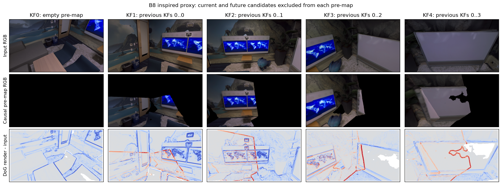
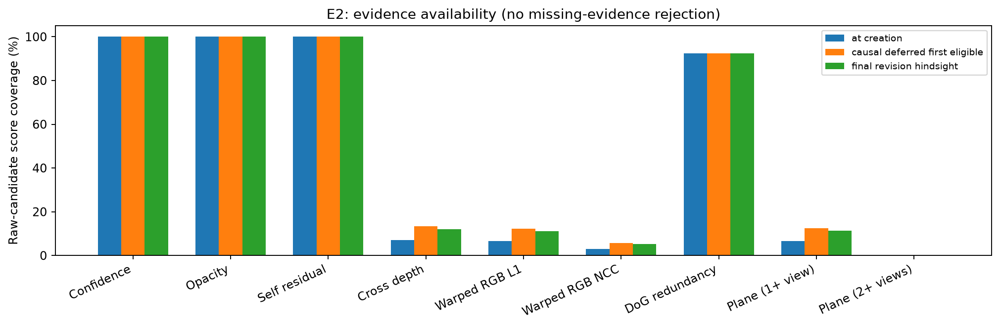
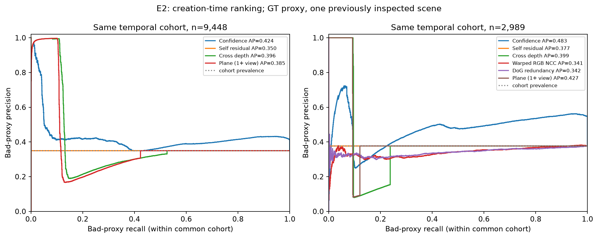
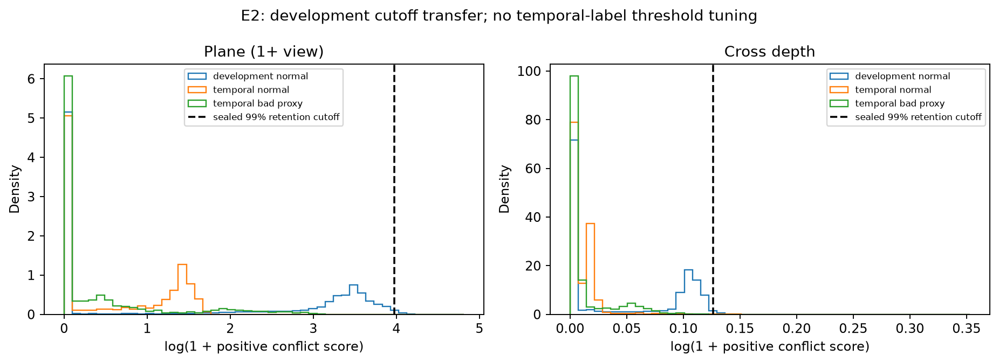

# 실험 보고서: E2 — Signal discriminability

## 결론

- 날짜: **2026-10-20 (Asia/Seoul)**
- 상태: **E2 단일 장면 점수 비교 파일럿 완료. E3/E4 진행 판단은 보류(REVISE).**
- [v3 §7–8, §10](../surface_guided_gaussian_mapping_research_plan_v3.md)의 B2/B5/B6/B7/B8/P1 비교를 같은 고정 후보에 수행했다. [E1](E1_error_taxonomy.md)의 GT proxy와 pose 민감도를 이어받고, 생성 당시 pose에 맞춘 평가 라벨도 추가했다.
- 모든 신호를 계산할 수 있는 좁은 시간 분할 공통 집합에서 P1 1-view 진단의 AP는 **0.4268**, B6 깊이 **0.3995**, B7 NCC **0.3414**, B8 DoG **0.3424**였다. 그러나 **confidence가 0.4830으로 더 높았다.**
- 더 넓은 기하 공통 집합에서는 **P1 0.3847 < B6 0.3964 < confidence 0.4239**였다. P1의 점수 이득은 선택된 작은 영역에 한정되며 일관된 우위가 아니다.
- 개발 KF에서 정상 보존율 99%를 목표로 정한 P1 임계값을 마지막 KF에 적용하면 **거절 0개, bad recall 0%, 정밀도 미정의**였다. 정상 보존율 100%는 아무것도 거절하지 않은 결과다. 95% 목표에서도 P1 거절은 0개였다.
- **동시에 2개 이상의 유효 source-disjoint plane 관측을 가진 후보는 생성·보류 후·최종 진단 모두 0개**였다. 반복 관측에 근거한 admission은 검증할 수 없었다.
- GT-anchor 라벨로 바꾸면 좁은 공통 집합에서 **P1 0.0919 < B6 0.1349**가 된다. E1 두 pose 조건이 모두 bad인 후보는 이 좁은 집합에서 **0개**여서 AP가 미정의다.

**판단:** 제한된 교차관측 영역의 ranking 단서는 있지만, confidence 대비 추가 이익·전이 가능한 거절 운영점·반복 관측 조건을 확보하지 못했다. 새 admission 정책의 성공, 통계적 독립성 또는 연구 전체 GO를 주장하지 않는다.

## 고정 조건과 데이터 분리

| 항목 | 조건 |
|---|---|
| 기준선 | E0b extended, Replica office0, 180입력 / 5-KF |
| 원본 코드 | Splatt3R-SLAM `74ffc37454dfa7560c9531b1534825c54c36a89e` + 기존 E0/E0b 패치 |
| 후보 | 737,280개 raw self-branch 전체; 원본 active 705,772개는 별도 민감도 분석 |
| 후보 식별 | 원본 prediction event + `self` + source pixel index; 후보 생성·tracking·원본 필터 변경 없음 |
| 점수 계산 pose | 생성 decision snapshot revision **1, 43, 78, 117, 157**. 종료 후 revision 188은 별도 진단만 |
| 관측 풀 | 5개 KF의 **raw self-branch pointmap**. Fused map을 출처가 분리된 자료로 간주하지 않음 |
| 개발 분할 | KF0–3: original frames 0, 82, 148, 222 |
| 시간 평가 분할 | KF4: original frame 298, raw 147,456개 / active 135,701개 |
| 주 GT proxy | E1의 22개 짝수 GT 시점·마스크·허용 오차를 유지하고, 후보를 **생성 당시 pose**에 배치해 재평가 |
| 라벨 민감도 | E1 final estimated / GT-anchor / 두 pose에서 bad 또는 normal이 일치하는 집합 |
| score 방향 | 클수록 오류 또는 중복 의심; 관측 부재는 **NaN**으로 보관 |
| 환경 | 기존 E0/E1 `.venv`, RTX 5060. 새 모델 실행·학습·패키지 설치 없음 |

[e2_discriminability.json](../../configs/e2_discriminability.json)의 점수·마스크·분할·운영점·공통 집합·기술적 진행 기준을 **E2 수치 측정 전에 고정**했다. E1에서 이미 본 단일 장면을 재사용했고, KF 간 원본 이미지와 GT 평가 시점도 겹친다. 이 시간 분할은 독립적인 미관측 장면 test나 통계적 반복 시행이 아니다.

**점수 추출과 GT 평가를 프로세스로 분리했다.** Feature 단계에서 GT depth/trajectory/intrinsics/E1 label 읽기를 금지하고 실제 파일 읽기 거부 테스트를 넣었다. Final local KF dump에서는 불변 image/head output만 사용하고, 그 안의 final `T_WC`는 버린다. 점수에 쓰는 pose는 해당 snapshot에서 가져온다. GT·E1 정렬은 이후 평가 라벨 생성에만 사용한다. 홀수 held-out RGB·GT를 점수·임계값 설정에 사용하지 않았다.

주 평가의 bad는 E1과 같은 **반복 GT-front + 3σ extent 조건**을 만족한 후보(code 3), normal은 GT 표면 지지를 받는 후보(code 1 또는 2), ambiguous는 평가에서 제외한다. 생성 pose 라벨은 중복 subclass를 나누지 않으며 정상 후보를 모두 code 1로 둔다. 주 시간 평가 집합은 **bad 27,231 / normal 40,400 / ambiguous 79,825**다. E1 최종 라벨과 숫자가 다른 이유는 생성 시점과 최종 pose 배치가 다르기 때문이다.

## 비교한 신호

| 방법 | 구현과 해석 |
|---|---|
| B2 confidence / opacity | 각각 `−confidence`, `−opacity`. 확률로 해석하지 않음 |
| B5 self residual | 동일 raw prediction의 Gaussian mean과 pointmap 간 거리 / pointmap 거리 |
| B6 depth front proxy | 다른 출처의 예측 ray와 대응시켜 `(관측 거리−후보 거리−3σray)/관측 거리`의 양수 부분 |
| B7 RGB L1 / NCC region proxy | source 5×5 pointmap patch를 해당 시점의 상대 Sim(3)로 warp하고 상대 raw ray에 대응. sample별 depth/angle/confidence/occlusion mask 후 RGB L1 또는 `1−NCC` |
| B8 DoG redundancy proxy | `DoG(이전 맵 render)−DoG(입력 RGB)`. 클수록 새로 추가할 필요가 적은 영역이라는 진단 |
| P1 plane front, 1+ view | 신뢰 가능한 5×5 raw patch의 PCA plane을 향한 signed front 잔차에서 3σnormal을 빼고 local 3D spacing으로 정규화한 양수 부분 |
| P1 plane front, 2+ views | 같은 snapshot에서 위 관측이 최소 2개인 경우만 점수 부여 |

**B5는 모든 후보에서 정확히 0이었다.** 실제 저장 데이터의 Gaussian mean과 raw pointmap이 정확히 같았다. 상수 점수의 AP는 그 평가 집합의 bad 비율이며, 판별력으로 해석하지 않는다.

교차 신호는 후보 source와 관측 source의 원본 이미지가 겹치지 않아야 한다. Confidence ≥1.5, ray 각도 ≤1°, 시차 ≥1°를 요구하고, raw depth 경계와 가림을 마스킹한다. 뒤에 숨은 후보나 관측 부재를 front 오류로 만들지 않는다. Plane은 최소 9개 점, `λsmall/λmiddle≤0.1`, `λmiddle/λlarge≥0.05`의 patch 조건도 요구한다.

B7은 최소 60% patch sample을 확보해야 하며, NCC는 양쪽 luminance 표준편차 ≥0.01도 요구한다. **후보 중심의 주변 영역 신호를 후보 ID에 연결한 region proxy**다. 그 Gaussian 하나의 실제 photometric 책임을 분리한 oracle로 부르지 않는다. B6/B7은 GeoGS-A의 전체 학습/최적화 loss 재현이 아니다.

여러 관측이 있는 경우 같은 snapshot의 유효 관측 점수 중앙값을 사용한다. 1-view P1은 판별력 진단이며, 관측 한 개만으로 실제 REJECT를 허용한 정책이 아니다. 두 관측이 있어도 서로 이미지나 모델 bias를 공유할 수 있어 통계적 독립성을 보장하지 않는다.

### B8의 실제 과거 맵 재구성

저장된 decision snapshot에서 **현재 KF보다 앞선 KF만** 원본 필터로 bake했다. 각 후보 생성 당시의 map prefix와 pose를 사용하며, current/future Gaussian 및 final PLY를 사용하지 않았다.

| 현재 후보 KF | 포함한 KF | 원본 active Gaussian | pose revision |
|---|---|---:|---:|
| 0 | 없음 | 0 | 1 |
| 1 | 0 | 142,432 | 43 |
| 2 | 0, 1 | 286,208 | 78 |
| 3 | 0, 1, 2 | 430,531 | 117 |
| 4 | 0, 1, 2, 3 | 570,071 | 157 |

원본 SH residual + 저장된 노출 정규화 RGB, 원본 TF32 bake, 같은 CUDA rasterizer를 사용한다. 카메라는 **현재 예측 pointmap ray만으로** pinhole surrogate를 fit하고, 렌더링을 원래 predicted-ray grid로 다시 sample했다. GT calibration은 넣지 않았다. KF별 ray fit median은 약 **0.045–0.092°**, p95는 **0.138–0.220°**였다.

로컬 GeoGS-B 논문 §III-C, Eqs. 6–7을 확인하여 DoG σ=**0.5, 1.5**를 사용했다. RGB 채널 DoG의 L2 norm을 쓰며 probability calibration을 추가하지 않는다. 새 후보를 원 논문처럼 다시 생성하거나 VGGT·joint optimizer를 재현하지 않고, 같은 고정 후보의 **중복/삽입 필요성 점수**로 변환한 inspired proxy다.



## 평가·임계값 규칙

- **주 ranking 지표는 AP**, 즉 동점 score block을 묶은 step PR area다. Trapezoidal PR-AUC도 JSON에 보관하지만 상수 점수에서 생기는 선형 보간 착시를 피하기 위해 주 지표로 쓰지 않는다.
- 각 방법의 **자기 평가 가능 집합**과, 같은 후보 ID에서 모든 방법을 계산할 수 있는 **공통 집합**을 분리한다. 서로 다른 집합의 AP를 그대로 방법 간 순위로 비교하지 않는다. 각 집합의 bad prevalence도 함께 저장한다.
- 정상 보존율 목표는 99%와 95%. 개발 KF의 **유효 normal score quantile**을 `higher` 방식으로 구하고, **score > threshold**일 때만 거절한 것으로 계산한다. 동점·관측 없음은 유지한다.
- 임계값을 `thresholds_development_only.json`에 먼저 저장한 후 시간 평가 성능을 계산한다. 시간 평가 라벨을 보고 임계값을 다시 맞추지 않았다. E1 라벨 민감도에도 같은 임계값을 재사용한다.
- Precision은 GT 판정 가능한 거절 중 bad 비율, bad recall은 해당 시간 분할 전체 GT bad 대비 비율이다. 관측이 없는 후보도 포함한 전체 normal 보존율과, 관측이 있는 normal에 한정한 보존율을 함께 기록한다. **판정 불명 후보의 거절은 별도 개수**로 남기며 정상/오류로 임의 변환하지 않는다.
- 실제 map을 삭제하지 않은 점수·운영점 진단이다. E3 causal admission replay, budget matching, 렌더링 품질 개선 실험을 수행한 결과가 아니다.

## 결과

### 1. 점수를 계산할 수 있는 후보 비율

| 방법 | 생성 시점 전체 raw 중 score 가용 | 마지막 KF 중 score 가용 |
|---|---:|---:|
| B2 confidence / opacity | 100% | 100% |
| B5 self residual | 100% | 100% |
| B6 depth front | 51,996 / **7.05%** | 11.46% |
| B7 warped RGB L1 | 48,209 / **6.54%** | 10.43% |
| B7 warped RGB NCC | 21,667 / **2.94%** | 3.84% |
| B8 DoG | 681,672 / **92.46%** | 88.90% |
| P1 plane, 1+ view | 48,374 / **6.56%** | 9.92% |
| P1 plane, 2+ views | **0 / 0%** | **0%** |



새 KF가 올 때만 재평가하고 방법별 **처음 유효해진 시점의 score를 잠그는** 보류 진단에서는 P1이 91,886개(**12.46%**), B6 98,386개(**13.34%**), B7 NCC 41,927개(**5.69%**)까지 늘었다. 하지만 P1 2-view는 여전히 0개다. 유효해진 후보만의 지연 p95는 입력 75프레임이며, 끝내 P1이 가용하지 않은 비율은 **87.54%**였다. 지연 0인 후보도 포함한 조건부 통계다.

Confidence/self/DoG는 생성 시점 점수를 유지하고 cross-view 점수만 재평가했다. 같은 후보라도 방법별 최초 유효 시점이 달라, 보류 진단을 생성 시점의 동시 조건 비교와 섞지 않는다. 마지막 평가 KF4 이후에는 새 KF가 없으므로 그 KF의 보류 결과는 생성 시점과 같다. 최종 revision 진단도 별도 저장하며 시간 전체 가용성의 상한으로 해석하지 않는다.

### 2. 같은 후보 집합에서의 AP

**넓은 기하 공통 집합:** 마지막 KF raw 147,456개 중 score 공통 14,627개, 그중 GT 라벨이 있는 **9,448개(bad 3,304 / normal 6,144)**다.

| 방법 | AP |
|---|---:|
| B2 confidence | **0.4239** |
| B5 self, 상수 점수 / 집합 bad prevalence | 0.3497 |
| B6 depth | **0.3964** |
| P1 plane, 1+ view | **0.3847** |

**모든 신호의 좁은 공통 집합:** raw score 공통 **4,986개(시간 평가 raw의 3.38%)**, GT 라벨이 있는 **2,989개(bad 1,127 / normal 1,862)**다.

| 방법 | AP |
|---|---:|
| B2 confidence | **0.4830** |
| B5 self, 상수 점수 / 집합 bad prevalence | 0.3770 |
| B6 depth | 0.3995 |
| B7 NCC region | 0.3414 |
| B8 DoG redundancy | 0.3424 |
| P1 plane, 1+ view | **0.4268** |

P1은 좁은 집합에서 B6보다 **+0.0274**, NCC보다 **+0.0854**였다. 설정에 미리 쓴 **“이 공통 집합에서 B6/B7 대비 AP +0.02, 최소 표본/coverage, 전체 정상 보존 99%”라는 제한적 기술 기준은 충족**했다. 다만 이 기준은 confidence 우위나 유효 bad recall을 요구한 연구 전체 GO가 아니다. Confidence가 더 높고 넓은 집합에서 P1 이득이 없어, 이를 P1의 일반적인 개선으로 해석하지 않는다.

원본 active 후보만 비교한 좁은 공통 집합에서도 **confidence 0.5374 > P1 0.4899 > B6 0.4587**, 넓은 집합에서는 **confidence 0.4315 > B6 0.4240 > P1 0.4089**였다.



그림은 동점 score의 step AP와 일치하는 계단 방향을 사용한다. 상수 self 점수의 AP는 prevalence와 같으며, 상수 점수가 recall 전체에서 precision 1을 유지하는 것으로 표시하지 않는다.

### 3. 정상 보존 목표 임계값의 전이

개발 구간에서 99% 정상 보존을 목표로 고정한 임계값을 마지막 KF에 적용한 결과다. **목표 보존율을 평가 구간에서 달성했다고 가정하지 않고 실제 보존율을 측정했다.**

| 방법 | bad 거절 | normal 오거절 | 판정불명 거절 | 정밀도¹ | 전체 정상 보존 | 전체 bad recall |
|---|---:|---:|---:|---:|---:|---:|
| B2 confidence | 349 | 2,492 | 4,217 | 12.28% | **93.83%** | 1.282% |
| B6 depth | 1 | 15 | 114 | 6.25% | 99.96% | 0.0037% |
| B7 RGB NCC | 73 | 148 | 89 | 33.03% | 99.63% | 0.268% |
| B8 DoG | 82 | 132 | 931 | 38.32% | 99.67% | 0.301% |
| P1 plane, 1+ view | **0** | **0** | **0** | **미정의** | **100%** | **0%** |

¹ 판정 가능한 거절만 분모다. 판정불명 후보의 안전한 제거를 입증한 정밀도가 아니다. 관측 가용 normal에 한정한 보존율은 B7 NCC **92.86%**, 전체 normal에서는 99.63%다. 낮은 coverage가 높은 전체 보존율로 보이는 효과를 숨기지 않는다.

P1의 개발 normal score 99분위수 기반 임계값은 **52.230**이었지만, 시간 평가의 유효 score 최댓값은 **37.589**였다. 정상 보존 95% 목표의 임계값 **42.361**도 모든 시간 평가 score보다 높았다. 따라서 두 운영점 모두 아무것도 거절하지 않았다. 구간 사이의 score 분포 차이로 봉인된 절대 임계값이 작동하지 않았다. 국소 간격 정규화·예측 표면 bias·시야/장면 차이의 원인은 분리하지 않았다. 평가 결과에 맞춰 임계값을 낮춰 성공 사례로 바꾸지 않았다.



### 4. GT proxy 선택의 영향과 DoG의 목적 차이

같은 좁은 raw 공통 집합에서도 평가 라벨에 따라 결과가 달라진다.

| GT proxy | bad / normal | Confidence AP | B6 AP | P1 AP |
|---|---:|---:|---:|---:|
| 생성 당시 pose, 주 평가 | 1,127 / 1,862 | 0.4830 | 0.3995 | 0.4268 |
| E1 최종 추정 pose | 1,461 / 1,834 | 0.5434 | 0.4499 | 0.4787 |
| E1 GT-anchor | 72 / 3,121 | 0.5778 | **0.1349** | **0.0919** |
| E1 두 pose 공통 판정 | **0 / 613** | 미정의 | 미정의 | 미정의 |

GT-anchor 진단에서는 bad 표본이 적고, 두 pose 공통 bad는 이 영역에 없다. 좁은 영역에서 보인 P1 ranking 이득을 pose에 강건한 outlier 식별력으로 주장할 수 없다. GT-anchor는 E1과 마찬가지로 예측 anchor scale을 유지한다.

B8은 원래 기하 outlier보다 **중복 삽입 억제**를 겨냥한 신호다. E1 final 라벨 중 시간 평가의 유효 normal을 중복/비중복으로 나누면, B8의 중복 AP는 **0.3116**, 그 집합의 중복 비율은 **0.2684**였다. 작은 기술적 ranking 단서는 있지만, 이를 충분한 중복 제거·메모리 절감이나 geometry 개선으로 바꿔 부르지 않는다. GT 중복 라벨 자체도 공간적 proxy다.

## 검증·비용·산출물

- **테스트 25개 PASS:** 기존 16개와 E2의 source overlap/future 거부, GT·최종 trajectory 읽기 차단, 같은 pose의 시차 부재, occluded 후보의 오류 증거 금지, front plane·RGB warp, 예측 ray 카메라 fit, 누락 score 보존, 동점 AP, strict calibration tie 보호, 상수 DoG 검사를 포함한다.
- Feature 파일, snapshot sequence/revision/source, 후보 row identity, 실제 B8 prefix, GT label 연결을 hash로 남겼다. 최종 검증에서 **개발 normal 임계값 108건**, **별도 sklearn AP 구현과 48건 비교**, GT 없는 점수 재계산의 배열 해시 일치를 확인했다.
- 최종 CPU score **30.65초**, 5개 GPU pre-map 렌더링 **1.46초**, GT 평가·metric **11.55초**였다. 모델 실행이나 온라인 system latency가 아니다. 최종 실행별 실제 시간은 각 manifest에 저장했다.
- [설정](../../configs/e2_discriminability.json), [평가 결과 전체 소형 JSON](../../configs/e2_results_summary.json), [출처·코드·GPU·평가 명세](../../configs/e2_code_manifest.json), [최종 무결성 검사](../../configs/e2_validation.json)
- `results/E2_signal_discriminability/features.npz`, `b8_features.npz`: GT 없는 raw 전체 점수. B8은 별도 파일을 평가 시 결합한다.
- `score_metadata.json`, `pair_audit.jsonl`, `premaps/`: KF별 source·snapshot·ray camera·가용성·실제 과거 맵 기록
- `evaluation_labels.npz`, `thresholds_development_only.json`, `pr_curves.npz`, `metrics.json`: GT proxy·봉인된 개발 임계값·전체 평가 및 민감도
- `score_manifest.json`, `b8_manifest.json`, `evaluation_manifest.json`, `figure_manifest.json`, `code/`, `logs/`
- 공유용 PNG/PDF: [docs/figures/E2](../figures/E2)

재현 명령은 프로젝트 루트에서 실행한다. `render`는 GPU 접근이 필요하고 나머지 단계는 CPU에서 실행 가능하다.

```bash
bash scripts/run_e2.sh test
bash scripts/run_e2.sh score
bash scripts/run_e2.sh render
bash scripts/run_e2.sh analyze
bash scripts/run_e2.sh plot
```

같은 output의 설정이 바뀌면 score 단계가 종료한다. 대형 결과·원본 데이터는 기존 정책대로 Git 추적 제외이며, 설정·코드·요약·보고서·선별 그림은 추적한다. 이번 작업에서 commit은 만들지 않았다.

## 다음 판단

1. **E2 비교는 실행했고, 자동으로 E3/E4로 넘어갈 근거는 부족하다.** P1의 작은 공통 집합 AP 증가와 실용적인 거절 운영점 확보는 다른 결과다.
2. **다음 실험은 관측 가용성 확장이 우선이다.** 더 긴/재방문 구간 또는 명시적인 관측 풀 확장에서 동시에 ≥2개 유효 관측을 확보한 뒤 반복 충돌 정책을 검증한다. 현재의 GT 평가 22시점을 실제 gate 관측으로 쓰지 않는다.
3. **정규화·임계값 전이와 confidence 순증분을 검증해야 한다.** 다른 구간/장면을 개발·평가로 분리하고, 정상 보존과 유효 bad recall을 동시에 요구한다. 이번 시간 평가 라벨에 맞춘 임계값 재선택은 새 validation으로 포장하지 않는다.
4. **Pose/공유 모델 bias를 분리해야 한다.** E1의 pose 민감도와 제한된 source 관측 때문에 GT proxy 라벨이 바뀌면 ranking 이득도 사라진다. 원본 RGB나 다른 predictor가 순증분을 주는지는 추가 대조 대상이다.
5. **미검증:** 실제 삭제 뒤 inlier retention·geometry/coverage·NVS·resident VRAM, multi-scene 통계, 통계적 독립성, GeoGS 전체 시스템 재현. 이들을 성공으로 보고하지 않는다.
