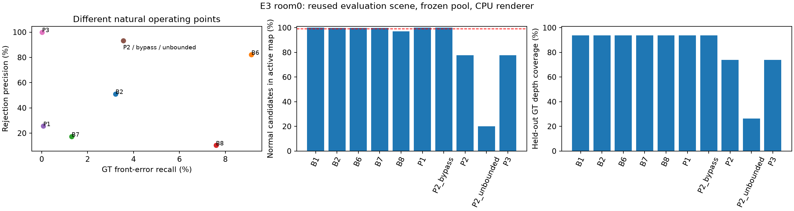
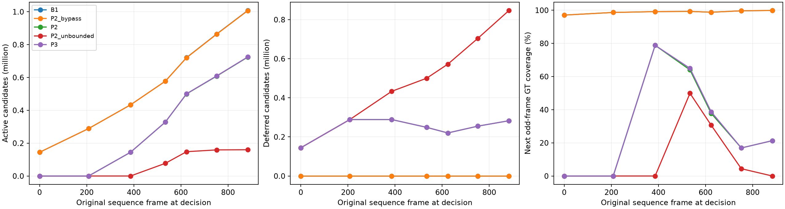
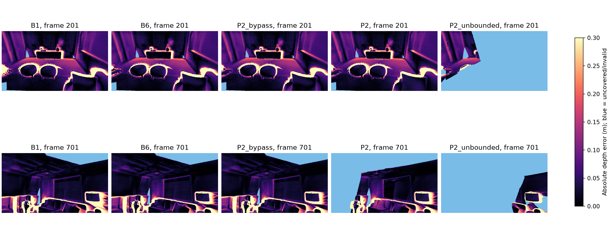

# E3 — 실제 Gaussian admission·DEFER 정책 비교

- 실행일: 2026-10-21 (Asia/Seoul)
- 판정: **REVISE — 현재 P2/P3의 admission 개선 주장을 지지하지 않음.**
- 상위 설계: [연구 계획 v3 §8](../surface_guided_gaussian_mapping_research_plan_v3.md#8-단계별-실험-매트릭스-사전등록)
- 설정: [e3_admission.json](../../configs/e3_admission.json), [봉인](../../configs/e3_preregistration.json), [room0 결과](../../configs/e3_room0_results_summary.json), [검증](../../configs/e3_validation.json)

## 결론

같은 room0 원본 active 후보 **1,008,252개**에서 반복 기하 gate는 GT bad **1,105개**, normal **79개**를 실제 맵에서 제외했다(생성 pose GT proxy). 거부 정밀도 **93.3277%**, bad recall **3.5494%**다. 그러나 2-KF DEFER 정책 P2는 종료 시 **282,890개**를 보류하여 정상 후보의 실제 active 보존율이 **77.5857%**에 그쳤다. 거부하지 않은 normal을 보존했다고 계산한 **99.9886%**와 구분해야 한다.

같은 기하 판정을 쓰는 **P2_bypass**는 동일한 후보를 동일 시점에 거부하면서 정상 active 보존 **99.9886%**를 유지했다. 이번 고정 raw 관측 실험에서 DEFER 자체가 추가 불량 제거를 만들지 않았으며, 가용성을 낮췄다. P2의 held-out 깊이 coverage는 원본 대비 **19.8583 percentage points** 낮았다. P3의 RGB AND 조건은 불량 회수율을 더 낮췄다. 이 결과에 맞춰 임계값·timeout·융합 규칙을 다시 선택하지 않았다.

## 범위와 사전 고정

office0 11-KF 개발 / room0 7-KF 평가에 E2b의 frozen 후보·raw 관측·실제 판단 snapshot을 재사용했다. 장면당 원본 1,000프레임 중 짝수 500입력이 mapping 입력이다. **room0는 E2b에서 이미 확인한 장면**이므로 새 독립 test 또는 일반화 검증으로 부르지 않는다. 연구 전체 GO는 아니다.

후보 풀은 E2b의 raw 전체가 아닌 **원본 active 필터 통과 후보**다. office0 1,547,680개, room0 1,008,252개이며 후보별 stable ID는 `raw_event:branch0:pixel_index`다. source ancestry는 원본 E2b lineage와 pair audit를 유지한다. source-disjoint는 모델 독립·통계 독립을 뜻하지 않는다.

E2b의 office0 개발 전용 **active** 99% finite-normal 누적 최대 점수 임계값을 재계산해 일치를 확인하고 E3 실행 전 봉인했다. P1/P2 반복 relative 임계값은 **0.0359322727**, B6는 **0.1214663386**, B7 NCC는 **1.6746114492**, B8는 **0.0574687049**다. E2b raw 임계값 0.03581599와 혼동하지 않는다. 모든 초과 판정은 strict `>`이며, 동률은 유지한다.

주 평가 전에 유한 점수·공통 집합 normal 보존 ≥99%, 실제 active normal 보존 ≥99%, bad recall ≥1%, B6/B7/B8 각각보다 정밀도 +2pp, 원본 대비 깊이 coverage 손실 ≤0.5pp 및 깊이 L1 증가 ≤0.005m를 문서화했다. 이는 이미 알려진 장면에 대한 설명적 판정 규칙으로서 새 confirmatory test의 사전등록과 동등하지 않다.

평가 라벨을 새로 읽기 전 초기 구현의 P1 가용성 통계를 생성 시점으로 제한하고 reason 코드를 보강했다. 초기 봉인·실행은 `results/E3_admission_decision_pre_evaluation_v1/`에 보존하고 재봉인했다. 임계값·정책·평가 기준은 바꾸지 않았다.

## 정책 정의

| ID | 실제 행동 |
|---|---|
| B1 | 원본 active 모두 즉시 편입 |
| B2 | confidence 임계값으로 생성 시점 한 번 판정 |
| B6 | source-disjoint depth conflict proxy, 실제 KF마다 재검사; 미관측 BYPASS |
| B7 | masked RGB NCC region proxy, 실제 KF마다 재검사; 미관측 BYPASS |
| B8 | 생성 시점에 **자기 정책의 직전 active 맵**을 렌더해 DoG redundancy 판정 |
| P1 | 반복 relative plane gate를 생성 시점에만 적용; 증거 부재 BYPASS |
| P2_bypass | 반복 gate를 KF마다 적용; 증거 부재 즉시 BYPASS, 편입 뒤에도 재검사 |
| P2 | 증거 부재 DEFER; 동일 snapshot 2+ 관측 확보 시 판단; 2개 후속 KF 뒤 미판정 BYPASS |
| P2_unbounded | P2의 timeout 제거; 종료 시 미판정은 맵에서 계속 부재 |
| P3 | P2의 기하 거부에 B7 임계값 초과를 AND 확인; RGB 부재 시 보류/timeout |

한 번 REJECT한 후보는 되살리지 않으며 KEEP/BYPASS 후보는 각 정책의 일정에 따라 재검사한다. 2+ plane 관측에서 support veto로 반복 점수가 NaN이면 지지 증거로 KEEP할 수 있다. 관측 수 부족의 NaN은 정상으로 인증하지 않는다. 종료 시 강제 flush·미래 KF 합성은 하지 않는다. DEFER 후보는 렌더링에서 제외한다.

정책별 membership으로 실제 compact Gaussian tensor 맵을 만들고 그 맵을 렌더했다. E2b의 `would_reject` 진단과 다르다. B8의 마지막 직전 맵은 자기 정책 **839,344개**, 원본 prefix **864,911개**로 경로 차이를 확인했다. B6/B7은 GeoGS-A-inspired proxy, B8은 GeoGS-B-inspired proxy이며 원 논문 시스템 재현이 아니다.

## room0 후보 의사결정 결과

`bad / normal / unknown`은 제거된 후보 수다. GT unknown은 precision/recall 분모에서 제외하고 개수를 따로 기록한다. 정상 active 보존은 DEFER로 맵에 없는 정상 후보도 손실로 계산한다. finite-normal 보존은 해당 정책의 실제 판단 시점에 유한 거부 점수를 가졌던 normal 중 오거부되지 않은 비율이며, DEFER 손실은 별도 active 열을 본다.

| 정책 | 제거 bad / normal / unknown | 거부 정밀도 | bad recall | 정상 active 보존 | finite-normal 비거부 | 최종 active | 최종 DEFER |
|---|---:|---:|---:|---:|---:|---:|---:|
| B1 | 0 / 0 / 0 | — | 0.0000% | 100.0000% | — | 1,008,252 | 0 |
| B2 | 1,001 / 958 / 1,241 | 51.0975% | 3.2153% | 99.8616% | 99.8616% | 1,005,052 | 0 |
| B6 | 2,844 / 621 / 827 | 82.0779% | 9.1353% | 99.9103% | 99.8300% | 1,003,960 | 0 |
| B7 | 406 / 1,949 / 1,073 | 17.2399% | 1.3041% | 99.7185% | 98.3865% | 1,004,824 | 0 |
| B8 | 2,363 / 20,539 / 8,914 | 10.3179% | 7.5903% | 97.0331% | 96.8764% | 976,436 | 0 |
| P1 | 22 / 64 / 15 | 25.5814% | 0.0707% | 99.9908% | 96.8473% | 1,008,151 | 0 |
| P2_bypass | 1,105 / 79 / 40 | 93.3277% | 3.5494% | 99.9886% | 98.5489% | 1,007,028 | 0 |
| P2 | 1,105 / 79 / 40 | 93.3277% | 3.5494% | 77.5857% | 98.5489% | 724,138 | 282,890 |
| P2_unbounded | 1,105 / 79 / 40 | 93.3277% | 3.5494% | 20.0656% | 98.5489% | 160,059 | 846,969 |
| P3 | 6 / 0 / 0 | 100.0000% | 0.0193% | 77.5971% | 100.0000% | 725,356 | 282,890 |



임계값은 같은 개발 정상 보존 목표를 썼지만 실제 편입 수는 다르다. **자연 작동점 비교**이며 matched-budget 우위로 해석하지 않는다. E4의 budget curve·TSDF·RGB PSNR/SSIM/LPIPS는 수행하지 않았다.

### 공통 가용 후보

B2/B6/B7/B8/P2가 각자의 인과적 판단 시점 중 한 번 이상 유한 신호를 가진 공통 원본 active 후보는 **3,920개**다. 같은 후보라는 사실이 증거 도착 시각까지 같음을 뜻하지 않는다.

| 정책 | bad / normal 거부 | 정밀도 | bad recall | 정상 비거부 | 정상 active 보존 |
|---|---:|---:|---:|---:|---:|
| B6 | 345 / 70 | 83.1325% | 55.2885% | 97.0301% | 97.0301% |
| B7 | 40 / 6 | 86.9565% | 6.4103% | 99.7454% | 99.7454% |
| B8 | 20 / 106 | 15.8730% | 3.2051% | 95.5028% | 95.5028% |
| P2_bypass | 273 / 79 | 77.5568% | 43.7500% | 96.6483% | 96.6483% |
| P2 | 273 / 79 | 77.5568% | 43.7500% | 96.6483% | 96.6483% |
| P3 | 6 / 0 | 100.0000% | 0.9615% | 100.0000% | 100.0000% |

## 실제 맵의 GT 깊이 평가

최종 공통 pose revision으로 모든 정책 맵을 배치하고, 평가 전용 trajectory Sim3 정렬 및 같은 GT camera를 사용했다. 원본 홀수 프레임 **1, 101, 201, 301, 401, 501, 601, 701, 801, 901, 999**의 11시점을 평가했다. 이 RGB/GT depth는 편입·점수·임계값에 쓰지 않았다. 총 Gaussian 중심의 좋은/나쁜 라벨과 실제 composited expected z-depth를 구별한다. 아래 값은 프레임 평균이다.

Coverage는 composited weight >0.001인 유효 GT 픽셀 비율, correct coverage는 E1의 `max(0.05m, 0.02×GT depth)` 오차 안인 전체 유효 픽셀 비율이다. L1은 coverage가 있는 픽셀에 한정하므로 구멍이 늘어난 정책의 L1 감소만으로 개선을 판정하지 않는다. Boundary는 기존 GT depth-edge 마스크다.

| 정책 | 깊이 L1 (m) | coverage | correct coverage | boundary correct | too-front 픽셀 | 시점별 임시 맵 coverage 평균 |
|---|---:|---:|---:|---:|---:|---:|
| B1 | 0.094190 | 93.8234% | 61.1091% | 39.0932% | 27.1534% | 98.9334% |
| B2 | 0.092790 | 93.7715% | 61.3208% | 39.1976% | 26.8530% | 98.9173% |
| B6 | 0.088765 | 93.8163% | 61.7288% | 39.4110% | 26.4884% | 98.9307% |
| B7 | 0.094151 | 93.8216% | 61.1316% | 39.1128% | 27.1289% | 98.9332% |
| B8 | 0.093619 | 93.8047% | 61.1739% | 39.1197% | 26.9696% | 98.9273% |
| P1 | 0.094146 | 93.8234% | 61.1148% | 39.1163% | 27.1477% | 98.9334% |
| P2_bypass | 0.091111 | 93.8234% | 61.6502% | 39.2531% | 26.6121% | 98.9334% |
| P2 | 0.107292 | 73.9651% | 46.8948% | 30.9846% | 24.2497% | 31.2794% |
| P2_unbounded | 0.082905 | 26.4003% | 16.5564% | 10.1291% | 9.6842% | 12.1407% |
| P3 | 0.110528 | 73.9651% | 46.3537% | 30.8247% | 24.7910% | 31.5500% |

임시 맵 평가는 실제 KF가 도착한 직후의 정책 맵을 **바로 다음 홀수 원본 프레임**에서 렌더했다. 각 시점에 도착한 후보만 포함하므로 최종 맵 결과와 다르다. 완성된 시퀀스의 공통 trajectory 정렬은 평가용이며 온라인 추정으로 주장하지 않는다.




## 보류 지연·미판정·메모리

입력 프레임 지연은 원본 프레임 지연의 1/2이다. 실제 KF 도착 시에만 재검사했으며, 처리시간 ms와 영상 시간 지연을 혼동하지 않는다. 지연 통계는 queue를 벗어난 후보의 조건부 통계이고 **right-censored 종료 후보를 별도 기록**한다. 정상 보류 노출은 각 KF snapshot의 정상 후보 수로 가중한 withheld 비율이며 실제 표면 면적 비율은 아니다.

| 정책 | peak queue 후보 | 원본 parameter payload MB | timeout BYPASS | 종료 미판정 | 해소 지연 p95 입력 / 원본 frames | 정상 후보 snapshot 보류율 |
|---|---:|---:|---:|---:|---:|---:|
| P2_bypass | 0 | 0.00 | 0 | 0 | — | 0.0000% |
| P2 | 288,823 | 17.33 | 627,420 | 282,890 | 193.0 / 386.0 | 40.9495% |
| P2_unbounded | 846,969 | 50.82 | 0 | 846,969 | 312.0 / 624.0 | 83.6897% |
| P3 | 288,823 | 17.33 | 627,501 | 282,890 | 193.0 / 386.0 | 40.9495% |

queue peak는 **KF 판단 직후 snapshot 기준**이다. 신규 후보 도착 직후의 임시 버퍼 peak는 별도 측정하지 않았다. queue MB는 원본 mean/scale/quaternion/전체 SH/opacity/confidence 텐서의 후보당 bytes를 합한 **payload 하한**이다. observation cache·공통 frozen 풀·allocator·로그·Python 객체·임시 렌더 버퍼를 포함하지 않는다. replay는 전체 원본 풀과 raw 관측을 CPU에 유지하므로 active 감소를 실제 총 RSS 또는 GPU 메모리 절감으로 주장하지 않는다. 저장된 `*_compact_map.npz`는 렌더용 mean/covariance/DC RGB/opacity 표현이며 원래 전체 SH 직렬화 크기와 다르다. 압축 파일 bytes와 원본 parameter payload bytes를 결과 JSON에 구별해 기록했다.

## 개발 장면과 pose 민감도

office0 결과는 개발 진단이며 추가 test 반복으로 세지 않는다.

| 정책 | bad / normal 거부 | 정밀도 | 정상 active 보존 | 깊이 L1 (m) | coverage |
|---|---:|---:|---:|---:|---:|
| B6 | 16,674 / 3,035 | 84.6009% | 99.5221% | 0.078107 | 97.8270% |
| B7 | 4,528 / 1,048 | 81.2052% | 99.8350% | 0.089143 | 97.8453% |
| B8 | 4,880 / 7,068 | 40.8437% | 98.8872% | 0.089032 | 97.8419% |
| P2_bypass | 16,632 / 333 | 98.0371% | 99.9476% | 0.081457 | 97.8449% |
| P2 | 16,632 / 333 | 98.0371% | 87.4357% | 0.080342 | 92.6872% |
| P3 | 825 / 5 | 99.3976% | 87.4874% | 0.088143 | 93.0837% |

생성 pose 라벨이 주 결과다. 최종 추정 pose·GT-anchor·cross-pose consensus의 같은 decision 집합 결과는 장면별 JSON `policies.*.decision`에 함께 기록했다. 거부 시점마다 GT 라벨을 새로 만들어 정책을 조정하지 않았다. GT-anchor도 predictor scale을 유지한 진단이며 완전한 정답 geometry가 아니다.

## 판정

| 정책 | 봉인한 설명적 기준 | 결과 |
|---|---|---|
| P2 | normal_active_retention | FAIL |
| P2 | finite_normal_retention | FAIL |
| P2 | common_normal_retention | FAIL |
| P2 | bad_recall | PASS |
| P2 | coverage | FAIL |
| P2 | depth_l1 | FAIL |
| P2 | precision_vs_each_strong_baseline | PASS |
| P3 | normal_active_retention | FAIL |
| P3 | finite_normal_retention | PASS |
| P3 | common_normal_retention | PASS |
| P3 | bad_recall | FAIL |
| P3 | coverage | FAIL |
| P3 | depth_l1 | FAIL |
| P3 | precision_vs_each_strong_baseline | PASS |

**REVISE.** 현재의 hard DEFER/P3를 그대로 개선 알고리즘으로 주장하거나 연구 전체 GO로 확대하지 않는다. P2_bypass의 낮은 오거부는 보존할 가치가 있지만 B6의 더 높은 불량 회수와의 자연 작동점 trade-off다. 다음 개발 iteration에서는 미관측 후보를 렌더 가능한 provisional/BYPASS 상태로 두고 재평가하는 설계와 보류 대상 축소를 검토할 수 있다. 이 제안은 후속 검증 대상이며 이번 test를 보고 최적화한 새 성공 결과가 아니다. E4를 수행한다면 matched budget·coverage 제약을 그대로 유지한다.

## 실행 환경·검증·재현

현재 환경에는 `/dev/nvidia*`가 없고 `torch.cuda.is_available()`은 false였다. 새 tracking/후보 생성 없이 기존 E2b 산출물을 사용했다. CPU 렌더러는 로컬 upstream forward CUDA의 EWA covariance·0.3 pixel low-pass·16×16 tile·front-to-back compositing·alpha cutoff를 옮긴 수치 적응판이다. 원본 parameter와 covariance는 고정했다. 기존 baseline TF32 GPU bake와 CPU float32 배치의 수치 차이는 남아 있다.

개발 장면 KF 1/5/10에서 기존 CUDA 저장 RGB pre-map과 대조한 PSNR **54.73–60.73 dB**, MAE 최대 **0.0006587**, 같은 B8 임계값의 판정 flip 최대 **0.0771%**였다. 이는 선택된 RGB pre-map의 대조이며 전체 GT depth 렌더의 CUDA 동등성을 증명하지 않는다. 모든 E3 정책에는 같은 CPU 렌더러를 썼다. GPU speed·VRAM·실시간성·E6 시스템 replay 통과는 주장하지 않는다.

**45개 테스트 PASS**: 기존 32개와 E3 13개. 미관측의 비거부·동시 관측 요구·timeout·흡수 거부·편입 후 재검사·RGB 부재·미래 정보 차단·정상 DEFER 가용성 손실·GT 파일 차단, 두 표면 analytic alpha compositing·principal point·scale 불변성을 검사했다. 후보별 첫 충돌 시점, revision, 실제 compact map membership, B8 자기 prefix, 원본 산출물 및 봉인 hash는 `scripts/check_e3.py`로 검증한다.

```bash
bash scripts/run_e3.sh test
bash scripts/run_e3.sh prepare
bash scripts/run_e3.sh replay office0
bash scripts/run_e3.sh replay room0
bash scripts/run_e3.sh evaluate office0
bash scripts/run_e3.sh evaluate room0
bash scripts/run_e3.sh verify
bash scripts/run_e3.sh report
```

완료된 replay/evaluation/봉인은 덮어쓰지 않는다. 새 전체 실행은 원본 결과를 보존하고 별도 output을 설정한다. raw 결과는 `results/E3_admission_decision/`에 있으며 설정·결과 요약·선별 그림만 Git 추적 대상으로 둔다. 커밋은 생성하지 않았다.
