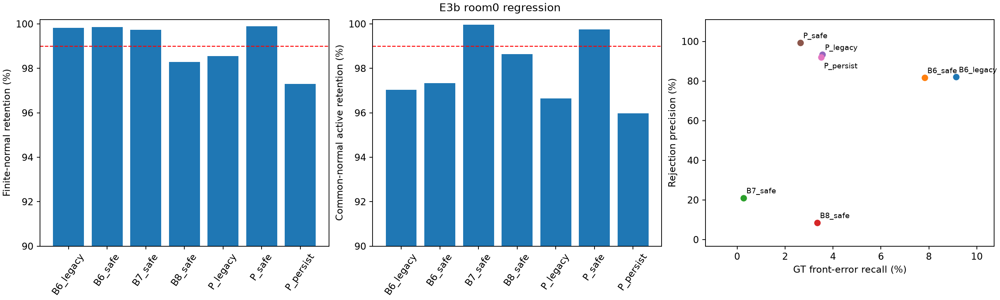
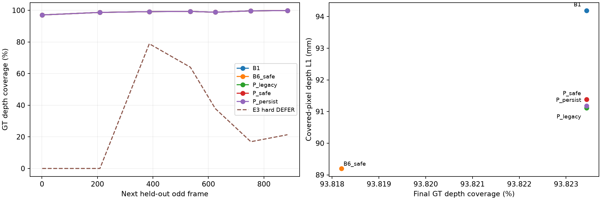
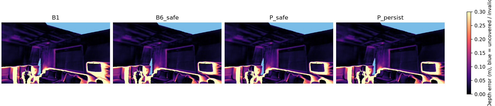
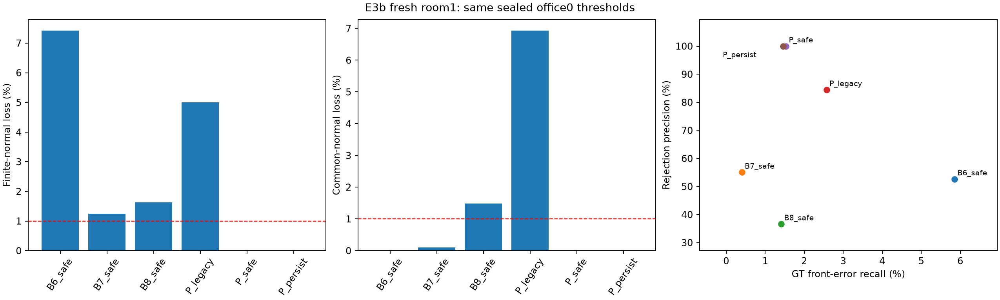

# E3b — 임시 편입 후 재검사 및 부분집합 정상 보존 보완

- 실행일: 2026-10-21 (Asia/Seoul)
- 상태: **개발 보정·기존 장면 회귀 실험 실행 완료. room0 판정 REGRESSION_PASS_ONLY. 새 room1 평가는 COMPLETE.**
- 전체 판정: **REVISE**. 새 장면이 있으면 그 평가를 우선하며 room0 통과로 대체하지 않는다.
- **E4 진행 승인: 아직 아님.** 기존 장면 결과만으로 진행을 확정하지 않는다.
- 이전 실험: [E3](E3_admission_decision.md)
- 설정: [e3b_provisional.json](../../configs/e3b_provisional.json), [봉인](../../configs/e3b_preregistration.json), [통합 결과](../../configs/e3b_results_summary.json), [검증](../../configs/e3b_validation.json)

## 현재 확인한 결과

증거가 없는 후보를 렌더링에서 제외하던 hard DEFER를 없애고, **즉시 렌더 가능한 PROVISIONAL 편입 → 실제 KF 도착 시 재검사 → 확인된 충돌만 제거**하도록 바꿨다. 모든 방법의 queue는 0개다. 새 관측·정규화·모델·pose·후보 생성·refiner는 바꾸지 않았다.

office0에서만 보정한 주 정책 P_safe의 room0 결과는 **GT bad 823개 / normal 6개 제거**, 정밀도 **99.2762%**, 전체 bad recall **2.6436%**다. normal 전체 active 보존 **99.9991%**, 유한 점수 normal 보존 **99.8898%**, 모든 신호 공통 후보 normal 보존 **99.7454%**를 구별한다. 최종 깊이 coverage는 **93.8234%**로 원본 **93.8234%**와 비교했다.

두 연속 KF에서 충돌이 지속될 때 제거하는 P_persist는 bad **1,092개**, normal **95개**를 제거했다. 유한 점수 normal 보존은 **97.2958%**다. P_persist는 개발에서 별도로 보정해 임계값도 달라졌으므로 그 차이를 시간 지속성 하나의 효과로 해석하지 않는다. 이 결과를 보고 두 정책 중 유리한 것을 새 주 정책으로 선택하거나 임계값을 다시 조정하지 않았다.

**새 room1 평가를 완료했다.** 처음에는 샌드박스에서 GPU가 보이지 않았으나, 샌드박스 밖 읽기 전용 확인에서 RTX 5060 8GB와 PyTorch CUDA 접근을 확인했다. 같은 봉인으로 공식 Replica room1 원본 1,000프레임·짝수 500입력 기준선을 생성했다. GT pose·다른 predictor·임의 KF로 대체하지 않았다. office0/room0와 RGB 입력 hash가 겹치지 않고 동일 backbone·weights인지는 무결성 검증에서 확인했다. 주 정책은 bad 5,104개 / normal 0개를 제거하며 정상 보존과 coverage 기준을 통과했다. 다만 공통 후보에서 B6_safe 대비 정밀도 증가를 보이지 못해 **추가 우위 미확인·E4 보류**다.

## office0 개발 보정과 봉인

후보는 원본 active 필터를 통과한 office0 1,547,680개 / room0 1,008,252개다. 공통 점수 cohort는 B2 confidence, B6 depth, B7 RGB NCC, B8 DoG, 반복 plane이 각각 인과적 snapshot 중 유한 점수를 가진 후보의 교집합이다. 개발 공통 후보는 **53,280개**, room0 공통 후보는 **3,920개**다. 공통 후보라는 사실이 증거 도착 시점까지 같다는 뜻은 아니다.

E3b 임계값은 후보별 **시간 누적 최대 점수**를 이용해 개발 normal의 99% higher quantile을 계산했다. (1) 자체 유한 점수 normal, (2) 모든 신호 공통의 유한 normal, (3) 유한 normal ≥100개인 각 anchor KF에서 계산한 임계값 중 최댓값을 택했다. 필수 (1)/(2)에 normal이 100개 미만이면 미보정으로 기록하고 성공 판정을 금지한다. 작은 anchor group은 별도 기록하며 보호를 보장하지 않는다. strict `>`만 제거하고 동률·미관측은 유지한다. 이는 개발 집합의 경험적 오거부 제약이며, 새 장면 위험의 통계적 보장은 아니다.

P_persist의 개발 점수는 두 **인접 실제 KF snapshot** 점수의 최솟값을 시간에 따라 최대 집계한 값이다. 중간 snapshot에서 점수가 NaN이면 연속성을 끊는다. 각 snapshot의 plane 점수 자체는 이미 source-disjoint 2+ 관측과 support veto를 요구한다. **같은 raw 관측의 시간적 지속성은 새 독립 관측 두 개를 뜻하지 않는다.**

| 방법 | 고정 임계값 | office0 bad / normal 제거 | 유한 normal 보존 | 공통 normal 보존 | bad recall |
|---|---:|---:|---:|---:|---:|
| B6_safe | 0.1326046139 | 13,199 / 822 | 99.7292% | 99.9591% | 3.5485% |
| B7_safe | 1.8435887098 | 970 / 134 | 99.8722% | 99.8978% | 0.2608% |
| B8_safe | 0.0943873599 | 1,533 / 2,102 | 99.6508% | 99.7955% | 0.4121% |
| P_safe | 0.0560654998 | 5,656 / 15 | 99.9550% | 99.9693% | 1.5206% |
| P_persist | 0.0304945186 | 5,452 / 21 | 99.8947% | 99.9387% | 1.4657% |

B6/B7에도 같은 부분집합 보정 규칙을 적용했다. B8은 개발 원본 pre-map에서 보정하되, 실제 replay는 매번 **자기 정책의 직전 맵**에서 다시 DoG를 계산한다. 경로 의존성 때문에 실제 개발·평가 normal 보존이 보정 진단과 다르면 그대로 보고하며 재튜닝하지 않는다. legacy control은 E3의 office0 전용 임계값 그대로다. 이 통제군들의 후보별 첫 제거 시점이 E3와 정확히 일치하는지 검증한다.

## room0 회귀: 후보별 실제 결정

bad/normal은 고정된 생성 snapshot pose에 대한 GT geometry proxy다. unknown GT는 정밀도·recall 분모에서 제외하고 제거 수를 별도로 기록한다. 이는 엄밀한 Gaussian별 물리적 floater oracle이 아니다.

| 방법 | 제거 bad / normal / unknown | 정밀도 | 전체 bad recall | 정상 active 보존 | 유한 normal 보존 | 공통 normal 보존 |
|---|---:|---:|---:|---:|---:|---:|---:|
| B1 | 0 / 0 / 0 | — | 0.0000% | 100.0000% | — | 100.0000% |
| B2_legacy | 1,001 / 958 / 1,241 | 51.0975% | 3.2153% | 99.8616% | 99.8616% | 100.0000% |
| B6_legacy | 2,844 / 621 / 827 | 82.0779% | 9.1353% | 99.9103% | 99.8300% | 97.0301% |
| B7_legacy | 406 / 1,949 / 1,073 | 17.2399% | 1.3041% | 99.7185% | 98.3865% | 99.7454% |
| B8_legacy | 2,363 / 20,539 / 8,914 | 10.3179% | 7.5903% | 97.0331% | 96.8764% | 95.5028% |
| P_legacy | 1,105 / 79 / 40 | 93.3277% | 3.5494% | 99.9886% | 98.5489% | 96.6483% |
| B6_safe | 2,435 / 548 / 698 | 81.6292% | 7.8215% | 99.9208% | 99.8499% | 97.3271% |
| B7_safe | 84 / 316 / 254 | 21.0000% | 0.2698% | 99.9544% | 99.7384% | 99.9576% |
| B8_safe | 1,040 / 11,232 / 5,052 | 8.4746% | 3.3406% | 98.3775% | 98.2918% | 98.6423% |
| P_safe | 823 / 6 / 0 | 99.2762% | 2.6436% | 99.9991% | 99.8898% | 99.7454% |
| P_persist | 1,092 / 95 / 66 | 91.9966% | 3.5076% | 99.9863% | 97.2958% | 95.9695% |



각 방법의 전체·자체 유한 점수·공통 후보·anchor별 결과와 최종 추정 pose / GT-anchor / consensus 라벨 민감도를 `configs/e3b_room0_results_summary.json`에 기록했다. 일부 subset에서만 유리한 값을 골라 전체 우위로 주장하지 않는다. B8은 중복 억제 proxy이므로 GT-valid 중복을 줄일 수 있지만 정상 구조 coverage와의 차이를 함께 본다. B6/B7/B8은 GeoGS-inspired proxy이며 원 논문 전체 시스템 재현이 아니다.

## 실제 맵 coverage·깊이

각 정책의 membership으로 compact Gaussian map을 만들고 같은 E3 CPU 렌더러로 평가했다. 최종 추정 pose·trajectory Sim3 정렬·512×288 camera·검정 배경·alpha cutoff·GT depth mask·오차 허용범위는 E3와 같다. 최종 맵은 홀수 원본 프레임 1, 101, 201, 301, 401, 501, 601, 701, 801, 901, 999의 11시점, 임시 맵은 각 실제 KF 직후의 다음 홀수 프레임에서 렌더했다. 평가 GT pose와 depth는 admission·임계값·evidence에 쓰지 않았다.

| 방법 | 깊이 L1 (m) | 최종 coverage | correct coverage | boundary correct | 임시 맵 coverage 평균 |
|---|---:|---:|---:|---:|---:|
| B1 | 0.094190 | 93.8234% | 61.1091% | 39.0932% | 98.9334% |
| B2_legacy | 0.092790 | 93.7715% | 61.3208% | 39.1976% | 98.9173% |
| B6_legacy | 0.088765 | 93.8163% | 61.7288% | 39.4110% | 98.9307% |
| B7_legacy | 0.094151 | 93.8216% | 61.1316% | 39.1128% | 98.9332% |
| B8_legacy | 0.093619 | 93.8047% | 61.1739% | 39.1197% | 98.9273% |
| P_legacy | 0.091111 | 93.8234% | 61.6502% | 39.2531% | 98.9334% |
| B6_safe | 0.089202 | 93.8182% | 61.6663% | 39.3931% | 98.9318% |
| B7_safe | 0.094182 | 93.8234% | 61.1122% | 39.0932% | 98.9334% |
| B8_safe | 0.093944 | 93.8199% | 61.1255% | 39.0910% | 98.9310% |
| P_safe | 0.091385 | 93.8234% | 61.5448% | 39.2049% | 98.9334% |
| P_persist | 0.091175 | 93.8234% | 61.6521% | 39.2544% | 98.9334% |

L1은 covered 픽셀에서 계산하므로 coverage와 같이 해석한다. correct coverage는 전체 유효 GT 픽셀에서 `max(0.05m, 0.02×GT depth)` 이내의 비율이다. 자연 작동점의 결과이며 matched-budget E4·TSDF·RGB NVS 결과가 아니다.




PROVISIONAL은 증거 부족의 의미를 유지하며 정상으로 인증한 KEEP과 구별한다. 실제 snapshot의 렌더 membership은 `도착한 원본 active 후보 − 그때까지 REJECT된 후보`와 정확히 같아야 한다. queue·보류로 생긴 미표현 후보는 0개다. confidence/observation cache와 frozen pool은 CPU에 그대로 있으므로 GPU memory·총 RSS 절감을 주장하지 않는다. 기록된 CPU replay 시간은 저장된 score 읽기와 정책 계산이며 새 feature 계산을 포함한 online latency가 아니다.

이 방식은 **검증 전 렌더링 차단보다 임시 편입 후 사후 제거에 가깝다.** 불량 후보가 충분한 증거를 얻을 때까지 노출되는 것을 막지는 않는다. 그 노출 기간의 렌더링 손실·실제 처리 지연·비용은 E6의 별도 검증 대상이다.

## 판정과 다음 행동

봉인한 기준은 전체/유한/공통/충분한 anchor normal 보존 ≥99%, bad recall ≥1%, bad 제거 ≥30개, 원본 대비 coverage 손실 ≤0.5pp, 깊이 L1 증가 ≤0.005m, B6_safe/B7_safe/B8_safe 각각보다 전체 및 공통 후보 정밀도 +2pp다. 이미 확인한 장면이므로 다음 표는 회귀 진단이다.

| 방법 | 기준 | room0 결과 |
|---|---|---|
| P_safe | calibrated | PASS |
| P_safe | global_normal | PASS |
| P_safe | finite_normal | PASS |
| P_safe | common_normal | PASS |
| P_safe | anchor_normal | PASS |
| P_safe | bad_recall | PASS |
| P_safe | bad_rejected | PASS |
| P_safe | coverage | PASS |
| P_safe | depth_l1 | PASS |
| P_safe | global_precision_gain_each_strong_baseline | PASS |
| P_safe | common_precision_gain_each_strong_baseline | PASS |
| P_persist | calibrated | PASS |
| P_persist | global_normal | PASS |
| P_persist | finite_normal | FAIL |
| P_persist | common_normal | FAIL |
| P_persist | anchor_normal | FAIL |
| P_persist | bad_recall | PASS |
| P_persist | bad_rejected | PASS |
| P_persist | coverage | PASS |
| P_persist | depth_l1 | PASS |
| P_persist | global_precision_gain_each_strong_baseline | PASS |
| P_persist | common_precision_gain_each_strong_baseline | FAIL |

## 새 room1 평가

원본 active 후보 **1,399,108개**, 실제 KF **10개**를 동일 frozen 후보·pose 조건에서 비교했다. office0 봉인 임계값을 그대로 썼으며 room0/room1 결과에 따른 재보정은 없다. 주 정책은 bad **5,104개**, normal **0개**를 제거했고 정밀도 **100.0000%**, 전체 bad recall **1.5354%**, 유한 normal 보존 **100.0000%**, 공통 normal 보존 **100.0000%**였다. coverage는 원본 **87.8749%** 대비 **87.8749%**다.

주 정책의 유한 점수 가용 후보는 **63,081개(4.5087%)**, 모든 신호 공통 후보는 **26,622개(GT bad 14,223개 / normal 8,434개)**다. GT normal 전체 **524,019개**, GT bad 전체 **332,418개**에 대한 분모와 구별한다. 아직 증거가 없는 후보는 렌더 가능하지만 판정에 성공했다고 세지 않는다.

room1 P_safe의 pose 라벨 민감도는 다음과 같다: creation: bad 5,104개 / normal 0개; final_estimated: bad 5,104개 / normal 0개; gt_anchor: bad 5,104개 / normal 0개; cross_pose_consensus: bad 5,104개 / normal 0개. GT-anchor는 예측 scale을 유지한 진단이며 이것만으로 독립적인 전체 표면 정확도나 엄밀한 floater oracle이 되지는 않는다.

| 방법 | 제거 bad / normal / unknown | 정밀도 | bad recall | 유한 normal 보존 | 공통 normal 보존 | 깊이 L1 (m) | coverage |
|---|---:|---:|---:|---:|---:|---:|---:|---:|
| B1 | 0 / 0 / 0 | — | 0.0000% | — | 100.0000% | 0.125140 | 87.8749% |
| B2_legacy | 8,080 / 7,528 / 13,155 | 51.7683% | 2.4307% | 98.5634% | 100.0000% | 0.123833 | 87.7319% |
| B6_legacy | 21,411 / 19,116 / 1,649 | 52.8314% | 6.4410% | 91.9004% | 100.0000% | 0.121820 | 87.8695% |
| B7_legacy | 11,182 / 5,549 / 1,523 | 66.8340% | 3.3638% | 93.7238% | 98.4705% | 0.125046 | 87.8670% |
| B8_legacy | 8,418 / 14,445 / 15,341 | 36.8193% | 2.5324% | 97.1001% | 94.7593% | 0.124532 | 87.8526% |
| P_legacy | 8,566 / 1,578 / 167 | 84.4440% | 2.5769% | 94.9933% | 93.0638% | 0.124526 | 87.8749% |
| B6_safe | 19,471 / 17,527 / 1,317 | 52.6272% | 5.8574% | 92.5737% | 100.0000% | 0.122192 | 87.8695% |
| B7_safe | 1,349 / 1,102 / 227 | 55.0388% | 0.4058% | 98.7536% | 99.9051% | 0.125129 | 87.8749% |
| B8_safe | 4,702 / 8,133 / 7,658 | 36.6342% | 1.4145% | 98.3672% | 98.5179% | 0.124850 | 87.8642% |
| P_safe | 5,104 / 0 / 0 | 100.0000% | 1.5354% | 100.0000% | 100.0000% | 0.124756 | 87.8749% |
| P_persist | 4,845 / 0 / 0 | 100.0000% | 1.4575% | 100.0000% | 100.0000% | 0.124712 | 87.8749% |

| 방법 | 봉인 기준 | room1 결과 |
|---|---|---|
| P_safe | calibrated | PASS |
| P_safe | global_normal | PASS |
| P_safe | finite_normal | PASS |
| P_safe | common_normal | PASS |
| P_safe | anchor_normal | PASS |
| P_safe | bad_recall | PASS |
| P_safe | bad_rejected | PASS |
| P_safe | coverage | PASS |
| P_safe | depth_l1 | PASS |
| P_safe | global_precision_gain_each_strong_baseline | PASS |
| P_safe | common_precision_gain_each_strong_baseline | FAIL |
| P_persist | calibrated | PASS |
| P_persist | global_normal | PASS |
| P_persist | finite_normal | PASS |
| P_persist | common_normal | PASS |
| P_persist | anchor_normal | PASS |
| P_persist | bad_recall | PASS |
| P_persist | bad_rejected | PASS |
| P_persist | coverage | PASS |
| P_persist | depth_l1 | PASS |
| P_persist | global_precision_gain_each_strong_baseline | PASS |
| P_persist | common_precision_gain_each_strong_baseline | FAIL |

새 장면 판정은 **REVISE**다. 통과한 subset만 선택하거나 미달 장면을 빼지 않았다. 단일 새 장면의 pilot이며 다장면 일반화·통계적 유의성을 입증한 결과로 확대하지 않는다.

**실패 항목의 의미:** 주 정책은 정상 보존·비영 bad recall·coverage 기준을 통과했지만, 공통 후보에서 B6_safe도 정밀도 **100.0000%**였다. 주 정책의 정밀도 **100.0000%**로는 봉인한 “각 대조군보다 +2pp” 조건을 충족하지 못한다. B6가 이미 100%인 경우 이 조건은 수학적으로 달성할 수 없지만, 결과를 보고 기준을 바꾸어 GO로 기록하지 않았다. 공통 후보의 bad 제거 수는 B6_safe **4,966개**, P_safe **4,338개**로 B6 쪽이 더 많았다. 따라서 단순한 기준의 ceiling 문제만으로 보지 않고 **추가 정책의 순이익이 아직 입증되지 않았다**고 판정한다.

다음 보완은 **E3c: 같은 실제 시점의 관측 자격·support veto·위험 보정을 B6에도 적용한 뒤 plane 점수의 추가 가치를 비교**하는 것이다. 높은 정밀도가 score 자체의 정보인지, 좁은 관측 가능 후보만 골랐기 때문인지 분리해야 한다. E4 진행과 알고리즘 우위 주장은 그 결과와 별도 새 평가 계획을 보고 결정한다. room1을 다시 조정용 test로 써서 이번 E3b를 성공으로 소급하지 않는다.




E3b 전체 상태는 **REVISE**다. 회귀 결과가 기준을 충족하더라도 room1 fresh 평가와 무결성 검증을 통과하기 전에는 E4 GO가 아니다. 기준 미달이면 실패한 항목을 새 개발 iteration에서 다루되 평가 결과에 맞춰 임계값을 이동시켜 이번 실행의 성공으로 기록하지 않는다. 대조군 대비 부분집합 보호·불량 제거·coverage의 유용한 trade-off가 없으면 정책 개선 주장을 축소한다.

## 재현·실행 범위

개발·회귀 실행과 검증:

```bash
bash scripts/run_e3b.sh test
bash scripts/run_e3b.sh prepare
bash scripts/run_e3b.sh replay office0
bash scripts/run_e3b.sh replay room0
bash scripts/run_e3b.sh evaluate office0
bash scripts/run_e3b.sh evaluate room0
bash scripts/run_e3b.sh verify
bash scripts/run_e3b.sh report
```

GPU가 보이는 실행 환경에서 **같은 봉인**으로 새 room1 1,000원본프레임/500입력 평가를 실행한다:

```bash
bash scripts/run_e3b.sh fresh-status
bash scripts/run_e3b.sh fresh-download
bash scripts/run_e3b.sh fresh-baseline
bash scripts/run_e3b.sh fresh-score
bash scripts/run_e3b.sh replay room1
bash scripts/run_e3b.sh fresh-labels
bash scripts/run_e3b.sh evaluate room1
bash scripts/run_e3b.sh verify
bash scripts/run_e3b.sh report
```

공식 Replica room1 다운로드·원본 GPU 기준선·동일 raw 점수 추출·GT 없는 replay·그 뒤의 GT 라벨링·실제 맵 렌더링을 모두 실행했다. 임계값·관측 자격·후보 생성·pose·refiner 설정을 바꾸지 않았다. 다운로드는 기존 파일을 CRC 재사용하고 중복 HTTP range를 공유 캐시하는 별도 transport를 사용했으며 원본 ZIP 크기·CRC·SHA256 검증은 유지했다. 기존 후보·점수·E3 코드와 산출물은 수정하지 않았다. 완료된 봉인·replay·evaluation은 덮어쓰지 않는다.

**테스트 56개 PASS**(기존 45개 + E3b 11개). 부분집합/anchor 위험 집중, 시간 누적 임계값, 중간 NaN의 연속성 단절, 미관측 즉시 렌더, 미래 후보 차단, 거부 후 복구 금지, 미보정 정책의 비거부, GT 읽기 차단을 검사했다. 무결성 검증은 개발 임계값 재계산·모든 snapshot의 즉시편입 membership·첫 제거 시점/revision·legacy control 일치·B8 자기 prefix·compact map/hash를 확인했다. code·환경·봉인·결과는 `configs/e3b_*`, 원본 출력은 `results/E3b_provisional_admission/`에 보관했다. 커밋은 생성하지 않았다.
