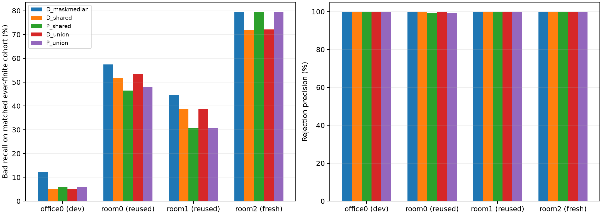
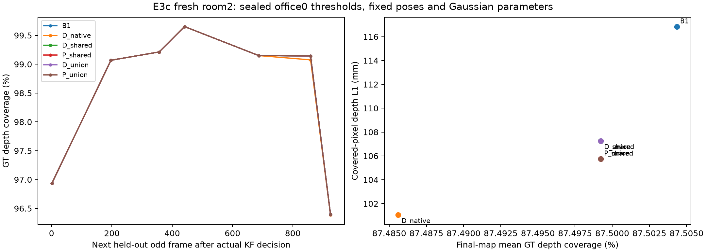
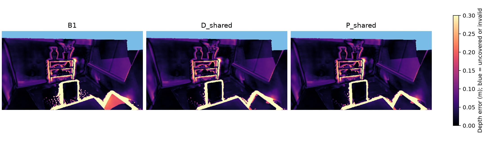

# E3c — 동일 인과적 관측 조건에서 depth와 plane 점수 비교

**실행 완료: 2026-10-22. 판정: GO_FOR_E4; E4 비교 실험의 진행 조건 충족. 다장면 우위는 미확인.**

## 질문과 사전 등록

E3b는 미관측 후보를 즉시 provisional로 렌더해 hard DEFER 공백을 보완했다. 그러나 B6와 plane은 관측 자격·집계·support veto가 달랐다. E3c는 **같은 시점에 같은 관측을 사용해도 plane 잔차가 depth 잔차보다 불량을 더 잘 골라내는가**를 검사한다.

office0만 임계값 개발에 사용했다. 이미 살펴본 room0·room1은 회귀 장면이고 **room2는 사전 등록한 새 평가 장면**이다. room2는 원본 1,000프레임 중 짝수 500개를 동일 backbone·weights·seed 0·32-KF buffer·원본 filter로 처리했다. 임계값·정책·평가 기준을 봉인한 뒤 평가했으며 room2 GT 라벨은 모든 admission 결정이 끝난 뒤 만들었다.

새 기준은 정상 보존 ≥99%, 원본 대비 coverage 하락 ≤0.5%p, 깊이 L1 증가 ≤5 mm, 전체 bad recall ≥1%, bad 제거 ≥30개다. own finite·공통 finite·finite normal ≥100인 anchor별 보존을 검사한다. 이 조건을 두 방법 모두 만족하면서 **동일 ever-finite 후보의 bad recall을 plane이 ≥2%p 높이고 정밀도 손실은 ≤0.1%p**여야 한다. 대칭 union veto에서도 안전 조건 및 양의 recall 개선을 요구한다. 이는 E3c에 새로 사전 등록한 기준이며 E3b의 정밀도 +2%p 기준을 소급 변경하지 않는다.

## 비교 정책

| 정책 | 관측·집계 |
|---|---|
| B1 | 원본 active 후보 전부 유지 |
| D_native | 원래 B6의 depth 유한 관측 median; E3c 위험 보정 |
| D_maskmedian | 공통 관측·2개 이상·plane support veto 후 depth median |
| D_shared / P_shared | 관측별 finite depth ∩ finite plane, 2개 이상, 두 번째 큰 점수, 동일 plane-zero support veto |
| D_union / P_union | 같은 공통 관측·집계, 어느 점수든 0인 shared 관측이 하나라도 있으면 둘 다 veto |

각 actual KF snapshot에 도착한 source-disjoint raw view와 그 시점의 pose만 쓴다. 먼저 관측별 교집합을 적용하고 나중에 집계한다. 두 잔차 모두 evidence의 예측 radius로 정규화한다. score 방향별 Gaussian covariance의 3σ를 제외한다. unknown은 렌더 가능한 provisional이고 제거는 absorbing이다. 모든 정책은 같은 고정 Gaussian·pose에서 실제 membership만 바꾼다. D_native의 **점수**는 기존 B6와 같지만 임계값은 E3c 공통 cohort로 다시 개발 보정했으므로 E3b B6_safe 정책의 재현으로 해석하지 않는다.

**공통 gate에는 plane PCA의 신뢰성 판정이 들어간다.** 따라서 D_shared는 PCA를 전혀 안 쓰는 baseline이 아니며, 이 실험은 해당 gate 아래 잔차 점수의 조건부 가치를 분리한다. primary support veto가 plane에 정의되어 있다는 비대칭은 union 대조로 점검한다. 후보와 각 evidence의 source는 겹치지 않지만 evidence끼리 공유 이미지를 가질 수 있으므로 두 view를 완전히 독립인 통계 표본으로 부르지 않는다.

## 봉인된 office0 임계값

| 정책 | 임계값 |
|---|---:|
| D_native | 0.132605 |
| D_maskmedian | 0.103403 |
| D_shared | 0.100280 |
| P_shared | 0.056065 |
| D_union | 0.100294 |
| P_union | 0.056270 |

후보별 시간 누적 최대 점수의 99% higher quantile을 own finite normal, 공통 ever-finite normal, normal ≥100인 각 anchor에서 계산해 최댓값을 썼다. strict `>`만 제거한다. 두 paired 방법의 매 snapshot 유한 후보 및 ever-finite 후보는 정확히 같다. **ever-finite 교집합은 개발 위험 보정과 사후 진단 분모에만 쓰며 미래의 관측 가능성을 실제 admission gate로 쓰지 않는다.**

## 실제 결과

bad는 E1 GT 분류의 front-error(class 3), normal은 class 1/2다. unknown(class 0) 제거도 따로 기록하며 정밀도 분모에서는 제외한다. 여기서 불량은 해당 기하 분류를 뜻하며 모든 시각적 결함을 포괄하지 않는다.

| 장면 | KF | 원본 active | primary 공통 후보 | 공통 bad / normal |
|---|---:|---:|---:|---:|
| office0 (개발) | 11 | 1,547,680 | 190,857 | 96,094 / 33,302 |
| room0 (회귀) | 7 | 1,008,252 | 9,112 | 1,771 / 5,444 |
| room1 (회귀) | 10 | 1,399,108 | 63,081 | 16,607 / 31,518 |
| room2 (새 평가) | 7 | 999,190 | 70,621 | 6,903 / 44,904 |

### office0

| 정책 | bad / normal / unknown 제거 | 정밀도 | 전체 bad recall | 자체 finite normal 보존 | primary 공통 bad recall | coverage | 깊이 L1 (m) |
|---|---:|---:|---:|---:|---:|---:|---:|
| B1 | 0 / 0 / 0 | — | 0.0000% | — | 0.0000% | 97.8454% | 0.089328 |
| D_native | 13,199 / 822 / 6,311 | 94.1374% | 3.5485% | 99.7292% | 5.9796% | 97.8337% | 0.079821 |
| D_maskmedian | 11,638 / 15 / 6,249 | 99.8713% | 3.1288% | 99.9550% | 12.1111% | 97.8447% | 0.081624 |
| D_shared | 4,956 / 15 / 64 | 99.6982% | 1.3324% | 99.9550% | 5.1574% | 97.8449% | 0.085384 |
| P_shared | 5,656 / 15 / 135 | 99.7355% | 1.5206% | 99.9550% | 5.8859% | 97.8449% | 0.085016 |
| D_union | 4,956 / 14 / 64 | 99.7183% | 1.3324% | 99.9570% | 5.1574% | 97.8449% | 0.085384 |
| P_union | 5,610 / 14 / 127 | 99.7511% | 1.5082% | 99.9570% | 5.8380% | 97.8449% | 0.085030 |

| paired 대조 | plane−depth 공통 bad recall | 정밀도 차이 | 판정 |
|---|---:|---:|---|
| shared | 0.7285%p | 0.0372%p | FAIL: recall_gain |
| union | 0.6830%p | 0.0328%p | PASS |

안전·최소 제거 조건 미달: 없음.

### room0

| 정책 | bad / normal / unknown 제거 | 정밀도 | 전체 bad recall | 자체 finite normal 보존 | primary 공통 bad recall | coverage | 깊이 L1 (m) |
|---|---:|---:|---:|---:|---:|---:|---:|
| B1 | 0 / 0 / 0 | — | 0.0000% | — | 0.0000% | 93.8234% | 0.094190 |
| D_native | 2,435 / 548 / 698 | 81.6292% | 7.8215% | 99.8499% | 58.3286% | 93.8182% | 0.089202 |
| D_maskmedian | 1,016 / 0 / 9 | 100.0000% | 3.2635% | 100.0000% | 57.3687% | 93.8234% | 0.091491 |
| D_shared | 917 / 0 / 2 | 100.0000% | 2.9455% | 100.0000% | 51.7787% | 93.8234% | 0.091565 |
| P_shared | 823 / 6 / 0 | 99.2762% | 2.6436% | 99.8898% | 46.4709% | 93.8234% | 0.091385 |
| D_union | 917 / 0 / 2 | 100.0000% | 2.9455% | 100.0000% | 51.7787% | 93.8234% | 0.091565 |
| P_union | 822 / 6 / 0 | 99.2754% | 2.6404% | 99.8826% | 46.4145% | 93.8234% | 0.091385 |

| paired 대조 | plane−depth 공통 bad recall | 정밀도 차이 | 판정 |
|---|---:|---:|---|
| shared | -5.3077%p | -0.7238%p | FAIL: recall_gain, precision_noninferior |
| union | -5.5233%p | -0.7246%p | FAIL: recall_gain, precision_noninferior |

안전·최소 제거 조건 미달: D_native=common_normal.

### room1

| 정책 | bad / normal / unknown 제거 | 정밀도 | 전체 bad recall | 자체 finite normal 보존 | primary 공통 bad recall | coverage | 깊이 L1 (m) |
|---|---:|---:|---:|---:|---:|---:|---:|
| B1 | 0 / 0 / 0 | — | 0.0000% | — | 0.0000% | 87.8749% | 0.125140 |
| D_native | 19,471 / 17,527 / 1,317 | 52.6272% | 5.8574% | 92.5737% | 35.6235% | 87.8695% | 0.122192 |
| D_maskmedian | 7,405 / 0 / 0 | 100.0000% | 2.2276% | 100.0000% | 44.5896% | 87.8749% | 0.124503 |
| D_shared | 6,433 / 0 / 0 | 100.0000% | 1.9352% | 100.0000% | 38.7367% | 87.8749% | 0.124623 |
| P_shared | 5,104 / 0 / 0 | 100.0000% | 1.5354% | 100.0000% | 30.7340% | 87.8749% | 0.124756 |
| D_union | 6,431 / 0 / 0 | 100.0000% | 1.9346% | 100.0000% | 38.7246% | 87.8749% | 0.124623 |
| P_union | 5,068 / 0 / 0 | 100.0000% | 1.5246% | 100.0000% | 30.5173% | 87.8749% | 0.124759 |

| paired 대조 | plane−depth 공통 bad recall | 정밀도 차이 | 판정 |
|---|---:|---:|---|
| shared | -8.0026%p | 0.0000%p | FAIL: recall_gain |
| union | -8.2094%p | 0.0000%p | FAIL: recall_gain |

안전·최소 제거 조건 미달: D_native=global_normal,finite_normal,anchor_normal.

### room2

| 정책 | bad / normal / unknown 제거 | 정밀도 | 전체 bad recall | 자체 finite normal 보존 | primary 공통 bad recall | coverage | 깊이 L1 (m) |
|---|---:|---:|---:|---:|---:|---:|---:|
| B1 | 0 / 0 / 0 | — | 0.0000% | — | 0.0000% | 87.5044% | 0.116845 |
| D_native | 5,151 / 0 / 952 | 100.0000% | 17.9929% | 100.0000% | 34.8110% | 87.4856% | 0.101055 |
| D_maskmedian | 5,478 / 0 / 164 | 100.0000% | 19.1351% | 100.0000% | 79.3568% | 87.4992% | 0.106035 |
| D_shared | 4,971 / 0 / 75 | 100.0000% | 17.3641% | 100.0000% | 72.0122% | 87.4992% | 0.107259 |
| P_shared | 5,491 / 0 / 74 | 100.0000% | 19.1805% | 100.0000% | 79.5451% | 87.4992% | 0.105758 |
| D_union | 4,970 / 0 / 75 | 100.0000% | 17.3606% | 100.0000% | 71.9977% | 87.4992% | 0.107260 |
| P_union | 5,487 / 0 / 74 | 100.0000% | 19.1666% | 100.0000% | 79.4872% | 87.4992% | 0.105764 |

| paired 대조 | plane−depth 공통 bad recall | 정밀도 차이 | 판정 |
|---|---:|---:|---|
| shared | 7.5330%p | 0.0000%p | PASS |
| union | 7.5036%p | 0.0000%p | PASS |

안전·최소 제거 조건 미달: 없음.



## 새 room2의 coverage·시간별 검사

coverage는 GT-valid pixel에서 누적 렌더 weight >0.001인 비율이다. mesh의 위상적 구멍 개수가 아니다. 깊이 L1은 덮인 pixel에서 계산하므로 coverage와 함께 해석한다. 최종 지도는 사전 등록한 홀수 11프레임, 시간별 지도는 실제 KF snapshot 바로 다음 홀수 프레임에서 동일 CPU 수치 적응 렌더러로 평가했다. E3 개발 RGB CUDA pre-map parity PSNR 54.7–60.7 dB를 계승하며 새 장면 CUDA depth 동등성이나 GPU latency/VRAM 개선을 주장하지 않는다.

| 정책 | 최종 coverage 변화 (%p) | temporal 평균 coverage 변화 (%p) | 최대 temporal coverage 손실 (%p) |
|---|---:|---:|---:|
| B1 | 0.000000 | 0.000000 | 0.000000 |
| D_native | -0.018743 | -0.011628 | 0.067831 |
| D_maskmedian | -0.005118 | -0.000775 | 0.005425 |
| D_shared | -0.005118 | -0.000775 | 0.005425 |
| P_shared | -0.005118 | -0.000775 | 0.005425 |
| D_union | -0.005118 | -0.000775 | 0.005425 |
| P_union | -0.005118 | -0.000775 | 0.005425 |





## pose 라벨 민감도

정책과 임계값을 바꾸지 않고 room2의 creation / final estimated / GT-anchor / cross-pose consensus 라벨로 제거 대상을 다시 집계했다. 공통 후보 분모도 고정한다.

| 라벨 | depth bad / normal | plane bad / normal | depth / plane 공통 bad recall |
|---|---:|---:|---:|
| creation | 4,971 / 0 | 5,491 / 0 | 72.0122% / 79.5451% |
| final_estimated | 4,972 / 0 | 5,492 / 0 | 51.8187% / 57.2381% |
| gt_anchor | 5,001 / 5 | 5,520 / 5 | 70.6955% / 78.0322% |
| cross_pose_consensus | 4,939 / 0 | 5,459 / 0 | 75.1522% / 83.0645% |

## 판정과 다음 조치

**GO_FOR_E4: 사전 등록한 새 room2 비교 및 회귀 안전 조건을 충족했다. E4는 별도 matched-budget 계획으로 진행할 수 있다.**

실패 항목은 위 paired 결과 및 정책별 안전 검사에 명시했다. 정상·coverage 보존과 depth 대비 점수의 추가 가치는 별개의 판단이다. **room0·room1은 depth에 유리하고 room2는 plane에 유리한 혼합 결과**이므로 모든 장면에서 plane이 우월하다고 해석할 수 없다.

집계 ablation도 중요하다. room2에서 D_maskmedian은 bad 5,478개, P_shared는 5,491개를 제거했다. 차이는 **13개 / 공통 bad recall 0.1883%p**에 그친다. 이는 사전 등록한 두 번째 큰 값 집계의 primary PASS를 취소하거나 대체하는 새 판정 기준이 아니다. 다만 **더 강한 median-depth 대조군보다 충분히 유용하다는 증거는 아직 부족**하며 E4에서 이 대조군을 반드시 유지해야 한다.

이번 평가 결과에 맞춰 임계값을 옮기거나 room2를 다시 fresh test라고 부르지 않는다. 다음은 D_maskmedian·D_shared·P_shared를 모두 유지한 별도 사전 등록 E4 비교이며, anchor·표면 방향별 분석은 이후 개발 가설을 정하는 데 사용한다. 단일 fresh 장면·고정 후보·고정 pose의 결과이며 다장면 일반화, 통계적 유의성, end-to-end SLAM, NVS·TSDF·메모리·실시간 또는 novelty의 증명은 아니다. E4 자체는 이번 실행에 포함하지 않았다.

## 검증·산출물·재현

**63개 테스트 PASS, 4장면 무결성 검증 PASS.** 기존 세 장면의 모든 actual snapshot에서 D_native와 기존 B6, P_shared와 기존 plane 점수가 정확히 일치했다. 모든 paired finite mask, source disjointness·시간 순서, 개발 임계값 재계산, 모든 membership·첫 제거 시점/revision, 코드·입력·모델·지도 hash를 검사했다. 새 room2는 기존 장면과 입력 RGB hash가 겹치지 않고 원본 backbone·weights·설정이 동일하다. 이전 E3/E3b 코드와 산출물은 보존했다.

- [프로토콜](../../configs/e3c_protocol_registration.json), [임계값·코드 봉인](../../configs/e3c_preregistration.json), [설정](../../configs/e3c_matched_evidence.json)
- [전체 결과](../../configs/e3c_results_summary.json), [검증](../../configs/e3c_validation.json), [CPU 환경](../../configs/e3c_environment.json), [GPU 환경](../../configs/e3c_gpu_environment.json)
- 원본: `results/E3c_matched_evidence/`의 `scores`, `replay`, `evaluation`, `sealed_code`, `logs`; room2 GT 라벨·raw baseline 포함. 생성 배열·모델·데이터는 git 제외, 요약·코드·보고서·그림은 추적 가능하다.

```bash
bash scripts/run_e3c.sh test
bash scripts/run_e3c.sh initialize
bash scripts/run_e3c.sh score office0
bash scripts/run_e3c.sh prepare
# room2 baseline은 GPU가 보이는 실행 환경에서 실행
bash scripts/run_e3c.sh fresh-download
bash scripts/run_e3c.sh fresh-baseline
for scene in room0 room1 room2; do bash scripts/run_e3c.sh score "$scene"; done
for scene in office0 room0 room1 room2; do bash scripts/run_e3c.sh replay "$scene"; done
bash scripts/run_e3c.sh fresh-labels
for scene in office0 room0 room1 room2; do bash scripts/run_e3c.sh evaluate "$scene"; done
bash scripts/run_e3c.sh verify
bash scripts/run_e3c.sh report
```

완료된 출력·봉인은 덮어쓰지 않는다. 위 명령은 실행 순서 기록이며 기존 완료 경로에서 재실행하면 보존 guard가 중단한다. 새 실행은 새 출력 경로와 별도 등록이 필요하다.
