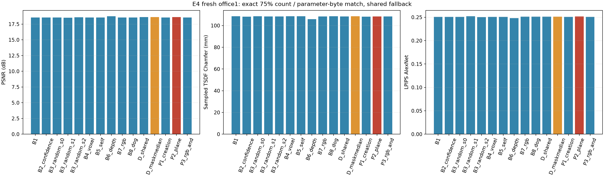
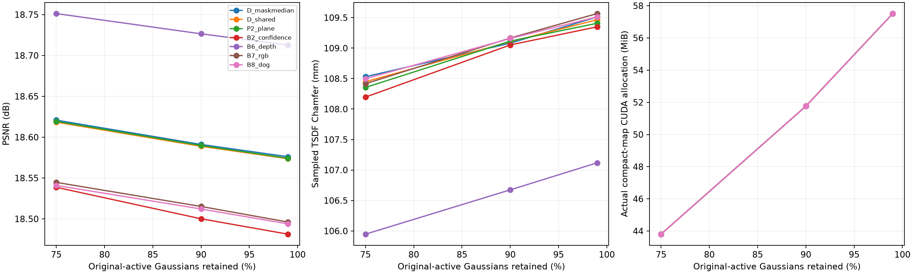
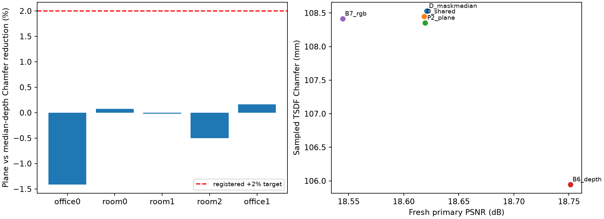

# E4 — 동일 Gaussian 수·파라미터 바이트에서 RGB·기하 품질 비교

**실행 완료: 2026-10-22. 판정: REVISE.**

## 목적과 봉인

E3c의 plane 점수 이득이 실제 지도 품질과 메모리 예산에서도 유용한지 검사했다. office0에서만 개발하고 기존 room0·room1·room2는 회귀로 구분했다. **새 office1**은 아직 E4에 쓰지 않은 장면으로 사전 등록했으며 원본 1,000프레임/짝수 500입력·동일 backbone·weights·seed·32-KF buffer·원본 filter로 기준선을 생성했다. 모델·지도·pose refinement는 0 step이다. 새 GT 라벨은 모든 자연 정책 및 예산별 선택이 끝난 뒤 생성했다.

**주 평가:** office1에서 원본 active의 75%를 유지하는 `policy_fallback` arm. 정상 자연 보존 ≥99%이며, P2가 median-depth·동일 집계 depth·confidence·voxel·원래 B6·RGB·DoG·무작위 3 seeds 각각보다 TSDF sampled Chamfer를 ≥2% 줄여야 한다. 동시에 PSNR 손실 ≤0.2 dB, SSIM 손실 ≤0.005, LPIPS 증가 ≤0.01, coverage 손실 ≤0.5%p, completion ratio 손실 ≤1%p를 요구했다. 필수 대조군이 도달 불가하면 GO로 판정하지 않는다. 90%·99% 및 회귀 장면은 사후 주 조건을 바꾸는 데 사용하지 않는다.

E3c와 E3b의 완료 결과·코드·판정을 보존했다. E4 평가 전 identical-membership 렌더 캐시의 방법별 finite-score 라벨 메타데이터를 수정해 최초 봉인을 `seal_revisions/v1_before_evaluation/`에 보존하고 다시 봉인했다. 임계값·membership 규칙·예산·평가 기준은 동일하며 office1 기준선/특징 및 E4 held-out 평가 전에 수행했다.

## 방법과 arm의 구별

| 방법 | 정의 |
|---|---|
| B1 | 원본 active, 원본 DC appearance |
| B2_confidence | 기존 E3b 개발 임계값의 confidence gate |
| B3_random_s0/s1/s2 | 무작위 count controls, seed 0/1/2; 자연점은 95% 진단용 |
| B4_voxel | 실제 snapshot pose의 원본 pre-map 및 같은 birth 내 voxel duplicate(0/1) 점수 |
| B5_self | 같은 source prediction의 means–pts3d 상대 거리, 자기 일관성 대조군 |
| B6_depth | 원래 source-disjoint depth median + 기존 E3b 임계값 |
| B7_rgb | source-disjoint masked 5×5 RGB NCC 영역 proxy + 기존 E3b 임계값 |
| B8_dog | 각 정책의 실제 과거 보유 지도에서 다시 계산한 insertion DoG proxy |
| D_shared / D_maskmedian | E3c의 동일 관측 gate에서 두 번째 큰 depth / median-depth |
| P1_creation | birth 시점에서만 반복 plane 판정 |
| P2_plane | E3c P_shared 임계값 그대로, 실제 KF마다 재검사 |
| P3_rgb_and | 같은 snapshot의 min(plane/t_plane, RGB/t_RGB), AND 결합; office0 별도 보정 |

B4의 binary 점수는 개발 normal 보호 후 임계값 1, B5는 원본 means=pts3d라 임계값 0이다. strict `>`이므로 두 자연 정책은 제거 0개가 정상 결과다. 이들의 score ranker는 count 목표에서 별도 진단한다. 모든 B6/B7/B8은 논문의 전체 시스템 재현이 아닌 inspired proxy이며, shared gate에는 PCA/plane support 판정이 들어간다.

- `natural`: 봉인 임계값만 적용한 정책 자체의 결과. B3의 95% 자연점은 자원 대조군이며 인과적 admission 효과가 아니다.
- `rank_only`: 시간 누적 점수의 큰 값부터 제거하는 **고정 후보 풀의 사후 자원 진단**. 유한 점수가 부족하면 도달 불가. threshold-safe 정책과 구별하며 B8 점수는 natural 정책의 실제 map에서 얻은 값이다.
- `policy_fallback`: natural 제거를 유지하고 남은 후보에 **동일한 seed 0 무작위 우선순위**를 적용해 정확히 K개를 남긴다. 자연 생존 수가 K 미만이면 복구하지 않고 도달 불가다. B1/B3은 직접 count control이다.

**25% budget pruning 전체를 순수 admission 효과로 주장하지 않는다.** membership 결정에 GT/held-out RGB를 사용하지 않았다. rank/fallback은 causal quota controller의 실행 결과가 아니며 E6 online replay를 대신하지 않는다.

## 예산·렌더·TSDF 정의

원본과 같은 degree-0 appearance를 사용했다. 각 선택 지도를 float32 means 3 + 대칭 covariance 상삼각 6 + DC RGB 3 + opacity 1, 즉 **Gaussian당 52 bytes**의 무압축 `.f32`로 저장했다. 따라서 동일 count arm의 파라미터 직렬화 바이트도 정확히 같다. membership index 및 JSON 메타데이터는 별도이며 전체 저장 디렉터리 크기가 같다는 주장은 아니다. 실제 CUDA compact 버퍼에 선택된 Gaussian만 올려 resident count·allocated 증가·render peak를 측정했다. active mask만 줄인 값을 VRAM 절감으로 세지 않았다.

RGB는 사전 고정한 홀수 11개 view 전체 영상에서 PSNR·SSIM·LPIPS AlexNet을 계산했다. 동일 GT-aligned 고정 estimated pose·카메라·해상도·검은 배경·원본 색상 및 exposure 전처리를 사용했다. gain은 첫 입력 frame000000의 RGB 평균에 고정하고 예측 영상에 맞추지 않았다. 단순 인접 홀수 frame이므로 temporal held-out이며 off-axis NVS reference는 없어 별도 수치를 만들지 않았다.

기하는 고정된 짝수 20개 view의 expected rendered z-depth를 **Open3D 0.19.0 TSDF**(4 cm voxel, 12 cm truncation)로 융합했다. 같은 view·카메라·GT-valid interior mask의 GT depth도 같은 TSDF로 융합해 관측 영역 reference를 만들었다. 이는 전체 장면 GT mesh 비교가 아니다. 각 mesh에서 triangle area에 비례한 점 100,000개를 seed 0으로 샘플링해 accuracy(pred→reference), completion(reference→pred), 그 평균 Chamfer, 5 cm precision/completion ratio/F1을 계산했다. 점 샘플 근사 오차가 있으며 통계적 유의성이나 논문 mesh 수치와 직접 동등 비교를 주장하지 않는다. 구현은 [Open3D TSDF API](https://www.open3d.org/html/python_api/open3d.pipelines.integration.ScalableTSDFVolume.html) 및 [mesh sampling 문서](https://open3d.org/docs/release/python_api/open3d.geometry.TriangleMesh.html)를 참고했다.

렌더러·LPIPS·TSDF 비용을 구분했고 render timing은 frame501에서 warmup 2회 후 동기화 5회 median/p95다. peak renderer allocation은 LPIPS 실행 후 reset하여 RGB render만 따로 측정하며 LPIPS 모델의 상주 baseline도 기록했다. 동시 GPU 기준선/평가 없이 실행했다. cost-matched·tracker FPS·온라인 전체 시스템 VRAM 개선은 이 실험의 결론 범위가 아니다.

## 새 office1 주 조건 결과

| 방법 | active/resident | parameter MiB | PSNR | SSIM | LPIPS | depth coverage | TSDF accuracy / completion / Chamfer (m) | completion@5cm |
|---|---:|---:|---:|---:|---:|---:|---:|---:|
| B1 | 860,701 | 42.683 | 18.5429 | 0.632662 | 0.250979 | 95.8949% | 0.101318 / 0.115844 / 0.108581 | 14.2430% |
| B2_confidence | 860,701 | 42.683 | 18.5387 | 0.632714 | 0.250782 | 95.8590% | 0.100842 / 0.115550 / 0.108196 | 14.4110% |
| B3_random_s0 | 860,701 | 42.683 | 18.5429 | 0.632662 | 0.250979 | 95.8949% | 0.101318 / 0.115844 / 0.108581 | 14.2430% |
| B3_random_s1 | 860,701 | 42.683 | 18.5322 | 0.632828 | 0.252165 | 95.9082% | 0.101433 / 0.115390 / 0.108411 | 14.1680% |
| B3_random_s2 | 860,701 | 42.683 | 18.5723 | 0.632846 | 0.250278 | 95.9103% | 0.101520 / 0.115237 / 0.108378 | 14.2080% |
| B4_voxel | 860,701 | 42.683 | 18.5429 | 0.632662 | 0.250979 | 95.8949% | 0.101318 / 0.115844 / 0.108581 | 14.2430% |
| B5_self | 860,701 | 42.683 | 18.5429 | 0.632662 | 0.250979 | 95.8949% | 0.101318 / 0.115844 / 0.108581 | 14.2430% |
| B6_depth | 860,701 | 42.683 | 18.7513 | 0.635130 | 0.248052 | 95.8960% | 0.097736 / 0.114158 / 0.105947 | 14.5230% |
| B7_rgb | 860,701 | 42.683 | 18.5447 | 0.632685 | 0.251053 | 95.8951% | 0.101325 / 0.115507 / 0.108416 | 14.2900% |
| B8_dog | 860,701 | 42.683 | 18.5409 | 0.632585 | 0.251286 | 95.8951% | 0.101231 / 0.115765 / 0.108498 | 14.3130% |
| D_shared | 860,701 | 42.683 | 18.6184 | 0.633604 | 0.251057 | 95.8951% | 0.101359 / 0.115538 / 0.108449 | 14.2380% |
| D_maskmedian | 860,701 | 42.683 | 18.6209 | 0.633790 | 0.251221 | 95.8951% | 0.101288 / 0.115772 / 0.108530 | 14.2480% |
| P1_creation | 860,701 | 42.683 | 18.5439 | 0.633005 | 0.250927 | 95.8954% | 0.101183 / 0.115262 / 0.108222 | 14.6240% |
| P2_plane | 860,701 | 42.683 | 18.6193 | 0.633632 | 0.251615 | 95.8951% | 0.101431 / 0.115278 / 0.108354 | 14.2220% |
| P3_rgb_and | 860,701 | 42.683 | 18.5639 | 0.632703 | 0.250851 | 95.8950% | 0.101276 / 0.115519 / 0.108398 | 14.2650% |



| P2 vs 대조군 | Chamfer 상대 개선 | 미달 항목 |
|---|---:|---|
| D_maskmedian | 0.1619% | chamfer_improvement |
| D_shared | 0.0869% | chamfer_improvement |
| B2_confidence | -0.1464% | chamfer_improvement |
| B4_voxel | 0.2086% | chamfer_improvement |
| B6_depth | -2.2723% | chamfer_improvement |
| B7_rgb | 0.0566% | chamfer_improvement |
| B8_dog | 0.1321% | chamfer_improvement |
| B3_random_s0 | 0.2086% | chamfer_improvement |
| B3_random_s1 | 0.0523% | chamfer_improvement |
| B3_random_s2 | 0.0220% | chamfer_improvement |

자연 정책 P2의 정상 보존은 **100.0000%**다. 주 비교 판정은 **REVISE**이며 다장면 연구 전체 GO와 구별한다.

plane의 Chamfer는 0.108354 m, median-depth는 0.108530 m로 상대 개선은 **0.1619%**다. 기준 2%에 미달한다. 원래 B6 depth는 **0.105947 m**, PSNR **18.7513 dB**로 plane(18.6193 dB)보다 두 지표에서 좋았다. 이번 주 비교의 미달 원인은 coverage/RGB 비열등성보다 **대조군 대비 충분한 기하 추가 개선 부족**이다.

## 정책 자체의 자연 작동점

| 장면 | 방법 | active | bad / normal / unknown 제거 | normal 보존 | PSNR | coverage | Chamfer (m) |
|---|---|---:|---:|---:|---:|---:|---:|
| office0 | B1 | 1,547,680 | 0 / 0 / 0 | 100.0000% | 22.1684 | 97.8454% | 0.063830 |
| office0 | D_maskmedian | 1,529,778 | 11,638 / 15 / 6,249 | 99.9976% | 22.3323 | 97.8447% | 0.061399 |
| office0 | D_shared | 1,542,645 | 4,956 / 15 / 64 | 99.9976% | 22.2818 | 97.8449% | 0.062637 |
| office0 | P2_plane | 1,541,874 | 5,656 / 15 / 135 | 99.9976% | 22.3254 | 97.8449% | 0.062388 |
| office0 | B6_depth | 1,527,348 | 13,199 / 822 / 6,311 | 99.8706% | 22.3093 | 97.8337% | 0.061694 |
| office0 | B7_rgb | 1,546,044 | 970 / 134 / 532 | 99.9789% | 22.1680 | 97.8454% | 0.063843 |
| office0 | B8_dog | 1,542,586 | 1,533 / 2,102 / 1,459 | 99.6690% | 22.1655 | 97.8439% | 0.063817 |
| room0 | B1 | 1,008,252 | 0 / 0 / 0 | 100.0000% | 16.1851 | 93.8234% | 0.084119 |
| room0 | D_maskmedian | 1,007,227 | 1,016 / 0 / 9 | 100.0000% | 16.2476 | 93.8234% | 0.083416 |
| room0 | D_shared | 1,007,333 | 917 / 0 / 2 | 100.0000% | 16.2433 | 93.8234% | 0.083383 |
| room0 | P2_plane | 1,007,423 | 823 / 6 / 0 | 99.9991% | 16.2246 | 93.8234% | 0.083298 |
| room0 | B6_depth | 1,004,571 | 2,435 / 548 / 698 | 99.9208% | 16.3479 | 93.8182% | 0.083302 |
| room0 | B7_rgb | 1,007,598 | 84 / 316 / 254 | 99.9544% | 16.1854 | 93.8234% | 0.084131 |
| room0 | B8_dog | 990,928 | 1,040 / 11,232 / 5,052 | 98.3775% | 16.1033 | 93.8199% | 0.083896 |
| room1 | B1 | 1,399,108 | 0 / 0 / 0 | 100.0000% | 13.0163 | 87.8749% | 0.077108 |
| room1 | D_maskmedian | 1,391,703 | 7,405 / 0 / 0 | 100.0000% | 13.0218 | 87.8749% | 0.077197 |
| room1 | D_shared | 1,392,675 | 6,433 / 0 / 0 | 100.0000% | 13.0216 | 87.8749% | 0.077331 |
| room1 | P2_plane | 1,394,004 | 5,104 / 0 / 0 | 100.0000% | 13.0223 | 87.8749% | 0.077179 |
| room1 | B6_depth | 1,360,793 | 19,471 / 17,527 / 1,317 | 96.6553% | 13.0549 | 87.8695% | 0.076343 |
| room1 | B7_rgb | 1,396,430 | 1,349 / 1,102 / 227 | 99.7897% | 13.0155 | 87.8749% | 0.077134 |
| room1 | B8_dog | 1,378,615 | 4,702 / 8,133 / 7,658 | 98.4480% | 12.9937 | 87.8642% | 0.077011 |
| room2 | B1 | 999,190 | 0 / 0 / 0 | 100.0000% | 15.6960 | 87.5044% | 0.088095 |
| room2 | D_maskmedian | 993,548 | 5,478 / 0 / 164 | 100.0000% | 15.7233 | 87.4992% | 0.086213 |
| room2 | D_shared | 994,144 | 4,971 / 0 / 75 | 100.0000% | 15.7213 | 87.4992% | 0.086422 |
| room2 | P2_plane | 993,625 | 5,491 / 0 / 74 | 100.0000% | 15.7216 | 87.4992% | 0.086550 |
| room2 | B6_depth | 993,087 | 5,151 / 0 / 952 | 100.0000% | 15.7720 | 87.4856% | 0.086070 |
| room2 | B7_rgb | 997,833 | 93 / 793 / 471 | 99.9054% | 15.6968 | 87.5044% | 0.088064 |
| room2 | B8_dog | 987,497 | 464 / 9,565 / 1,664 | 98.8587% | 15.6867 | 87.4918% | 0.088040 |
| office1 | B1 | 1,147,602 | 0 / 0 / 0 | 100.0000% | 18.4936 | 95.9306% | 0.109540 |
| office1 | D_maskmedian | 1,146,421 | 1,181 / 0 / 0 | 100.0000% | 18.5733 | 95.9306% | 0.109606 |
| office1 | D_shared | 1,146,546 | 1,056 / 0 / 0 | 100.0000% | 18.5706 | 95.9306% | 0.109528 |
| office1 | P2_plane | 1,145,704 | 1,686 / 0 / 212 | 100.0000% | 18.5714 | 95.9306% | 0.109548 |
| office1 | B6_depth | 1,137,007 | 10,476 / 64 / 55 | 99.9855% | 18.7130 | 95.9305% | 0.107134 |
| office1 | B7_rgb | 1,146,099 | 287 / 461 / 755 | 99.8953% | 18.4938 | 95.9306% | 0.109801 |
| office1 | B8_dog | 1,143,837 | 1,697 / 862 / 1,206 | 99.8041% | 18.4923 | 95.9306% | 0.109571 |

### 새 장면 pose 라벨 민감도

P2 자연 정책을 고정한 채 GT 라벨의 pose 기준만 바꾼 진단이다. 주 판정은 creation 라벨을 사용했다.

| 라벨 | bad / normal / unknown 제거 | normal 보존 |
|---|---:|---:|
| creation | 1,686 / 0 / 212 | 100.0000% |
| final_estimated | 1,898 / 0 / 0 | 100.0000% |
| gt_anchor | 1,837 / 6 / 55 | 99.9989% |
| cross_pose_consensus | 1,686 / 0 / 212 | 100.0000% |

office1의 자연 P2는 bad 1,686개·normal 0개·unknown 212개를 제거했다. 자체 유한 점수 후보는 전체 active의 **10.6999%**, 전체 GT bad recall은 **0.5865%**다. 높은 정밀도·정상 보존만으로 지도 전체의 오류를 충분히 줄였다고 볼 수 없다.

75% 지도에서 natural 정책이 제거한 후보는 1,898개이고 **공통 fallback이 추가로 제거한 후보는 285,003개**다. 파라미터 버퍼 약 25% 감소를 plane admission 자체의 메모리 이득으로 귀속하지 않는다.

## 예산 도달성과 비용

| 장면 | 전체 arm | 도달 | 도달 불가 |
|---|---:|---:|---:|
| office0 | 105 | 93 | 12 |
| room0 | 105 | 88 | 17 |
| room1 | 105 | 90 | 15 |
| room2 | 105 | 93 | 12 |
| office1 | 105 | 97 | 8 |

도달 불가 목록과 이유는 장면별 결과 JSON의 모든 row에 남겼다. score finite 부족과 natural map이 이미 목표보다 작은 경우를 분리한다. B1/B3의 quota arm은 직접 uniform count control이며 unknown을 증거 점수로 승격한 것이 아니다.



| office1 75% 방법 | 실제 map allocated 증가 MiB | RGB render peak allocated MiB | render median / p95 ms | fallback 추가 제거 |
|---|---:|---:|---:|---:|
| B3_random_s0 | 43.806 | 226.053 | 1.628 / 1.660 | 0 |
| D_maskmedian | 43.806 | 226.000 | 1.610 / 1.617 | 285,720 |
| D_shared | 43.806 | 226.008 | 1.610 / 1.634 | 285,845 |
| P2_plane | 43.806 | 225.984 | 1.624 / 1.646 | 285,003 |
| B6_depth | 43.806 | 226.075 | 1.614 / 1.626 | 276,306 |
| B7_rgb | 43.806 | 226.015 | 1.622 / 1.652 | 285,398 |
| B8_dog | 43.806 | 225.994 | 1.632 / 1.649 | 283,136 |

동일 membership의 렌더·TSDF·timing은 한 번 평가 후 재사용하고 `reused_identical_membership`에 원본을 명시했다. 방법별 GT 분류·finite 분모는 별도로 계산했다. map allocation과 peak는 renderer 평가 프로세스의 값이며 tracker 가중치·CPU 원본 export·감사 파일을 포함한 시스템 전체 크기는 아니다.

| 장면 | feature bundle wall s | natural replay + quota CPU wall s | 홀수→직전 짝수 이동 중앙값 m / 회전 중앙값 deg |
|---|---:|---:|---:|
| office0 | 327.115 | 28.616 | 0.009019 / 0.643049 |
| room0 | 43.809 | 15.367 | 0.012217 / 0.326249 |
| room1 | 264.494 | 24.571 | 0.006866 / 0.277754 |
| room2 | 122.109 | 16.298 | 0.012877 / 0.496893 |
| office1 | 175.248 | 18.161 | 0.005793 / 0.321474 |

feature bundle은 공통 전처리·기하/RGB 점수를 함께 계산한 시간이며 P2 단독의 알고리즘 비용이 아니다. 기존 세 장면의 feature 시간은 E3c 기하 bundle을 재사용한 값으로, 새 room2·office1의 RGB 포함 bundle과 직접 속도를 비교하지 않는다. pose gap 수치는 temporal held-out의 제한을 정량화한 진단이다.

## 회귀와 해석



이미 살펴본 room0·room1·room2 결과는 일반화 성공을 승인하는 새 test가 아니다. scene별 결과를 그대로 보고하고 Gaussian·pixel·KF를 독립 반복으로 세어 유의성을 주장하지 않는다. 무작위 3 seeds는 thinning 변동성 대조군이며 새 독립 장면 수를 늘리지 않는다.

## 판정과 다음 단계

**REVISE.** 봉인한 새 장면 주 조건을 충족하지 못했다. E5/E6 효능 검증으로의 자동 진행을 보류한다.

미달 항목은 위 모든 필수 대조군 표에 명시했다. depth/photometric 대조군보다 실용적으로 유용한지, geometry 이득이 RGB 품질 손실을 동반하는지를 함께 판단해야 한다. 현재 결과로 test 임계값·budget·장면을 바꿔 성공으로 재기록하지 않는다. 다음 개발 가설과 새 평가 분할을 별도 등록하며 기존 완료 장면을 다시 fresh test라고 부르지 않는다.

## 검증·산출물·재현

**75개 테스트, compact CUDA 대 기존 CUDA 수치 일치, 합성 TSDF 평면 검사, 5장면 무결성 검사 PASS.** 동일 count·52-byte parameter buffer, 실제 resident 수, fallback의 비복구·unknown ranker의 도달성, 모든 원본 filter 범위, E3c 자연 정책 일치, B8 과거 자기 지도, 봉인·모델·입력·지도·mesh hash와 fresh 결정 후 GT 평가를 검사했다.

- [프로토콜](../../configs/e4_protocol_registration.json), [설정](../../configs/e4_matched_budget.json), [임계값·코드 봉인](../../configs/e4_preregistration.json)
- [전체 판정](../../configs/e4_results_summary.json), [검증](../../configs/e4_validation.json), [GPU 환경](../../configs/e4_gpu_environment.json), [평가 환경](../../configs/e4_environment.json)
- 원본 출력: `results/E4_matched_budget/{scores,replay,selection,evaluation,sealed_code,seal_revisions,logs}`. compact `.f32` 및 TSDF `.ply` 보존. 생성 데이터는 git 제외, 코드·요약·그림·보고서는 추적 가능하다.

```bash
bash scripts/run_e4.sh test
bash scripts/run_e4.sh initialize
bash scripts/run_e4.sh score room2
bash scripts/run_e4.sh prepare
bash scripts/run_e4.sh fresh-download
# GPU가 보이는 환경에서 실행
bash scripts/run_e4.sh fresh-baseline
bash scripts/run_e4.sh score office1
for scene in office0 room0 room1 room2 office1; do bash scripts/run_e4.sh replay "$scene"; done
bash scripts/run_e4.sh fresh-labels
for scene in office0 room0 room1 room2 office1; do bash scripts/run_e4.sh evaluate "$scene"; done
bash scripts/run_e4.sh verify
bash scripts/run_e4.sh report
```

새 의존성은 `results/E4_matched_budget/deps`에 설치해 기존 venv 패키지를 바꾸지 않았다. 완료된 replay/evaluation/봉인은 보존 guard로 덮어쓰지 않는다. 위 명령은 실행 순서이며 독립 재실행에는 새 출력 경로와 별도 사전 등록이 필요하다.
