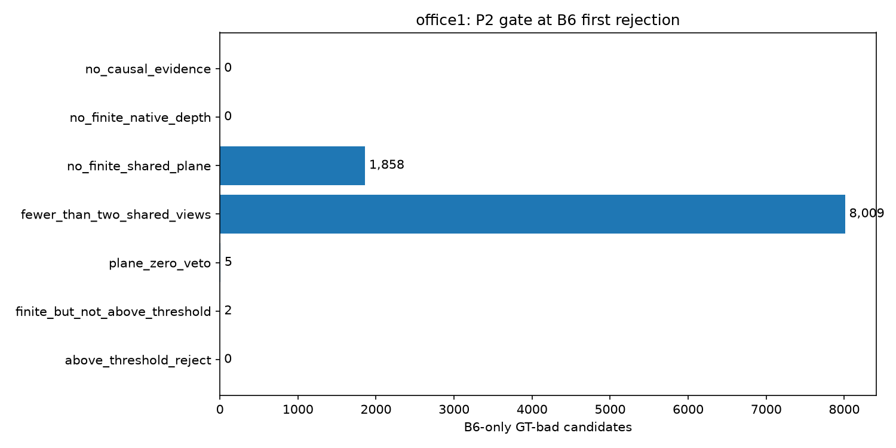

# E4b 결과: 기준 평면 오류와 B6/plane 판정 경로

**상태: 실행 완료. E4 REVISE 및 E5/E6 효능 검증 보류 유지.**

기존 E4의 5장면을 재사용한 사후 진단이다. [등록된 설계](E4b_reference_plane_audit.md)와 설정·등록 파일은 보존했다. 모든 실제 snapshot의 원래 기하 점수·finite mask와 자연 정책의 상태·최초 제거 시점·revision을 정확히 재현한 뒤 GT 감사와 oracle을 실행했다.

**핵심 관측:** office1에서 잘못된 평면이 불량을 지지한 후보는 **31,412개**였고, 그중 **30,777개**는 주변 공통 점의 80% 이상이 같은 방향으로 틀린 점군도 함께 관측됐다. 질문한 실패 방식의 사례가 확인됐다. 80% 조건을 모든 점 오류로 바꾸어 표현하지 않는다.

동시에 B6-only bad 9,874개 중 **9,867개(99.93%)**는 **B6 최초 제거 시점에** P2의 유효 평면 관측이 두 개 미만이었다. 해당 시점의 차이를 기준 평면 오차 하나로 설명할 수 없다. 이후 전체 이력과 관측 오류의 중첩은 별도로 감사했다.

GT-plane/veto 재계산은 새 bad **5,209개**, 새 normal **409개**, 새 unknown **10,713개**를 제거했다. B6-only 회복은 **265개(2.68%)**다. 기준 오류의 기여는 확인됐지만, GT 교체만으로 전체 관측·판정 제한을 해결하지는 못했다.

## office1에서 확인한 내용

전체 active 1,147,602개 중 GT bad는 287,446개다. B6만 제거한 bad는 **9,874개**, 두 방식 모두 놓친 bad는 **275,886개**다.

| B6-only bad: B6 최초 제거 시점의 P2 차단 단계 | 후보 수 | 해당 집합 비율 |
|---|---:|---:|
| 출처·시간 조건에 맞는 관측 없음 | 0 | 0.00% |
| 유효한 깊이 비교 관측 없음 | 0 | 0.00% |
| 유효한 평면 비교 관측 없음 | 1,858 | 18.82% |
| 유효한 평면 비교 관측이 하나뿐임 | 8,009 | 81.11% |
| 다른 관측의 비충돌 지지로 보류(veto) | 5 | 0.05% |
| 점수가 제거 임계값 이하 | 2 | 0.02% |
| 임계값 초과로 제거 | 0 | 0.00% |

원래 B6는 유효한 깊이 관측 하나로도 점수를 만들 수 있지만 P2는 같은 판정 시점에 유효한 평면 관측 두 개 이상을 요구한다. 여기서 관측 개수는 서로 다른 기준 view 수이며, 모델까지 독립이라는 뜻은 아니다.

차단 단계는 정해진 순서의 첫 실패이며 중첩된 원인을 모두 분리한 인과 효과는 아니다. 예를 들어 반복 수 부족과 veto가 동시에 있을 수 있다. 후보별 전체 이력과 중첩 flag는 Parquet에 보존했다.

| office1 bad 집합 | 후보 | GT 평면 검사 가능 후보 | 기준 평면 오류 관측 후보 | 80% 일관된 점군 오류 후보 | 엄격한 잘못된 지지 후보 |
|---|---:|---:|---:|---:|---:|
| both_miss | 275,886 | 120,480 | 91,386 | 99,812 | 31,132 |
| b6_only | 9,874 | 8,998 | 8,486 | 4,777 | 280 |
| both_reject | 602 | 600 | 600 | 600 | 0 |
| plane_only | 1,084 | 1,084 | 1,084 | 1,080 | 0 |

**기준 오류 관측**은 원래 shared finite 관측에서 GT 평면 위치 또는 법선 오차를 확인한 후보 수다. **엄격한 잘못된 지지**는 미제거 bad·plane 점수 0·기준 오류·같은 관측의 GT-front·patch 내 calibrated 대응을 모두 만족한다. 전수 후보에서 한 번이라도 관측된 수이며, 같은 patch를 여러 후보가 쓴 것은 후보 수에 각각 포함된다.

## GT 평면 교체 진단

| office1 arm | 새로 제거한 bad | 더 이상 제거하지 않는 bad | 새로 제거한 normal | 더 이상 제거하지 않는 normal | 전체 bad recall | 정상 보존 | B6-only bad 회복 |
|---|---:|---:|---:|---:|---:|---:|---:|
| factual_common | 0 | 0 | 0 | 0 | 0.5865% | 100.0000% | 0 |
| GT_plane_fixed_veto | 3,508 | 0 | 404 | 0 | 1.8069% | 99.9082% | 263 |
| GT_plane_recomputed_veto | 5,209 | 0 | 409 | 0 | 2.3987% | 99.9071% | 265 |

원래 shared 관측 중 GT 평면으로 교체 가능한 관측 기록 비율은 **94.11%**, active 후보 중 한 번 이상 교체 가능한 후보 비율은 **55.17%**다. 검사 불가 pair는 원래 값을 유지했고, 원래 없던 관측은 만들지 않았다.

기준 평면 오류가 판정 전환 이전 또는 같은 시점에 관측되고 oracle에서 새로 제거된 bad는 fixed-veto **3,428개**, recomputed-veto **5,129개**다. 엄격한 잘못된 지지 사례와 oracle 전환이 겹친 bad는 각각 **143 / 1,612개**다. 이는 해당 후보 판정에 대한 기여의 근거이며, 단일 원인이나 모델 편향의 인과성을 확정하지 않는다.

Oracle은 원래 대응·후보·covariance·추정 pose·finite pair mask·정규화·임계값을 유지한다. 바뀐 법선 방향의 σ만 같은 covariance에서 다시 계산했다. fixed-veto는 원래 지지를 유지하고 recomputed-veto는 교체 점수의 0 여부로 veto만 다시 계산했다. 추가 정상 손상과 bad 제거 손실을 함께 해석해야 한다.

## 장면별 결과

| 장면 | active bad | B6-only bad | both-miss bad | 엄격한 잘못된 지지 bad | GT oracle 새 bad / 새 normal (veto 재계산) |
|---|---:|---:|---:|---:|---:|
| office1 | 287,446 | 9,874 | 275,886 | 31,412 | 5,209 / 409 |
| office0 | 371,964 | 9,790 | 356,518 | 52,098 | 4,140 / 95 |
| room0 | 31,132 | 1,693 | 28,616 | 1,016 | 242 / 0 |
| room1 | 332,418 | 15,297 | 312,017 | 16,769 | 6,043 / 0 |
| room2 | 28,628 | 2,882 | 20,255 | 293 | 225 / 0 |

## 분모·검사 불가·민감도

### office1

후보×시점 5,169,035행, 후보×시점×출처 적격 관측 16,066,358행, 참조된 snapshot별 고유 patch 2,061,926행. 그중 shared pair가 참조한 고유 `(snapshot, evidence KF, pixel)`는 1,552,812개, GT 검사 가능 1,464,269개, 기준 평면 오류 847,527개, 일관된 점군 오류 564,009개, 공통 점 전부 오류 539,773개다.

GT 상태별 shared 고유 patch 수: invalid_GT=8, GT_edge=54,620, too_few_common=275, nonplanar_or_border=33,640, reliable=1,464,269.

평면 오류 민감도(절대 허용 cm_법선 각도 deg; 상대 2% 유지): 2_5: 1,273,186, 2_10: 1,107,015, 2_20: 999,898, 5_5: 1,139,885, 5_10: 847,527, 5_20: 674,671, 10_5: 970,387, 10_10: 567,093, 10_20: 329,015.

기준 관측 자기 좌표의 오류와 별도로, 동일 shared 대응에서 GT-anchor 상대 pose를 넣었을 때 GT-front 판단이 달라진 bad 후보는 6,855개다. 두 pose 모두 calibrated patch 대응이 가능한 경우만 센다.

GT-plane/veto 재계산의 라벨 민감도: gt_anchor: 새 bad 4,829, 손실 bad 0, 새 normal 5,345, 정상 보존 99.0491%; cross_pose_consensus: 새 bad 4,402, 손실 bad 0, 새 normal 352, 정상 보존 99.9028%.

### office0

후보×시점 9,335,719행, 후보×시점×출처 적격 관측 46,555,529행, 참조된 snapshot별 고유 patch 2,967,698행. 그중 shared pair가 참조한 고유 `(snapshot, evidence KF, pixel)`는 2,028,957개, GT 검사 가능 1,912,042개, 기준 평면 오류 1,084,451개, 일관된 점군 오류 697,408개, 공통 점 전부 오류 652,508개다.

GT 상태별 shared 고유 patch 수: invalid_GT=763, GT_edge=65,287, too_few_common=322, nonplanar_or_border=50,543, reliable=1,912,042.

평면 오류 민감도(절대 허용 cm_법선 각도 deg; 상대 2% 유지): 2_5: 1,546,302, 2_10: 1,237,039, 2_20: 997,285, 5_5: 1,458,896, 5_10: 1,084,451, 5_20: 796,640, 10_5: 1,347,567, 10_10: 853,851, 10_20: 469,220.

기준 관측 자기 좌표의 오류와 별도로, 동일 shared 대응에서 GT-anchor 상대 pose를 넣었을 때 GT-front 판단이 달라진 bad 후보는 54,586개다. 두 pose 모두 calibrated patch 대응이 가능한 경우만 센다.

GT-plane/veto 재계산의 라벨 민감도: gt_anchor: 새 bad 4,018, 손실 bad 965, 새 normal 75, 정상 보존 99.9902%; cross_pose_consensus: 새 bad 3,892, 손실 bad 944, 새 normal 75, 정상 보존 99.9859%.

### room0

후보×시점 4,038,502행, 후보×시점×출처 적격 관측 10,089,445행, 참조된 snapshot별 고유 patch 1,615,069행. 그중 shared pair가 참조한 고유 `(snapshot, evidence KF, pixel)`는 1,382,758개, GT 검사 가능 1,276,863개, 기준 평면 오류 370,412개, 일관된 점군 오류 93,546개, 공통 점 전부 오류 83,121개다.

GT 상태별 shared 고유 patch 수: invalid_GT=34, GT_edge=79,235, too_few_common=277, nonplanar_or_border=26,349, reliable=1,276,863.

평면 오류 민감도(절대 허용 cm_법선 각도 deg; 상대 2% 유지): 2_5: 651,606, 2_10: 384,484, 2_20: 213,675, 5_5: 645,433, 5_10: 370,412, 5_20: 194,273, 10_5: 627,985, 10_10: 334,228, 10_20: 144,496.

기준 관측 자기 좌표의 오류와 별도로, 동일 shared 대응에서 GT-anchor 상대 pose를 넣었을 때 GT-front 판단이 달라진 bad 후보는 240개다. 두 pose 모두 calibrated patch 대응이 가능한 경우만 센다.

GT-plane/veto 재계산의 라벨 민감도: gt_anchor: 새 bad 238, 손실 bad 6, 새 normal 0, 정상 보존 100.0000%; cross_pose_consensus: 새 bad 236, 손실 bad 6, 새 normal 0, 정상 보존 100.0000%.

### room1

후보×시점 7,731,079행, 후보×시점×출처 적격 관측 33,544,400행, 참조된 snapshot별 고유 patch 1,653,690행. 그중 shared pair가 참조한 고유 `(snapshot, evidence KF, pixel)`는 1,277,128개, GT 검사 가능 1,202,000개, 기준 평면 오류 599,718개, 일관된 점군 오류 478,658개, 공통 점 전부 오류 456,532개다.

GT 상태별 shared 고유 patch 수: invalid_GT=0, GT_edge=31,309, too_few_common=149, nonplanar_or_border=43,670, reliable=1,202,000.

평면 오류 민감도(절대 허용 cm_법선 각도 deg; 상대 2% 유지): 2_5: 864,982, 2_10: 689,706, 2_20: 592,184, 5_5: 809,120, 5_10: 599,718, 5_20: 482,146, 10_5: 704,487, 10_10: 417,133, 10_20: 253,768.

기준 관측 자기 좌표의 오류와 별도로, 동일 shared 대응에서 GT-anchor 상대 pose를 넣었을 때 GT-front 판단이 달라진 bad 후보는 4,622개다. 두 pose 모두 calibrated patch 대응이 가능한 경우만 센다.

GT-plane/veto 재계산의 라벨 민감도: gt_anchor: 새 bad 6,039, 손실 bad 46, 새 normal 0, 정상 보존 100.0000%; cross_pose_consensus: 새 bad 6,039, 손실 bad 46, 새 normal 0, 정상 보존 100.0000%.

### room2

후보×시점 4,011,212행, 후보×시점×출처 적격 관측 10,009,937행, 참조된 snapshot별 고유 patch 2,203,672행. 그중 shared pair가 참조한 고유 `(snapshot, evidence KF, pixel)`는 1,876,273개, GT 검사 가능 1,699,640개, 기준 평면 오류 508,861개, 일관된 점군 오류 184,549개, 공통 점 전부 오류 153,103개다.

GT 상태별 shared 고유 patch 수: invalid_GT=173, GT_edge=122,694, too_few_common=795, nonplanar_or_border=52,971, reliable=1,699,640.

평면 오류 민감도(절대 허용 cm_법선 각도 deg; 상대 2% 유지): 2_5: 882,665, 2_10: 533,089, 2_20: 327,357, 5_5: 868,545, 5_10: 508,861, 5_20: 297,458, 10_5: 805,646, 10_10: 396,729, 10_20: 159,066.

기준 관측 자기 좌표의 오류와 별도로, 동일 shared 대응에서 GT-anchor 상대 pose를 넣었을 때 GT-front 판단이 달라진 bad 후보는 114개다. 두 pose 모두 calibrated patch 대응이 가능한 경우만 센다.

GT-plane/veto 재계산의 라벨 민감도: gt_anchor: 새 bad 226, 손실 bad 48, 새 normal 0, 정상 보존 99.9994%; cross_pose_consensus: 새 bad 225, 손실 bad 48, 새 normal 0, 정상 보존 100.0000%.

## 고정 사례·검증·재현

각 장면의 `example_ids.json`을 GT 품질·그림 검사 전에 seed 0으로 저장했다. 네 bad 집합당 최대 8개와 normal 최대 8개이며, 관측 부재나 검사 불가 예시도 교체하지 않았다. 전체 사례 그림은 `results/E4b_reference_plane_audit/<scene>/figures/`에 있다.



원본 등록 문서는 보존했다. 실행 설정·입력 manifest·코드 봉인·환경·검증·장면별 요약은 결과 디렉터리와 `configs/e4b_*`에 기록했다. Parquet에는 모든 active 후보 이력, 출처 적격 관측의 실패 gate, GT 품질과 oracle 값이 남아 있다. source-ineligible 관측쌍은 `pair_audit.jsonl`에 출처 중복과 함께 기록했다.

```bash
OMP_NUM_THREADS=2 OPENBLAS_NUM_THREADS=2 .venv/bin/python -m unittest discover -s tests -p test_e4b.py
.venv/bin/python scripts/run_e4b.py initialize
for scene in office1 office0 room0 room1 room2; do .venv/bin/python scripts/run_e4b.py reproduce "$scene"; done
for scene in office1 office0 room0 room1 room2; do .venv/bin/python scripts/run_e4b.py audit "$scene"; done
MPLCONFIGDIR=/tmp/e4b-mpl .venv/bin/python scripts/report_e4b.py all
```

완료된 출력은 덮어쓰지 않는다. 위는 이번 실행 순서이며 독립 재실행에는 별도 output·봉인을 사용한다. CPU 분석이며 tracker·학습·SLAM 기준선·기존 E4 결과는 변경하지 않았다.

## 해석 범위

잘못된 기준이 불량을 지지한 관측과 oracle 판정 변화의 수를 보고한다. GT가 없는 곳·비평면 표면·잘못된 대응·pose 오류·원래 관측 부재는 여전히 남으며, 0 회복을 공통 오류 부재로 해석하지 않는다. GT bad는 반복 front 오류 proxy이고 모든 시각적 불량을 뜻하지 않는다. GT oracle의 추가 제거를 실제 알고리즘 효능으로 보고하지 않는다. RGB/TSDF 재평가를 하지 않았으므로 E4의 Chamfer 격차의 원인 비율이나 개선, 단일 지배 원인, 다장면 일반화를 확정하지 않는다.

**후속 판단:** 기준 오류와 관측/정책 제한을 함께 고려해 개선 가설을 개발할 수 있다. 변경 알고리즘의 성공 판정에는 별도 봉인과 아직 살펴보지 않은 평가 데이터가 필요하다. E4 REVISE는 유지한다.

## 추가 분모 감사: 원본 patch와 시점별 patch

GT 감사 집계 전에 기록한 [분모 명확화](../../configs/e4b_execution_notes.json)에 따라 위의 snapshot별 고유 patch와 별도로 **원본 `(evidence event, branch 0, pixel)`을 시점 전체에서 중복 제거한 수**를 보고한다. 조건별로 한 번 이상 관측됐는지를 집계하므로 조건 간 집합은 중첩될 수 있다. 같은 시점에 해당 조건과 후보 집합 연결이 성립한 경우만 group bit에 누적했다.

| 장면 | shared가 참조한 원본 patch | GT 검사 가능 원본 patch | 기준 평면 오류 원본 patch | 80% 일관된 점군 오류 원본 patch | 공통 점 전부 오류 원본 patch |
|---|---:|---:|---:|---:|---:|
| office1 | 587,213 | 556,325 | 328,310 | 244,918 | 235,707 |
| office0 | 746,217 | 693,721 | 437,997 | 345,000 | 327,092 |
| room0 | 419,355 | 385,500 | 134,616 | 50,700 | 44,580 |
| room1 | 455,230 | 425,470 | 224,403 | 191,187 | 182,437 |
| room2 | 683,191 | 624,346 | 183,815 | 76,173 | 65,330 |

## 판정 근거를 추적할 수 있는 office1 사례

고정 무작위 그림 표본은 변경하지 않았다. 엄격한 잘못된 지지 조건을 만족한 ID 중 가장 작은 5개를 고르고, 최초 적격 snapshot·가장 작은 evidence KF의 기록을 추가했다. 선택 규칙과 코드는 [trace 등록](../../configs/e4b_trace_registration.json)에 기록했다. 다음은 사례의 존재를 보여주는 기록이며 빈도는 전수 집계로 판단한다.

| 후보 ID | input frame / pose revision | 기준 KF / pixel | plane 점수 | 평면 위치 오차 m | 법선 각도 ° | 80% 점군 오류 |
|---|---|---|---:|---:|---:|---|
| 22584 | 340 / 350 | 2 / 11721 | 0.00000 | 0.0862 | 3.15 | True |
| 23116 | 340 / 350 | 2 / 12250 | 0.00000 | 0.0904 | 2.13 | True |
| 23608 | 340 / 350 | 2 / 12744 | 0.00000 | 0.0857 | 2.89 | True |
| 23609 | 326 / 334 | 2 / 12745 | 0.00000 | 0.0828 | 3.47 | True |
| 23623 | 340 / 350 | 2 / 12757 | 0.00000 | 0.0894 | 4.91 | True |

각 기록은 GT bad, 최종 P2 미제거, 원래 finite plane 점수 0, 기준 평면 오류, 같은 GT 관측에서 3σ까지 front, calibrated 투영이 해당 patch 안이라는 조건을 만족한다. 모든 장면의 추가 사례는 `strict_support_examples.json`에 저장했다.

## Unknown 제거와 대조군의 보조 집계

| 장면 | active unknown | GT-plane/veto 재계산 새 unknown | 더 이상 제거하지 않는 unknown |
|---|---:|---:|---:|
| office1 | 420,029 | 10,713 | 9 |
| office0 | 540,589 | 245 | 96 |
| room0 | 284,840 | 2 | 0 |
| room1 | 542,671 | 0 | 0 |
| room2 | 132,454 | 1 | 0 |

office1 B6-only 집합의 B6 최초 제거 시점에 임계값을 넘긴 후보 수는 B6 9,874, D_maskmedian 2, D_shared 2, P2 0개다. matched depth들도 같은 관측 mask·2+·veto를 적용하면 그 시점의 제거 근거가 크게 제한된다. 각 방법의 임계값이 다르므로 순수 residual의 인과 비교는 아니다.

## 최종 검증

13개 합성 테스트 PASS. 다섯 장면의 원본 점수·finite mask·정책 필드·최초 제거 시점 재현 PASS. 입력 1,155개 재해시, 모든 감사 파일 해시, Parquet metadata 행 수와 집계 일치, 정해진 집합 분할·원본 patch 중복 제거와 고정 사례 존재를 검사했다. 기준 오류·정책 차이의 진단은 완료했으며 효능 GO 판정은 하지 않았다.

보조 집계 재현 명령:

```bash
.venv/bin/python scripts/finalize_e4b.py
```

먼저 본문의 `report_e4b.py report`로 기본 보고서를 생성한 뒤 실행한다. 입력별 분모·trace 규칙을 변경하지 않는 보고 단계이며, 전체 실행 결과를 덮어써서 정책을 재계산하지 않는다.
