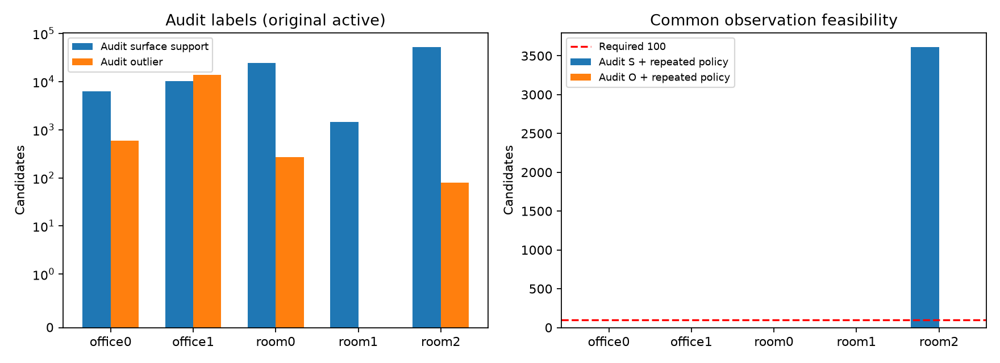

# E4c 결과: 표면 일관성 pruning의 개발 성립 검사

**실행일: 2026-10-22. 판정: INCONCLUSIVE. 개발 성립 단계 완료, 새 장면 효능 검증 미진입.**

[계획](E4c_surface_consistency_pruning.md)과 [A1 분할 변경](E4c_execution_amendment.md) 및 [A2 구현 수정](E4c_v2_execution_amendment.md)에 따라 실제 원본 점군·decision-time pose에서 기하 feature와 분리 관측의 audit 분류를 계산했다. 후보 제외 robust patch와 명시적인 support/conflict/unknown은 구현했지만, 임계값 보정에 필요한 공통 표본을 확보하지 못했다. **이 결과는 pruning 효능 성공이나 표면 일관성 가설의 반증이 아니다.**

## 실행한 범위

- 원래 raw-event 분할 실패를 5장면에서 확인하고, 좌표·GT 결과를 보기 전에 A1을 등록했다. 매 3번째 raw event를 audit로 잡으면 각 장면의 500개 raw 중 audit 166개와 source가 겹치지 않는 policy event가 0개였다.
- A1은 pose가 저장된 KF raw만 사용하며 KF 2·3을 audit로 고정했다. source-image 분리·가시성·시선 다양성·후보 제외 조건을 유지했다.
- A1 첫 기하 실행에서 support용 수선점 hull 조건을 충돌에도 적용한 구현 문제를 확인했다. 고정 fixture를 추가하고 A2를 등록한 V2에서 ray–plane 교점의 hull로 공통 자격을 수정했다. A1 배열·코드·보정 실패는 원래 경로에 보존했으며 이 보고서의 수치는 수정한 V2만 사용한다.
- office0/office1 개발 및 room0/room1/room2 회귀의 모든 original-active 후보와 모든 actual KF snapshot에서 네 표면 두께 조합을 계산했다. audit는 별도의 7×7 RANSAC 표면과 최종 revision을 쓰는 사후 평가다.
- 개발 audit 라벨만으로 임계값 보정을 시도했다. GT 라벨은 보정 이후 이 보고서의 교차 집계에만 열었다. 새 office2/office3의 데이터·RGB·GT·baseline은 열지 않았다.

## 장면별 관측·표본

| 장면 | original active | audit S | audit O | audit 분류 비율 | 공통 S | 공통 O | policy 반복 가능 | 보호 후 반복 충돌 가능 | local 표면 지지 |
|---|---:|---:|---:|---:|---:|---:|---:|---:|---:|
| office0 | 1,547,680 | 6,258 | 594 | 0.443% | 0 | 0 | 212,017 | 4,836 | 1,430,238 |
| office1 | 1,147,602 | 10,327 | 13,926 | 2.113% | 0 | 0 | 35,437 | 394 | 1,087,050 |
| room0 | 1,008,252 | 24,500 | 273 | 2.457% | 0 | 0 | 4,935 | 118 | 913,073 |
| room1 | 1,399,108 | 1,435 | 0 | 0.103% | 0 | 0 | 81,749 | 2,514 | 1,325,632 |
| room2 | 999,190 | 52,313 | 79 | 5.243% | 3,613 | 0 | 142,086 | 666 | 917,177 |

S는 audit의 반복 표면 지지, O는 반복 앞쪽 충돌, U는 그 외다. policy 반복 가능은 표면 보호 전 paired score가 한 번 이상 유한한 active 후보이며, 공통 S/O는 그 집합과 audit 분류의 교집합이다. 보호 후 반복 충돌 가능은 local/cross support 보호와 앞쪽 확인을 적용한 뒤 유한한 paired plane 점수가 한 번 이상 있었던 수이며 실제 제거 수가 아니다. 위 local 지지는 `(c_s,c_h)=(3,1)`의 후보 제외 자기 출처 검사다. local 지지 수를 검증된 정상 수나 실제 보존율로 해석하지 않는다.



## 임계값 보정과 중단 이유

| 두께 조합 | 보정 상태 | S_surface 임계값 | D_surface 임계값 |
|---|---|---:|---:|
| c3_1 | INCONCLUSIVE_CALIBRATION | None | None |
| c3_2 | INCONCLUSIVE_CALIBRATION | None | None |
| c5_1 | INCONCLUSIVE_CALIBRATION | None | None |
| c5_2 | INCONCLUSIVE_CALIBRATION | None | None |

계획은 개발 장면별 own/common finite audit S를 각각 최소 100개 요구하고, 평가 성립에는 audit O와 common O도 각각 100개를 요구한다. 필요한 표본을 확보하지 못해 임계값을 정하지 않았다. 보정 불가는 제거 0개의 성공 정책과 다르므로 **자연 membership·제거율·정밀도·정상 보존율을 만들어 보고하지 않았다.** 새로운 장면을 평가하거나 GT 라벨로 부족한 audit S를 대체하지 않았다.

실제 기하/시차/가림 자격을 통과하는 policy 관측과 별도 audit 관측의 공간적 중첩이 부족했다. ancestry만으로 반복 가능했던 후보가 곧 실제 공통 표면 평가 후보가 되는 것은 아니었다. 특히 audit O가 0인 장면을 실제 이상점이 없는 장면으로 해석하지 않는다.

## 제거 목표와 audit O의 차이

office1의 audit O 13,926개 중 13,908개는 자기 출처에서 중심점을 제외한 국소 표면 지지를 가졌다. 이는 실제 REJECT 이후의 보존율이 아니라 임계값과 무관한 보존 조건의 관측이다.

**다른 두 관측과 앞쪽 충돌한다는 audit O 정의만으로, 국소 표면 밖의 고립점이라고 확정할 수 없다.** 이런 후보를 모두 제거 정답으로 삼으면 일관된 추정 표면을 보존한다는 목적과 다시 충돌할 수 있다. 후속 평가기는 audit 충돌과 별도로 후보 주변의 표면 소속을 독립적으로 확인해, 일관된 표면과 실제 표면 이탈을 구별해야 한다. 현재 O recall 기준을 효능 검증에 곧바로 쓰기에는 이 한계도 남는다.

## GT 라벨과의 교차 확인

| 장면 | audit S ∩ GT bad | audit O ∩ GT bad | audit U ∩ GT bad |
|---|---:|---:|---:|
| office0 | 16 | 557 | 371,391 |
| office1 | 4 | 12 | 287,430 |
| room0 | 40 | 269 | 30,823 |
| room1 | 0 | 0 | 332,418 |
| room2 | 66 | 79 | 28,483 |

GT bad는 기존 repeated-front-error proxy다. audit S와 겹치는 후보가 있어도 라벨을 바꾸지 않는다. 표면 일관성과 GT 위치 정확도를 분리한다는 원래 목적을 유지했으며, 이번 실행으로 해당 후보의 pruning 후 보존이나 지도 품질 개선을 검증한 것은 아니다.

## 검증·산출물

11개 기전 테스트 PASS. 112개 입력을 재해시했고, 5장면의 snapshot/revision·paired finite mask·audit 분류 집계·policy/audit source 분리·결과 배열 해시를 검사했다. 고정 사례 ID는 그림 생성 전에 seed 0으로 저장했다. 정책이 미보정이므로 KEEP/REJECT 사례 그림과 정상 보존 검증은 수행하지 않았다.

- [실행 설정](../../configs/e4c_v2_surface_consistency_pruning.json), [등록](../../configs/e4c_v2_protocol_registration.json), [개발 봉인](../../configs/e4c_v2_preregistration.json)
- [보정 결과](../../configs/e4c_v2_development_calibration.json), [전체 집계](../../configs/e4c_results_summary.json), [검증](../../configs/e4c_v2_validation.json)
- 원본 배열·기하 이력·audit 관측 집계·분할·환경·봉인 코드·고정 사례: `results/E4c_surface_consistency_pruning/v2/`

재현 순서(완료 경로는 덮어쓰기 guard로 보존하며, 재실행에는 별도 출력 경로와 새 등록이 필요):

```bash
OMP_NUM_THREADS=2 OPENBLAS_NUM_THREADS=2 .venv/bin/python -m unittest discover -s tests -p test_e4c_v2.py -v
.venv/bin/python scripts/run_e4c_v2.py initialize
for scene in office0 office1 room0 room1 room2; do
  OMP_NUM_THREADS=2 OPENBLAS_NUM_THREADS=2 .venv/bin/python scripts/run_e4c_v2.py geometry "$scene"
done
.venv/bin/python scripts/calibrate_e4c_v2.py
MPLCONFIGDIR=/tmp/e4c-mpl .venv/bin/python scripts/report_e4c_v2.py
```

## 미수행 범위와 다음 판단

기존 legacy 정책의 새 policy-pool 비교·ablation 보정·새 장면 baseline·natural pruning 효능·RGB/depth/TSDF·동일 수량·GPU compact buffer 평가는 진행하지 않았다. 이들 항목을 통과했다고 처리하지 않는다. E4 REVISE 및 E5/E6 효능 검증 보류를 유지한다.

다음 개발에서는 같은 표면을 관측하면서 source를 공유하지 않는 policy/audit 관측을 확보할 수 있는지부터 점검해야 한다. 관측 분할을 다시 바꾸려면 이번에 본 장면만 개발에 사용해 별도 amendment와 평가 coverage 검사를 등록해야 한다. 이번 결과에 맞춰 source 조건이나 표본 기준을 사후 완화해 성공으로 바꾸지 않는다.
