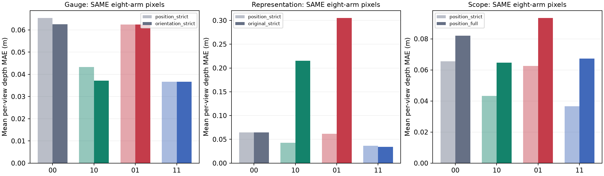
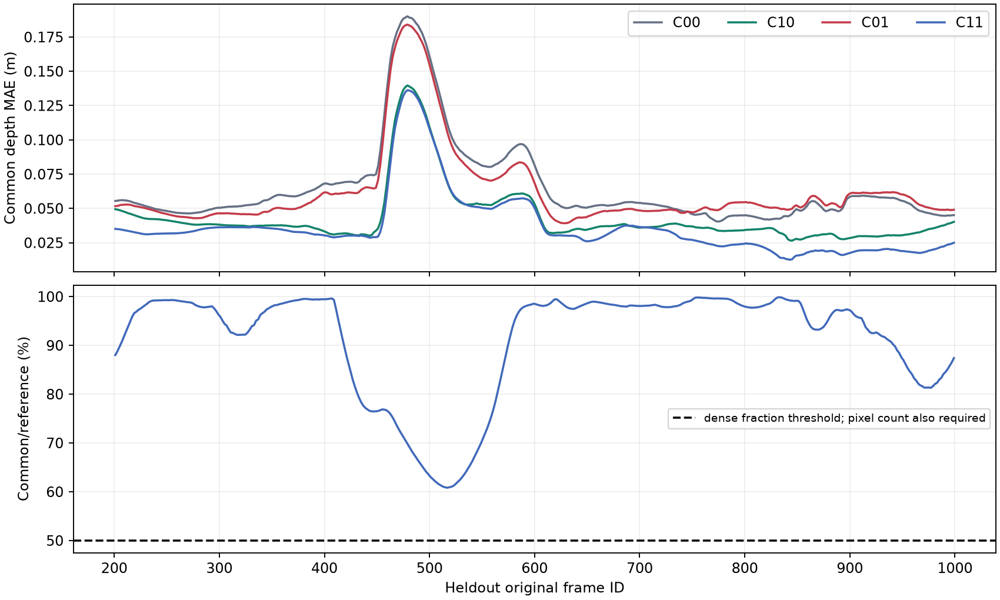
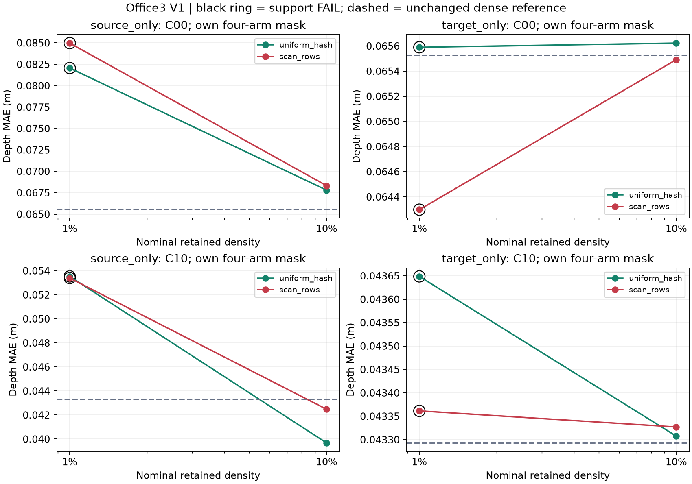
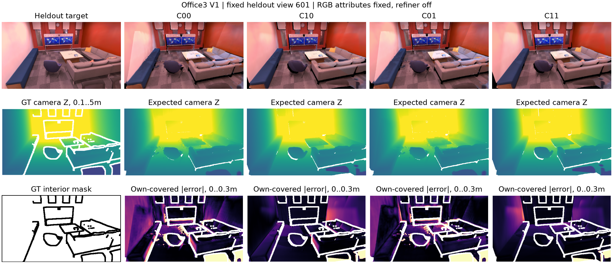

# V1: office3 고정 진단 재현

**실행일: 2026-10-26 (Asia/Seoul). 실행 COMPLETE. 보정 알고리즘 GO 보류.**

새 validation 장면 office3에서 유효 local 참조 치환의 깊이 MAE는 **0.065526→0.043293m (33.93% 감소)**였다. Rigid pose 단독은 **0.062524m**, joint 참조는 **0.036682m**였다. 이는 참조 개입의 진단이며 RGB-only 보정 성능을 측정한 것이 아니다. 독립 최종 test가 아닌 **고정된 validation 재현**이다.

## 1. 등록·실제 실행 범위

- [기존 frozen recipe](../../configs/v1_office3_diagnostic_protocol.json)는 원문과 hash를 보존했다. 그 파일의 NOT_EXECUTED는 당시 등록 상태이며 현재 완료 여부는 이 보고서와 [실행 요약](../../configs/v1_office3_results_summary.json)을 따른다.
- [실행 설정](../../configs/v1_office3_execution.json), [평가 설정](../../configs/v1_office3_analysis.json), [baseline 등록](../../results/V1_office3_diagnostic/2026-10-26/registration.json), [평가 코드·입력 등록](../../results/V1_office3_diagnostic/2026-10-26/analysis_registration.json). 평가 코드는 RGB-only baseline 실행 중 구현했고 **기준선 추적 자격을 확인한 뒤, gauge fit·Oracle map·heldout metric 확인 전** 봉인했다. Office2/HK의 기존 결과는 알고 있었다.
- 짝수 원본 ID 0..998의 RGB **500개**, seed0/refiner0/고정 weight/native filter. GT depth/trajectory를 mapper에 전달하지 않았다. Post-prefix/heldout GT로 gauge를 맞추지 않았다.
- 새 추론 결과: **500/500 pose**, prefix **100 pose**, **8 KF**, post-prefix **7 KF**. Tracking qualification PASS. 창·프레임·seed·threshold를 결과에 따라 바꾸거나 재추론하지 않았다.
- Native **1,136,762후보**, post-prefix native∩GT-interior strict **855,796후보**. 전체 native mixed에서는 prefix 포함 **967,994개 (85.154%)**에만 local 참조를 대입했고, 나머지 local은 예측값을 보존했다. 모든 후보의 rigid pose는 해당 arm 정책을 따른다. Full mixed는 완전 GT map이 아니다.
- 홀수 원본 ID **201..999의 400뷰 전부**, 주 position gauge와 same-prefix orientation sensitivity. Covariance 대조는 기존 고정 20뷰 201,241,..,961이다. Appearance/refiner 학습은 없다.

## 2. 계약 검증

- Journal **2,030 events·500 raw events**의 재생, KF raw self-branch/pts3d 일치, 최종 pose revision **514**, source ID·native mask·RGB/opacity 고정 및 GPU native PLY 재현 PASS. Native filter를 개입별로 다시 계산하지 않았다.
- Local point와 covariance에 KF scale을 함께 흡수했다. C 배율 0.8/1/1.25 × KF 단위 재배분 on/off **6개 양성 map이 독립 원본 경로와 SHA-256까지 동일**했다. 역변환·표준편차→covariance·world mean/covariance 검사가 모든 native 후보에서 PASS.
- 고정 5뷰 × 6 positive **30개 렌더 비교 PASS**, RGB/depth/weight와 coverage 일치. 잘못된 mean-only absorption/naive scale removal은 nonunit **7 KF**에서 대수적으로 검출했고 두 fixed view씩 negative render도 기대대로 불변성에 실패했다. [unit 계약](../../results/V1_office3_diagnostic/2026-10-26/maps/unit_contract.json), [렌더 검증](../../results/V1_office3_diagnostic/2026-10-26/unit_render/completion.json).
- C00=A00 지도 및 400뷰 depth/coverage cache가 bitwise 동일. C11/A11은 중심이 동일하고 covariance 계약이 다르다. 각 비교 내 source ID·순서·속성·local covariance를 고정했다. C01은 scale 추가 제거 없이 rigid R/t만 바꾼다.
- 관련 기존 unittest **48개 PASS**. pytest가 설치되지 않아 저장소의 unittest 형식으로 실행했다. Float64 계약, packed float32 및 TF32-off 기존 CUDA renderer를 사용했다.

## 3. Primary strict C4

네 C군 공통 reference-valid interior 픽셀의 **뷰별 MAE를 동일 가중 평균**했다. 주 표의 Coverage/correct coverage는 G/M과 같은 GT interior 분모다. A1-C의 전체-GT coverage 분모도 같은 cache에서 추가 계산해 아래에 병기했다. 분모가 다른 숫자를 직접 빼지 않는다. Correct threshold는 `max(0.05m, 2% GT Z)`다.

| Arm | 공통 깊이 MAE (m) | Coverage | Correct coverage | TSDF Chamfer (m) |
|---|---:|---:|---:|---:|
| C00 | 0.065526 | 92.439% | 71.199% | 0.084048 |
| C10 | 0.043293 | 92.033% | 79.631% | 0.058834 |
| C01 | 0.062524 | 92.476% | 73.119% | 0.083077 |
| C11 | 0.036682 | 92.047% | 85.283% | 0.056900 |


| Arm | Interior coverage / correct | All-GT-valid coverage / correct |
|---|---:|---:|
| C00 | 92.439% / 71.199% | 90.900% / 65.991% |
| C10 | 92.033% / 79.631% | 90.354% / 74.565% |
| C01 | 92.476% / 73.119% | 90.934% / 68.166% |
| C11 | 92.047% / 85.283% | 90.361% / 81.126% |
| CZ10 | 91.989% / 80.692% | 90.362% / 75.462% |
| CZ11 | 91.997% / 85.777% | 90.337% / 81.261% |


[분모 감사](../../results/V1_office3_diagnostic/2026-10-26/analysis/reference_denominator_audit.json)는 캐시의 own-covered metric도 전 400뷰에서 독립 재계산해 기존 값과 정확히 일치하는지 검사했다. Primary common mask·판정값은 바꾸지 않은 보고 보완이다.

Support: **400/400뷰 PASS**, 평균 공통 **112,373.78픽셀**, reference의 **91.358%**. Δlocal=C00−C10 **+0.022234m**, Δrigid=C00−C01 **+0.003002m**, interaction=C11−C10−C01+C00 **-0.003608m**다. 양수 Δ는 개선이다. Local 참조의 효과를 raw network depth의 고유 기여율로 해석하지 않는다.

TSDF는 같은 고정 20뷰의 GT-depth 관측영역 reference, 4cm voxel/12cm truncation/10m 최대 깊이/100k seed0 면적 표본을 사용했다. Gaussian center NN이나 전체 장면 completeness와 구분한다. Primary C/CZ RGB는 전 400뷰에서 PSNR/SSIM을 저장했고 sensitivity RGB는 고정 5뷰만 평가했다.




## 4. Gauge·표현·전체지도·Covariance 비교

각 행쌍은 별도의 **같은 8군 target 픽셀**이다. 행쌍 사이에는 분모가 달라 수치를 섞지 않는다. Own C4 표는 아래와 별도로 저장했다. A군은 office3의 같은 fresh baseline에서 새로 생성·평가했으며 과거 office2 cache를 재사용한 것이 아니다.

| 비교 (각 행쌍 동일 8군 픽셀) | 00 | 10 | 01 | 11 |
|---|---:|---:|---:|---:|
| position_strict | 0.065399 | 0.043233 | 0.062390 | 0.036641 |
| orientation_strict | 0.062552 | 0.037151 | 0.062405 | 0.036638 |
| position_strict | 0.065526 | 0.043293 | 0.062524 | 0.036682 |
| position_full | 0.081941 | 0.064674 | 0.093437 | 0.067227 |
| position_strict | 0.064631 | 0.042855 | 0.061644 | 0.036286 |
| original_strict | 0.064631 | 0.214983 | 0.305159 | 0.034356 |
| position_strict | 0.065474 | 0.043732 | 0.062332 | 0.037342 |
| fixed_world_strict | 0.065474 | 0.043732 | 0.062295 | 0.037310 |
| position_strict | 0.048552 | 0.038910 | 0.047916 | 0.034155 |
| source_only_uniform_hash_01 | 0.082061 | 0.053530 | 0.078158 | 0.037958 |
| position_strict | 0.061587 | 0.040859 | 0.058664 | 0.034742 |
| source_only_uniform_hash_10 | 0.067799 | 0.039673 | 0.063047 | 0.023620 |
| position_strict | 0.047429 | 0.032797 | 0.050586 | 0.030035 |
| source_only_scan_rows_01 | 0.084972 | 0.053393 | 0.080699 | 0.045307 |
| position_strict | 0.056326 | 0.040567 | 0.054136 | 0.034057 |
| source_only_scan_rows_10 | 0.068324 | 0.042477 | 0.063714 | 0.028075 |


두 gauge는 같은 prefix 100 pose만 썼다. 추정 위치 singular-value 비율은 **1/0.728590/0.439647**, 두 gauge 회전 차이는 **0.831928°**다. Position primary를 유지하고 더 좋은 heldout gauge를 사후 선택하지 않았다.

Covariance 비교는 canonical local covariance를 rigid transport한 네 군과 world covariance를 C00 값에 고정한 네 군의 20뷰 비교다. 단독 factor 부호가 바뀐 비교는 **position_full, source_only_scan_rows_01**이며 support·10% 효과 크기를 함께 확인해야 한다. 원 A/C의 차이는 factor와 covariance 정의 변경을 포함한다.

## 5. Source-only와 Target-only 희소화

| 조건 | 후보 수 | 00 | 10 | 01 | 11 | Support 통과 뷰 | 공통/reference |
|---|---:|---:|---:|---:|---:|---:|---:|
| source_only_uniform_hash_01 | 8,635 | 0.082061 | 0.053530 | 0.078158 | 0.037958 | 0/400 (FAIL) | 34.43% |
| target_only_uniform_hash_01 | 855,796 | 0.065590 | 0.043649 | 0.062662 | 0.036986 | 314/400 (FAIL) | 91.37% |
| source_only_uniform_hash_10 | 85,546 | 0.067799 | 0.039673 | 0.063047 | 0.023620 | 400/400 (PASS) | 87.75% |
| target_only_uniform_hash_10 | 855,796 | 0.065623 | 0.043307 | 0.062670 | 0.036706 | 400/400 (PASS) | 91.36% |
| source_only_scan_rows_01 | 8,168 | 0.084972 | 0.053393 | 0.080699 | 0.045307 | 0/400 (FAIL) | 7.75% |
| target_only_scan_rows_01 | 855,796 | 0.064298 | 0.043361 | 0.060804 | 0.036434 | 263/400 (FAIL) | 91.41% |
| source_only_scan_rows_10 | 85,902 | 0.068324 | 0.042477 | 0.063714 | 0.028075 | 360/400 (PASS) | 69.66% |
| target_only_scan_rows_10 | 855,796 | 0.065491 | 0.043327 | 0.062459 | 0.036694 | 400/400 (PASS) | 91.29% |


Source-only는 같은 strict 후보 행을 양 군 모두에서 GT-blind hash/scan-row mask로 1%/10% 남겼다. Scale/opacity/footprint를 부풀리거나 hole을 메우지 않았다. 분모는 원 dense target GT다. Target-only는 **dense 지도와 render cache를 그대로** 두고 target reference만 측정 mask로 제한했다. 위 target-only 후보 수는 unchanged dense 지도 수이고, 공통/reference 비율은 sampled GT가 분모다. Full-GT 대비 실제 측정·공통 비율은 [CSV](../../results/V1_office3_diagnostic/2026-10-26/analysis/V1_four_arms.csv)에 별도 기록했다.

Dense gate는 등록 뷰 ≥80%에서 공통 ≥1,000픽셀 및 reference ≥50%, target-only sparse gate는 ≥1,000픽셀 및 sampled reference ≥20%다. Target 1%는 뷰별 valid 픽셀 수가 작아 count gate에 실패할 수 있다. 실패도 포함해 전 400뷰를 유지했다. 이 희소화는 실제 LiDAR acquisition/noise의 재현이 아니다.



## 6. Predicted-ray Z 대조와 전체 factorial 효과

| Arm | 같은 C+CZ 6군 MAE (m) |
|---|---:|
| C00 | 0.065349 |
| C10 | 0.043246 |
| C01 | 0.062338 |
| C11 | 0.036641 |
| CZ10 | 0.042553 |
| CZ11 | 0.036207 |


Ray 대조는 6군 공통 픽셀로 계산했다. CZ10/CZ11은 predicted ray를 유지한 참조 Z 개입이다. C10/C11과 같은 픽셀에서 비교해 ray 변경과 depth 변경을 구분한다.

| Scope | Δlocal (m) | Δrigid (m) | Interaction (m) | Local gain |
|---|---:|---:|---:|---:|
| position_strict | 0.022234 | 0.003002 | -0.003608 | 33.93% |
| original_strict | -0.150254 | -0.240369 | -0.420985 | -231.85% |
| orientation_strict | 0.025577 | 0.000158 | -0.000364 | 40.72% |
| position_full | 0.017132 | -0.011474 | -0.009059 | 20.28% |
| fixed_world_strict | 0.021741 | 0.003178 | -0.003244 | 33.20% |
| source_only_uniform_hash_01 | 0.028531 | 0.003903 | -0.011669 | 34.77% |
| target_only_uniform_hash_01 | 0.021941 | 0.002927 | -0.003735 | 33.45% |
| source_only_uniform_hash_10 | 0.028126 | 0.004753 | -0.011300 | 41.48% |
| target_only_uniform_hash_10 | 0.022315 | 0.002953 | -0.003648 | 34.01% |
| source_only_scan_rows_01 | 0.031579 | 0.004273 | -0.003814 | 37.16% |
| target_only_scan_rows_01 | 0.020937 | 0.003494 | -0.003433 | 32.56% |
| source_only_scan_rows_10 | 0.025847 | 0.004610 | -0.009792 | 37.83% |
| target_only_scan_rows_10 | 0.022164 | 0.003032 | -0.003601 | 33.84% |


Strict가 아닌 full mixed·source-only 및 target-only는 서로 다른 정보량과 가림을 갖는다. 모든 표는 scene 내 조건부 진단이며 픽셀/400뷰를 독립 반복으로 세지 않는다. 단일 validation 장면으로 scene CI나 보편적 원인 기여율을 만들지 않았다.

## 7. 비용·재현 명령·산출물

- GPU: NVIDIA GeForce RTX 5060; Torch 2.13.0+cu132; CUDA 13.2. RGB-only 기준선 109.01초. 38개 intervention map·**13,680 unique depth-view**, unit original/positive/negative/repeat 40 depth-view, 실패한 A00 재렌더 400뷰를 별도 비용으로 기록한다. 성공 map의 렌더·저장·표면평가 시간 합은 135.11초, resume 구간은 69.95초다 (입력 로딩·unit 검증·실패 시도 제외). Device-memory CSV와 per-map GPU peak/시간은 각 manifest에 있다.
- Unit map·local npz·candidate hash·source KF/depth/confidence strata·mask·depth/coverage cache·고정 5뷰 RGB/depth·표면 PLY·100k 표본을 `results/V1_office3_diagnostic/2026-10-26/`에 저장했다.
- [요약](../../configs/v1_office3_results_summary.json), [4군 CSV](../../results/V1_office3_diagnostic/2026-10-26/analysis/V1_four_arms.csv), [effect CSV](../../results/V1_office3_diagnostic/2026-10-26/analysis/V1_effects.csv), [상세 결과](../../results/V1_office3_diagnostic/2026-10-26/analysis/results.json).

```bash
.venv/bin/python scripts/run_v1_baseline.py
.venv/bin/python scripts/build_v1.py register
.venv/bin/python scripts/build_v1.py build
.venv/bin/python scripts/evaluate_v1.py
.venv/bin/python scripts/analyze_v1.py
.venv/bin/python scripts/audit_v1_denominators.py
.venv/bin/python scripts/report_v1.py
```

완료 출력은 보존한다. 위 명령은 fresh output용 순서이며 재실행은 별도 amendment/output이 필요하다. Frozen recipe 원문과 기존 A0/A1 결과는 수정하지 않았다. N2 manifest의 zip_crc는 등록 전 hash 비교에서 provenance 부가필드로 구분했고 파일 bytes/SHA-256은 모두 대조했다.

**구현 수정 A1:** Sensitivity는 RGB를 고정 일부 뷰에만 계산하는데 초기 집계가 누락된 `psnr_db` key를 참조해 첫 original A00 평가 말미에 중단됐다. [수정 이력](../../configs/v1_implementation_amendment_A1.json)에 초기/수정 code hash, 당시 결과 접근 범위, 기존 출력 hash를 남겼다. 선택적 RGB 항목을 None으로 채우고 완료 cache를 보존해 resume했다. Partial A00와 실패 log도 `failed_attempt1/`에 보존했으며 **같은 map/400뷰 재렌더의 depth/coverage SHA-256이 실패 시도와 동일**했다. Geometry·split·threshold·mask·renderer·primary 지표 변경이나 baseline 재추론은 없다. 원 코드 스냅샷과 수정 코드를 모두 보관했다.

## 8. 경로 판정

자동 gate: **CONDITIONAL_LOCAL_OPPORTUNITY**, 두 gauge의 local ≥10% 및 correct coverage 보존: **True**, direction flip: **True**, support 실패 존재: **True**.

다음 후보는 **A2-S diagnostic scalar/spatial cross-fit**다. 이 판정은 Oracle local 개선 여지의 후속 진단 자격이며 Depth-only 우세·RGB 관측 가능성·보정 알고리즘 GO가 아니다. V1 ray/surface·covariance·paired support 및 기존 office2 차이를 함께 검토한 최종 경로는 [A1 경로 판정](A1_route_decision.md)에 기록한다. **Q0-HK 미해결, office4 보류를 유지**한다. 이 요청에서는 다음 단계 실험이나 새 optimizer를 자동 실행하지 않았다.


